# Infraestructura de despliegue — cómo funciona el sitio en producción

> Vista de conjunto del despliegue en **Railway**: qué piezas hay, cómo viaja cada petición, qué pasa en cada deploy y dónde están los datos. Los pasos para hacerlo están en [`DEPLOY-RAILWAY.md`](DEPLOY-RAILWAY.md) (la guía con checkboxes) y el detalle campo por campo en [`DEPLOY.md`](DEPLOY.md) § 9.5. Este documento no reemplaza a ninguno de los dos: los explica.
>
> Todo lo que se describe acá sale de la configuración versionada: `backend/railway.json`, `frontend/railway.json`, `frontend/Dockerfile`, `frontend/Caddyfile`, `frontend/index.html`, `backend/src/config/env.validation.ts` y `backend/src/modules/health/`. Si uno de esos archivos cambia, este documento cambia en el mismo PR.
>
> Los diagramas son [Mermaid](https://mermaid.js.org): GitHub los dibuja al abrir el archivo. En un editor sin soporte, el código de cada uno se lee como texto.

**Índice**

1. [Topología](#1-topología)
2. [Nombres, puertos y quién habla con quién](#2-nombres-puertos-y-quién-habla-con-quién)
3. [Cómo reparte Caddy las peticiones](#3-cómo-reparte-caddy-las-peticiones)
4. [Una visita a un perfil público](#4-una-visita-a-un-perfil-público)
5. [El panel: sesión, cookie y revocación](#5-el-panel-sesión-cookie-y-revocación)
6. [IP real del cliente y límites de peticiones](#6-ip-real-del-cliente-y-límites-de-peticiones)
7. [Qué pasa en cada deploy](#7-qué-pasa-en-cada-deploy)
8. [Cuando algo falla en el deploy](#8-cuando-algo-falla-en-el-deploy)
9. [Variables y secretos por servicio](#9-variables-y-secretos-por-servicio)
10. [Datos: base, migraciones y respaldos](#10-datos-base-migraciones-y-respaldos)
11. [Dominio y DNS](#11-dominio-y-dns)
12. [Primer despliegue, de punta a punta](#12-primer-despliegue-de-punta-a-punta)
13. [Límites conocidos de esta arquitectura](#13-límites-conocidos-de-esta-arquitectura)

---

## 1. Topología

Un **proyecto** de Railway con tres **servicios**. El navegador solo conoce un origen, el del servicio `web`; la API y la base no están expuestas a internet.

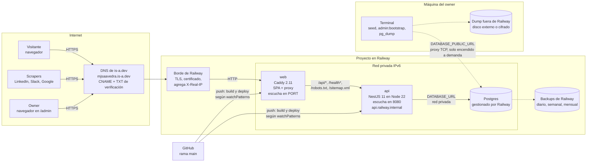

Tres ideas sostienen todo el diseño:

- **Un solo origen.** Caddy sirve la SPA y también hace de proxy hacia la API. Para el navegador todo vive en `https://mjsaavedra.is-a.dev`: no hay CORS, la cookie de sesión puede ir con `SameSite=strict` y `VITE_API_URL` queda vacía (el cliente usa rutas relativas).
- **La API y la base son privadas.** `api` no necesita dominio público (se puede generar uno para inspeccionarla y borrarlo después). El Postgres solo se abre a internet, por el proxy TCP de Railway, mientras dura una tarea desde la máquina del owner.
- **La configuración está en el repo.** En el panel de Railway se cargan variables, la ruta del archivo de configuración y el dominio. Build, start, pre-deploy, healthcheck y drenaje salen de los `railway.json`.

---

## 2. Nombres, puertos y quién habla con quién

| Pieza | Cómo se construye | Escucha en | Lo alcanza | Healthcheck |
|---|---|---|---|---|
| Borde de Railway | — | 443 público | internet | — |
| `web` | `frontend/Dockerfile`: Node 22 compila con Vite, la imagen final es `caddy:2.11.4-alpine` con `dist/` en `/srv` | `:{$PORT}` (lo inyecta Railway; 8080 por defecto) | el borde | `GET /` |
| `api` | Railpack: `npm run prisma:generate && npm run build`; arranca con `node dist/main` | `PORT=8080`, en `::` (IPv6) | `web`, por `http://api.railway.internal:8080` | `GET /health`, hasta 300 s |
| `Postgres` | servicio gestionado | 5432 privado; proxy TCP público opcional | `api` por `DATABASE_URL`; la máquina del owner por `DATABASE_PUBLIC_URL` (exige `sslmode=require`) | el de Railway |

Las sondas de la API están fuera del prefijo `/api`, sin autenticación y exentas del límite de peticiones:

| Ruta | Responde | Para qué |
|---|---|---|
| `GET /health` | `200 {"status":"ok",...}` si la base responde, **`503`** si no | la usa Railway para decidir si una versión entra en servicio |
| `GET /health/live` | `200` siempre que el proceso viva | evita reinicios por una caída momentánea de Postgres |

> La red privada de Railway resuelve por IPv6. `app.listen(port)` de Node escucha en `::` cuando no se le pasa host, así que funciona sin cambios. Si alguien ata la API a `0.0.0.0`, el proxy deja de encontrarla.

---

## 3. Cómo reparte Caddy las peticiones

Caddy evalúa los bloques en este orden. El primero que coincide atiende la petición.

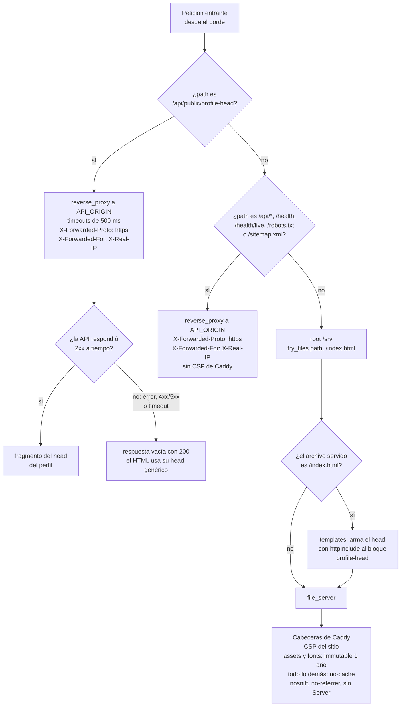

Detalles que importan:

- **`/health*` va al proxy a propósito.** Si cayera en la SPA, el fallback devolvería `200` con HTML y la verificación del deploy pasaría sin haber tocado la API.
- **El head del perfil** se pide con una sub-petición de Caddy a sí mismo (`httpInclude`), por eso existe una ruta propia con presupuesto de 500 ms. Una API lenta o caída no demora ni rompe el HTML: el sitio degrada al head genérico.
- **La CSP** solo se agrega a lo que sirve Caddy (HTML y estáticos). Las respuestas de la API llevan las cabeceras de Helmet que pone el backend.
- **Caché:** los archivos de `/assets/*` y `/fonts/*` llevan hash o versión en el nombre y se cachean un año. El HTML y `/profile-prefetch.js` van con `no-cache`, porque son los que apuntan a la versión nueva.

---

## 4. Una visita a un perfil público

Qué pasa cuando alguien abre `https://mjsaavedra.is-a.dev/tech-lead-dotnet?via=k7m2q9xw4t` desde un link compartido.

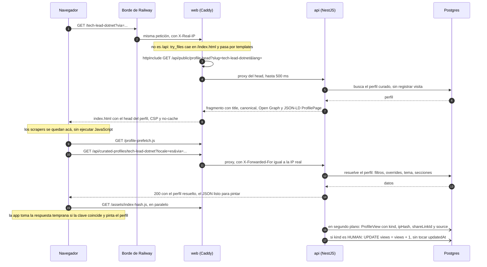

- **El head no registra visitas.** Solo la petición del perfil (`/api/curated-profiles/...`) registra una, en segundo plano, sin demorar la respuesta. Si el registro falla, la respuesta no cambia. El fragmento del head se guarda un minuto en una caché en memoria de la API, así que una edición del perfil puede tardar hasta un minuto en verse en las vistas previas.
- **Una visita por carga.** `profile-prefetch.js` pide el perfil apenas llega el HTML, con la misma clave que usaría la app (`slug`, idioma, token, `via`, `src`). La app reutiliza esa respuesta en lugar de pedirla otra vez.
- **Tipo de visita.** `OWNER` si la petición trae una sesión válida del panel, `BOT` si el User-Agent está en la lista o falta, `HUMAN` el resto. Solo las humanas suman a `views`.
- **`PROTECTED` y `PRIVATE`.** Un perfil privado responde 404, igual que uno inexistente. Uno protegido responde 401 sin un token válido. En los dos casos el head es el genérico con `noindex`, sin textos del perfil ni JSON-LD.

---

## 5. El panel: sesión, cookie y revocación

El panel vive en `/admin`, dentro de la misma SPA, en un chunk aparte. La sesión es una cookie que el cliente nunca lee.

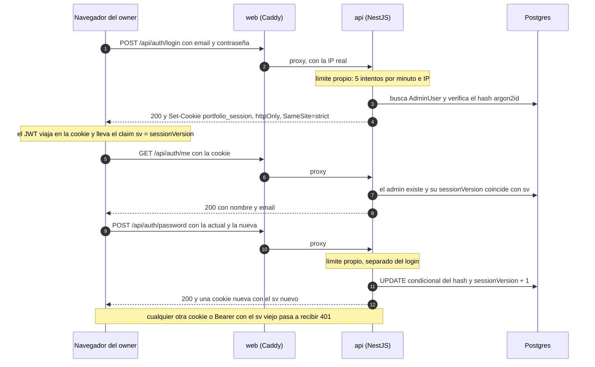

- **Un solo origen hace posible `SameSite=strict`.** Caddy preserva el `Host` al hacer proxy, así que la cookie queda ligada al dominio del sitio.
- **Revocación.** Cambiar la contraseña desde **Cuenta** o correr `admin:bootstrap` incrementa `sessionVersion` y cierra las demás sesiones. Un token sin `sv`, emitido antes de esta versión, vale como versión 0: el deploy no cierra la sesión abierta.
- **Logs.** Se redactan la contraseña del login, `currentPassword`, `newPassword`, `accessToken`, las cabeceras `Authorization`, `Cookie` y `X-Access-Token`, y el `Set-Cookie` de la respuesta (`REDACTED_PATHS` en `logger.options.ts`). De cada petición se registran id, método y URL, con el `?token=` censurado.

---

## 6. IP real del cliente y límites de peticiones

Con Caddy en el medio, la conexión que ve la API es la de Caddy. Sin este encadenamiento, todos los visitantes compartirían una IP.

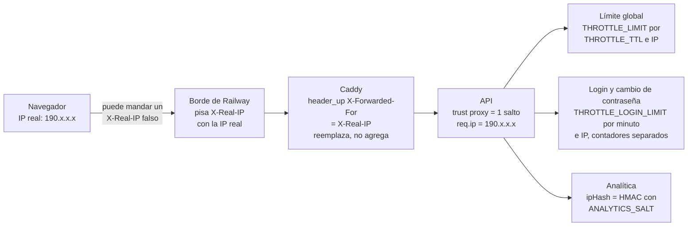

- **El borde pisa la cabecera del cliente.** Un `X-Real-IP` inventado no sirve para evadir el límite del login. Se comprueba en el paso 7c de la guía.
- **Los contadores viven en memoria**, por instancia. Con una sola réplica es exacto. Al subir réplicas habría que moverlos a un almacén compartido.
- **No se guarda la IP.** La analítica guarda solo un HMAC, con una sal distinta del `JWT_SECRET`.

---

## 7. Qué pasa en cada deploy

Cada push a `main` dispara un deploy, pero solo de los servicios cuya carpeta cambió (`watchPatterns`: `/backend/**` para `api`, `/frontend/**` para `web`).

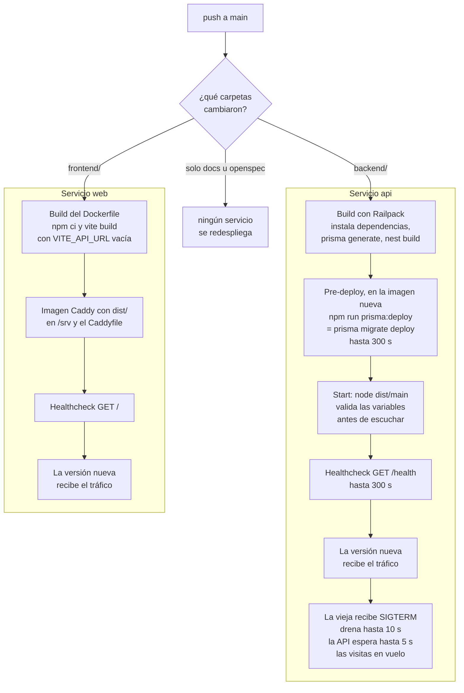

- **Las migraciones corren antes del cambio de tráfico.** Mientras el pre-deploy trabaja, la versión vieja sigue sirviendo. Por eso cada migración tiene que ser compatible con el código anterior durante ese intervalo, o hay que aceptar un error breve.
- **El seed nunca corre en un deploy.** El pre-deploy solo migra. Cargar contenido es una tarea manual desde la máquina del owner.
- **`prisma` y `tsx` están en `dependencies`** porque el pre-deploy corre en la imagen final, donde las `devDependencies` ya no están.
- **La API no arranca con secretos débiles.** En producción se niega si `JWT_SECRET` es el de ejemplo o tiene menos de 32 caracteres, si coincide con `ANALYTICS_SALT`, o si `FRONTEND_URL` no es https. El log nombra la variable y nunca su valor.

---

## 8. Cuando algo falla en el deploy

Railway solo cambia el tráfico si todas las fases pasan. Un fallo en cualquier fase deja sirviendo la versión anterior.

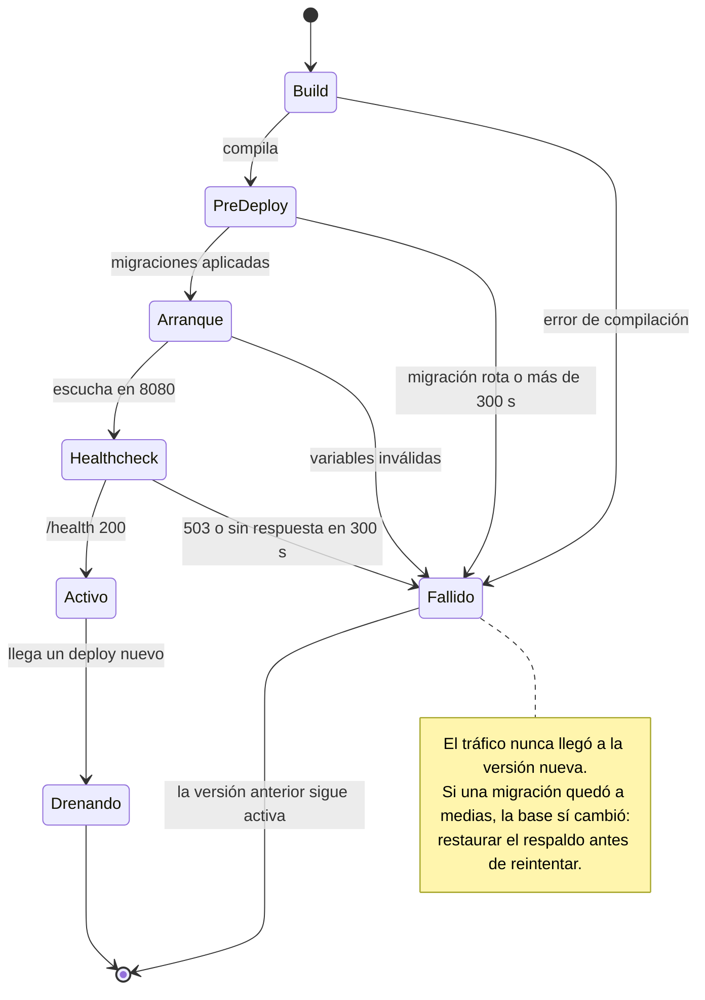

| Si falla en | Qué ves | Qué hacer |
|---|---|---|
| Build | error de TypeScript o de `@prisma/client` | revisar el Config file path: sin `/backend/railway.json` no corre `prisma generate` |
| Pre-deploy | error de `prisma migrate deploy` | leer el log; corregir en una rama. Si quedó a medias, restaurar el último respaldo y recién entonces desplegar la corrección |
| Arranque | el log nombra una variable | corregir la variable en el panel y redesplegar |
| Healthcheck | `healthcheck failed` | la base no responde (`/health` da 503 a propósito) o `PORT` distinto de 8080 |
| Después, en producción | un error que antes no estaba | **Rollback** desde Deployments, si la versión anterior tiene menos de 72 h. El rollback no revierte la base |

---

## 9. Variables y secretos por servicio

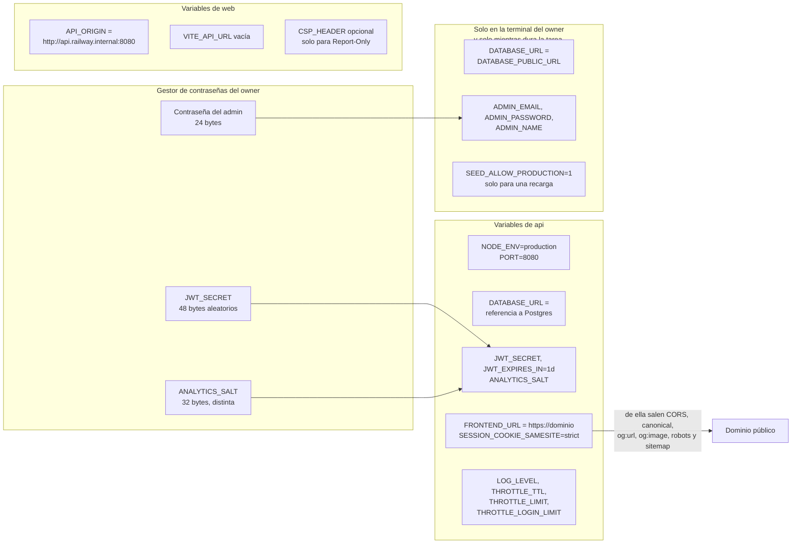

- **El dominio no está en el código.** Todo lo que lleva una URL absoluta sale de `FRONTEND_URL`. Cambiar de dominio es cambiar esa variable y redesplegar `api` (guía, «Cambiar de dominio»).
- **Nunca como variables del servicio:** `ADMIN_*`, `SEED_ALLOW_PRODUCTION` ni `ENABLE_API_DOCS`. Sin `ENABLE_API_DOCS`, Swagger queda cerrado.
- **`VITE_API_URL` se inlina en el build.** Está vacía a propósito: si tuviera un valor, el cliente llamaría a otro origen y se perderían el `SameSite=strict` y el proxy.

---

## 10. Datos: base, migraciones y respaldos

### Migraciones en el orden en que se aplican

El primer deploy las aplica todas sobre una base vacía. En los deploys siguientes, solo las nuevas.

| # | Migración | Qué hace | Riesgo sobre una base con datos |
|---|---|---|---|
| 1 | `init` | crea el esquema base | — |
| 2 | `curated_profile_lifecycle` | agrega `archivedAt`, `listed` (por defecto `true`) y la tabla de alias de slug | aditiva |
| 3 | `retire_accent_color` | copia `accentColor` a `themeOverrides.colors.accent` y borra la columna | **destructiva**: respaldo antes (DEPLOY.md § 9.5) |
| 4 | `localize_language_level` | `Language.level` pasa de `TEXT` a `JSONB` `{ es, en }` | **de datos**: respaldo antes (DEPLOY.md § 9.5) |
| 5 | `classify_profile_views` | enum `ViewKind` y columna `kind` con valor por defecto `HUMAN` | aditiva; después se puede correr `views:reclassify` |
| 6 | `add_share_links` | tabla `ShareLink` y columnas `shareLinkId` y `source` en `ProfileView` | aditiva |
| 7 | `add_certification_credential` | `verificationUrl`, `credentialId` y `expiresAt` en `Certification` | aditiva |
| 8 | `add_admin_session_version` | `sessionVersion` en `AdminUser`, por defecto 0 | aditiva; las sesiones abiertas siguen válidas |

### Dónde están los datos y cómo se recuperan

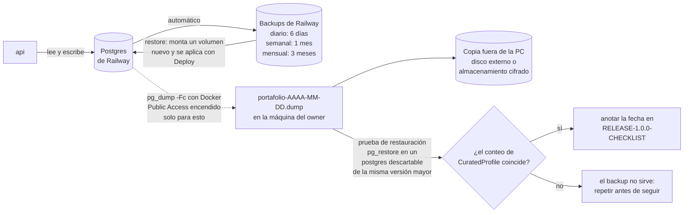

- **Dos copias, en dos lugares.** Los backups de Railway viven en la misma cuenta. El dump propio, no. Un backup que nunca se restauró no cuenta.
- **El contenido se edita en el panel, no en el repo.** `docs/cv-data.json` solo sirve para el primer poblado. Una recarga con `--overwrite` pisa lo editado en el panel, y por eso exige dos llaves y un dump previo.
- **`AdminUser` no lo toca el seed.** El administrador se crea y se recupera con `admin:bootstrap`.

---

## 11. Dominio y DNS

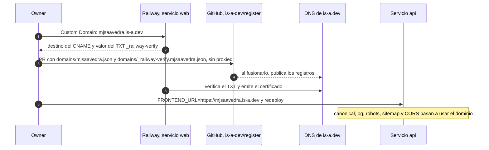

- **Sin `"proxied": true`.** Con el proxy de Cloudflare delante, Railway vería la IP de Cloudflare en `X-Real-IP` y se romperían los límites por visitante y la analítica.
- **El PR a is-a.dev lo abre el owner** desde su cuenta. Lo revisan a mano y el tiempo de aprobación no está publicado. Mientras tanto se puede trabajar con el dominio `*.up.railway.app` de `web`.

---

## 12. Primer despliegue, de punta a punta

El orden importa: la API necesita la base, el poblado necesita la API migrada, y `FRONTEND_URL` definitivo necesita el dominio.

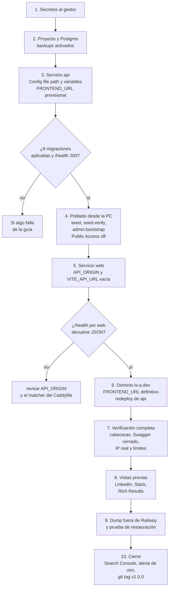

Cada caja es un paso de [`DEPLOY-RAILWAY.md`](DEPLOY-RAILWAY.md) con el mismo número.

---

## 13. Límites conocidos de esta arquitectura

| Límite | Por qué se acepta hoy | Qué haría falta para levantarlo |
|---|---|---|
| Una sola réplica de `api` | el tráfico de un portafolio no lo necesita | mover los contadores de límite a un almacén compartido y agregar `?connection_limit=5` a la `DATABASE_URL` |
| `web` se cobra como un servicio más | el mismo origen vale más que el ahorro | servir el frontend desde otro proveedor implica perder `SameSite=strict` y volver a `none` con CORS |
| Rollback limitado a 72 h (Hobby) | los deploys son frecuentes y chicos | volver a desplegar el commit anterior |
| Sin monitoreo externo todavía | queda para el change `add-uptime-monitoring`, que necesita el sitio arriba | un chequeo externo de `/health` con aviso |
| La migración corre mientras la versión vieja sirve | las migraciones actuales son aditivas | para un cambio destructivo, respaldo previo y aceptar unos segundos de error, o partirlo en dos deploys |
