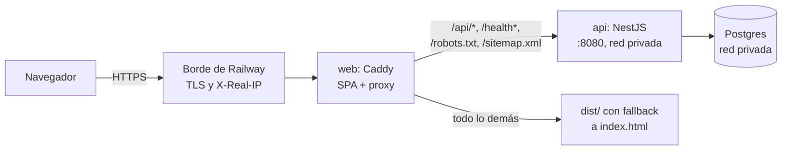

# DEPLOY — Guía definitiva (Railway)

> Diez pasos, en orden, para seguir con el panel de Railway abierto (y, al final, el [«Checklist de la 1.0.0»](#checklist-de-la-100), una página por fases con criterio de verificación y vuelta atrás). **El detalle y el por qué están en [`DEPLOY.md`](DEPLOY.md)**: cada paso indica entre paréntesis la sección a la que ir si algo no cierra.
>
> La configuración de build ya está versionada (`backend/railway.json`, `frontend/railway.json`, `frontend/Dockerfile`, `frontend/Caddyfile`). **En el panel se cargan variables, la ruta del archivo de configuración y el dominio.**
>
> Decisiones tomadas: plan **Hobby**; dominio **gratuito `mjsaavedra.is-a.dev`** para la 1.0.0 (subdominio de [is-a.dev](https://docs.is-a.dev), que se pide con un PR a su repositorio en GitHub); la compra de un dominio propio queda para después (ver [«Dominios candidatos»](#dominios-candidatos)). `FRONTEND_URL` lleva el dominio final desde el paso 3 (con el proxy es inocuo antes del lanzamiento; el paso 6 solo lo verifica). El dominio no está escrito en ningún archivo del código: si después se cambia por otro, alcanza con el procedimiento de [«Cambiar de dominio»](#cambiar-de-dominio). Comandos para **PowerShell**; los `curl` se escriben `curl.exe` para no chocar con el alias de PowerShell.

**Arquitectura:** tres servicios en un proyecto. `web` (Caddy) sirve la SPA y hace de **proxy** de `/api/*`, `/health*`, `/robots.txt` y `/sitemap.xml` hacia `api` por la red privada. Un solo origen → cookie `SameSite=strict`, sin CORS, `VITE_API_URL` sin definir. (§ 0, § 9.5)



> **¿Querés entender el despliegue completo antes de empezar?** [`DEPLOY-ARCHITECTURE.md`](DEPLOY-ARCHITECTURE.md) tiene los diagramas de topología, el reparto de Caddy, una visita y un login de punta a punta, las fases de cada deploy, el mapa de variables, las migraciones y los respaldos. Esta guía es la lista para hacerlo; aquel documento explica por qué funciona así.

---

## 0. Antes de empezar

- [ ] Cuenta de Railway con el plan **Hobby** (USD 5 incluidos; el costo es por uso).
- [ ] El repositorio conectado a Railway (GitHub) y `main` al día con este cambio.
- [ ] **El CI del último commit de `main` en verde** (pestaña *Actions* de GitHub: backend, frontend y `web-quality`). Railway despliega lo que haya en `main`, pase o no el CI: en este repo privado no hay *required checks* que lo impidan (el único freno posible es *Wait for CI* de los pasos 3 y 5, si el panel lo ofrece).
- [ ] `openspec/changes/` con **solo `archive/`**: antes del deploy se archivan, en este orden, `polish-pre-deploy-cleanup`, `add-ai-foundation` y `prepare-deploy-1-0-0`. Ningún change a medio implementar en `main`.
- [ ] En tu máquina: Node 22, `git`, **Docker** (para la prueba de restauración del paso 9) y el `.env` de `backend/` apuntando a **tu base local**, nunca a producción.
- [ ] Un gestor de contraseñas abierto: ahí van los secretos del paso 1.
- [ ] Cuenta de GitHub para pedir `mjsaavedra.is-a.dev` (paso 6). Mientras el PR de is-a.dev no esté aprobado, los pasos 1 a 5 se pueden hacer y mirar el sitio con el dominio `*.up.railway.app` del servicio `web`; el `FRONTEND_URL` ya lleva el dominio final, así que hasta que exista el `canonical` y el sitemap apuntan a un dominio que todavía no resuelve (no importa antes del lanzamiento). Los pasos 6 a 8 quedan para cuando el dominio exista.

---

## 1. Secretos (§ 1)

Pegá la función en PowerShell y generá los tres valores. Cada uno va **directo al gestor de contraseñas**; no los pegues en ningún archivo del repo.

```powershell
function New-Secret([int]$Bytes) {
  $b = [byte[]]::new($Bytes)
  $g = [Security.Cryptography.RandomNumberGenerator]::Create()
  $g.GetBytes($b); $g.Dispose()
  [Convert]::ToBase64String($b)
}

New-Secret 48   # JWT_SECRET       (64 caracteres; mínimo exigido: 32)
New-Secret 32   # ANALYTICS_SALT   (distinta del JWT_SECRET)
New-Secret 24   # contraseña del administrador (ADMIN_PASSWORD en el paso 4)
```

La de 24 bytes da 32 caracteres. En producción `admin:bootstrap` **exige 12 o más** (igual que el cambio desde **Cuenta**, `/admin/cuenta`, que acepta de 12 a 256) y rechaza la contraseña de ejemplo de `.env.example`. La rotación de rutina se hace después desde **Cuenta**; `admin:bootstrap` queda como recuperación.

Con `NODE_ENV=production` la API **no arranca** si el `JWT_SECRET` es el del `.env.example`, tiene menos de 32 caracteres o coincide con `ANALYTICS_SALT`; si `ANALYTICS_SALT` **falta** (es obligatoria en producción), tiene menos de 32 caracteres o coincide con una clave del keyring (`INTEGRATIONS_KEYS`); o si `FRONTEND_URL` no usa https. En **cualquier** entorno tampoco arranca con una `FRONTEND_URL` que no sea un origen: con barra final, ruta, query o credenciales. El mensaje nombra la variable y nunca imprime su valor.

---

## 2. Proyecto y Postgres (§ 7, § 9.5)

- [ ] New Project → **New → Database → PostgreSQL**.
- [ ] Pestaña **Backups**: activar el esquema **diario (6 días) + semanal (1 mes) + mensual (3 meses)**. Ahora, no después. Si el plan no ofrece Backups, el `.dump` del paso 9 es el **único** respaldo: hacelo semanal el primer mes.
- [ ] Anotar la **versión mayor de Postgres** del servicio (la muestra `select version();`): la necesitás en el paso 9 para usar la misma imagen `postgres:<N>-alpine`. Versión: `____`. El CI prueba con Postgres 16 (`postgres:16-alpine`): si Railway te da otra versión mayor, no hace falta cambiar nada para desplegar, pero anotá la diferencia y usá la de Railway en el paso 9.

---

## 3. Servicio `api` (§ 9.5)

- [ ] New → GitHub Repo. **Primero, Settings → Service Name: `api`** (el proxy del paso 5 resuelve `api.railway.internal`: con otro nombre, `web` no encuentra la API). El primer deploy automático que Railway lanza al crear el servicio, antes del nombre, la ruta y las variables, **falla: es esperable**; el bueno es el del botón Deploy de más abajo.
- [ ] **Settings → Root Directory: `backend`**.
- [ ] **Settings → Config-as-code → Config file path: `/backend/railway.json`**. Es una ruta **absoluta desde la raíz del repo**: el Root Directory no la reubica, y con `railway.json` a secas Railway no encuentra el archivo y usa sus valores por defecto (build sin `prisma generate`, sin pre-deploy ni healthcheck).
- [ ] No tocar Build / Start / Pre-deploy / Healthcheck: los toma de `backend/railway.json`:

  | Campo | Valor versionado |
  |---|---|
  | Builder | `RAILPACK` |
  | Build command | `npm run prisma:generate && npm run build` |
  | Watch paths | `/backend/**` |
  | Pre-deploy command | `npm run prisma:deploy` (= `prisma migrate deploy`) |
  | Pre-deploy timeout | `300` s |
  | Start command | `node dist/main` |
  | Healthcheck path | `/health` |
  | Healthcheck timeout | `300` s |
  | Draining | `10` s |
  | Restart policy | `ON_FAILURE` |

  Comprobá en el panel que esos campos figuren como definidos por el archivo y que el **Pre-deploy Timeout** diga `300`.

  **Versión de Node.** `backend/package.json` fija `"engines": { "node": "22.x" }` y Railpack la respeta. El conector `github` usa `AbortSignal.any`, que exige Node 20.3 o posterior: no bajes de esa versión.
- [ ] **Wait for CI** (Settings → Deploy), **si el panel lo ofrece**: es el único freno posible mientras el repo siga privado sin *required checks*. Si no aparece, el control es el del paso 0.
- [ ] **App Sleeping apagado** (Settings → Serverless). Si el servicio durmiera, la primera visita del día pagaría el arranque.
- [ ] Variables → Raw Editor, pegar y completar:

```ini
NODE_ENV=production
PORT=8080
DATABASE_URL=${{Postgres.DATABASE_URL}}
JWT_SECRET=<paso 1>
JWT_EXPIRES_IN=1d
ANALYTICS_SALT=<paso 1>
SESSION_COOKIE_SAMESITE=strict
LOG_LEVEL=info
THROTTLE_TTL=60
THROTTLE_LIMIT=120
THROTTLE_LOGIN_LIMIT=5
FRONTEND_URL=https://mjsaavedra.is-a.dev
```

- **`NODE_ENV=production` es la primera variable que importa.** Sin ella la API arranca en modo desarrollo: sin las reglas de arranque seguro, cookie sin `Secure`, sin HSTS y con Swagger abierto. En el log del arranque tiene que aparecer la línea «Swagger deshabilitado…», que solo sale en producción.
- **`FRONTEND_URL`** es un **origen**: `https://` y el host, **sin barra final ni ruta** (con una barra la API no arranca). Lleva el dominio final desde ahora: con el proxy solo da forma al `canonical`, `og:*`, sitemap, robots y JSON Resume, y CORS no interviene en un mismo origen, así que es inocuo antes del lanzamiento y evita un redeploy. El paso 6 solo lo verifica.
- **Secretos *sealed*:** si el panel lo ofrece, marcá como *sealed* `JWT_SECRET`, `ANALYTICS_SALT` y, cuando existan, `INTEGRATIONS_KEYS`, `GITHUB_SYNC_TOKEN` y `ANTHROPIC_API_KEY`. Quedan guardados en el gestor de contraseñas: un valor sellado no se vuelve a ver en el panel.
- **No** definir `ENABLE_API_DOCS` (Swagger queda cerrado), **ni** `ADMIN_EMAIL` / `ADMIN_PASSWORD` / `ADMIN_NAME` (viven solo en la terminal del paso 4), **ni** `SEED_ALLOW_PRODUCTION`.
- **Integraciones con terceros:** dejá las ocho variables `INTEGRATIONS_*` **sin definir** hasta que llegue un proveedor real (`INTEGRATIONS_ENABLED`, `INTEGRATIONS_SCHEDULER_ENABLED`, `INTEGRATIONS_SYNC_CRON`, `INTEGRATIONS_TICK_SECONDS`, `INTEGRATIONS_JOB_TIMEOUT_MS`, `INTEGRATIONS_RUN_MAX_MS`, `INTEGRATIONS_KEYS` e `INTEGRATIONS_ACTIVE_KEY`). Sus defaults dejan todo apagado y `fake` está prohibido en producción. `GITHUB_SYNC_TOKEN` (opcional) y `GITHUB_TRANSPORT` (`http` por defecto; `fixture` está prohibido en producción) solo cuentan si encendés el proveedor `github`, y eso queda para la fase [«Opcionales, con el sitio estable»](#opcionales-con-el-sitio-estable). La tabla completa de variables por servicio, con default, secreto y cómo generarla, está en [`DEPLOY.md` § 3](DEPLOY.md#variables-de-entorno); el detalle de integraciones, en [`DEPLOY.md` § 3](DEPLOY.md#integraciones-con-terceros-change-add-integrations-foundation).
- **Inteligencia artificial** (change `add-ai-foundation`): dejá las variables `AI_*` y `ANTHROPIC_API_KEY` **sin definir** en el primer deploy: con `AI_ENABLED` ausente la IA queda apagada y la app funciona exactamente igual. Se enciende en la fase [«Opcionales, con el sitio estable»](#opcionales-con-el-sitio-estable), después de un deploy estable.
- El drenaje de 10 s ya está versionado (`drainingSeconds`); la variable `RAILWAY_DEPLOYMENT_DRAINING_SECONDS` solo hace falta para pisarlo desde el panel. La API espera hasta 5 s a registrar las visitas en vuelo al apagarse.
- [ ] Deploy.

**Cómo verificar el deploy** (pestaña Deployments → logs):

1. En el **build**: aparece `prisma generate` (“Generated Prisma Client”) y después `nest build`, sin errores de TypeScript.
2. En el **pre-deploy**: `prisma migrate deploy` aplica las **15 migraciones**, en este orden: `init`, `curated_profile_lifecycle`, `retire_accent_color`, `localize_language_level`, `classify_profile_views`, `add_share_links`, `add_certification_credential`, `add_admin_session_version`, `add_application_tracking`, `add_integrations_foundation`, `add_job_posting_intake`, `order_repositories_section`, `add_github_code_evidence`, `retire_featured_repository_stars` y `add_ai_foundation` (la misma lista que `ls backend/prisma/migrations`). El log termina con «All migrations have been successfully applied». La tabla con lo que hace cada una está en [`DEPLOY-ARCHITECTURE.md` § 10](DEPLOY-ARCHITECTURE.md#10-datos-base-migraciones-y-respaldos).
3. El **healthcheck** `/health` pasa y la versión entra. En los logs, JSON con `reqId`, sin contraseñas ni tokens, y la línea «Swagger deshabilitado…» (prueba de que `NODE_ENV=production` llegó).

**Si falla:**

- *Build: TypeScript no encuentra tipos de `@prisma/client`* → el `buildCommand` no es el del archivo: el Config file path está mal (arriba).
- *Pre-deploy: error de conexión* → `DATABASE_URL=${{Postgres.DATABASE_URL}}` mal escrita, o el servicio de base con otro nombre en el canvas.
- *Arranque o pre-deploy: error de Prisma sobre `libssl`/OpenSSL o “query engine” no encontrado* → **a verificar**: sería que la imagen de runtime no trae la biblioteca que necesita el motor de Prisma. No definas variables a ciegas: copiá el mensaje exacto del log, buscalo en la documentación de Railpack y de Prisma y, si no se resuelve, frená y consultalo antes de seguir.
- *El log habla de un secreto, de `ANALYTICS_SALT` o de `FRONTEND_URL`* → validación de arranque (paso 1). Falta la sal, es corta o igual a otro secreto; o `FRONTEND_URL` lleva barra final o ruta.
- *“healthcheck failed”* → la base no responde (`/health` devuelve 503 a propósito) o `PORT` distinto de `8080`.
- Una migración que falla **detiene el deploy y la versión vieja sigue sirviendo**: ver *Si algo falla* al final.

> Las migraciones destructivas (`retire_accent_color`, `retire_featured_repository_stars`) y las de datos (`localize_language_level`, `order_repositories_section`) son inocuas sobre una base **vacía**, como la de este primer deploy. Las demás solo agregan tablas, tipos o columnas con valor por defecto. Si algún día un deploy aplica una migración destructiva o de datos sobre una base con contenido, hacé un respaldo antes (§ 9.5 y [«Deploys siguientes»](#deploys-siguientes)).

- [ ] Opcional: **Settings → Networking → Generate Domain** en `api`, para mirar la API cruda en el paso 7. Se puede borrar después.

---

## 4. Primer poblado y administrador — desde tu máquina (§ 3)

Se hace **una sola vez**, con tu PC contra la base de Railway por su dirección pública. No se usa `railway run` (correría localmente con la `DATABASE_URL` de la red privada, que desde tu PC no resuelve). **El seed nunca corre en un deploy**: el `preDeployCommand` solo migra.

- [ ] En el servicio **Postgres → Settings → Networking → Public Access**: encender. Copiar `DATABASE_PUBLIC_URL` (pestaña Variables). Se apaga al terminar.
- [ ] En una terminal nueva de PowerShell:

```powershell
cd backend

# Apuntar a producción SOLO en esta terminal (las variables del proceso pisan el .env; no lo edites)
$env:DATABASE_URL = '<DATABASE_PUBLIC_URL>'    # la cadena pública exige sslmode=require; si la conexión falla por TLS, agregá ?sslmode=require
$env:NODE_ENV = 'production'                   # así las protecciones del seed exigen sus dos llaves

npm run seed          # base vacía → carga docs/cv-data.json. Mirá que el destino impreso (host:puerto/base) sea el de Railway
npm run seed:verify   # conteos de la base contra el JSON: tienen que coincidir

# Administrador: ADMIN_* definidas solo en esta terminal
$env:ADMIN_EMAIL = '<tu email>'
$env:ADMIN_PASSWORD = '<la del paso 1>'
$env:ADMIN_NAME = 'Manuel Saavedra'
npm run admin:bootstrap   # en producción rechaza (código 1, sin tocar la base) la contraseña de ejemplo y las de menos de 12 caracteres

# Limpieza
Remove-Item Env:DATABASE_URL, Env:NODE_ENV, Env:ADMIN_EMAIL, Env:ADMIN_PASSWORD, Env:ADMIN_NAME
```

- [ ] **Apagar Public Access** del Postgres. Se vuelve a encender solo para backups y recargas (paso 9 y *Recarga*).
- [ ] Si `npm run seed` sale con código 2 («Negativa: … la base ya tiene contenido») es que ya había datos: no escribió nada. Leé el mensaje antes de seguir.
- [ ] Si `admin:bootstrap` dice «Faltan variables de entorno», las `ADMIN_*` no quedaron definidas en esta terminal: definilas de nuevo (cada terminal nueva las pierde) y repetí el comando. Si dice que `ADMIN_PASSWORD` es el valor de ejemplo o que exige 12 caracteres, usá la del paso 1.

**Rotar la contraseña del administrador**: la rotación de rutina va por **Cuenta** en el panel (cierra las sesiones de otros dispositivos). Si se perdió la contraseña, o se sospecha que hay una sesión tomada, `admin:bootstrap` es la recuperación: repetirlo con un `ADMIN_PASSWORD` nuevo (hace *upsert* por email y también cierra todas las sesiones). Hace falta Public Access encendido y las variables solo en esa terminal.

**Recarga deliberada** (borra y recarga desde `docs/cv-data.json`, **también lo editado en el panel**): primero el respaldo del paso 9; después, en una terminal con `DATABASE_URL` y `NODE_ENV=production` como arriba:

```powershell
$env:SEED_ALLOW_PRODUCTION = '1'
npm run seed -- --overwrite
Remove-Item Env:SEED_ALLOW_PRODUCTION, Env:DATABASE_URL, Env:NODE_ENV
```

Con contenido en producción hacen falta las **dos llaves** (`--overwrite` y `SEED_ALLOW_PRODUCTION=1`); `--overwrite` no se combina con `--file`. `AdminUser` no se toca.

---

## 5. Servicio `web` (§ 4, § 9.5)

- [ ] New → GitHub Repo (el mismo). **Primero, Settings → Service Name: `web`.** Igual que en `api`, el primer deploy automático falla y es esperable.
- [ ] **Root Directory: `frontend`**.
- [ ] **Wait for CI**, si el panel lo ofrece (como en el paso 3).
- [ ] **Config file path: `/frontend/railway.json`** (absoluta desde la raíz del repo, igual que en `api`).
- [ ] Variables:

```ini
API_ORIGIN=http://api.railway.internal:8080
```

`API_ORIGIN` usa el nombre que le fijaste al servicio en el paso 3 (`api`) y el `PORT` de `api`. **No definir `VITE_API_URL`**: el `ARG` de `frontend/Dockerfile` ya vale vacío y el cliente usa rutas relativas que resuelve el proxy. **No definir `CSP_HEADER`**: sin definir, la CSP del sitio bloquea (si tras un deploy algo deja de cargar, `CSP_HEADER=Content-Security-Policy-Report-Only` solo reporta; § 9.5).

- [ ] Deploy. El healthcheck de `web` es `/` (versionado).
- [ ] Verificar el proxy: `curl.exe -s https://<dominio-de-web>/health` tiene que devolver **JSON** (`{"status":"ok",...}`). Si devuelve HTML, el proxy no llega a la API (se sacó `/health` del matcher de `frontend/Caddyfile`, o `API_ORIGIN` está mal).

---

## 6. Dominio gratuito `mjsaavedra.is-a.dev` (§ 0)

Es un subdominio, así que no hace falta `ALIAS` ni redirección de `www`. El trámite es un PR al repositorio [`is-a-dev/register`](https://github.com/is-a-dev/register) y **lo hacés vos desde tu cuenta de GitHub** (su README pide que la solicitud no la genere una IA y la revisan a mano; el tiempo de aprobación no está publicado). Seguí su [guía para Railway](https://docs.is-a.dev/guides/railway/) y la [estructura de archivos](https://docs.is-a.dev/domain-structure/).

- [ ] En `web` → **Settings → Networking → Custom Domain** → agregar `mjsaavedra.is-a.dev`. Railway muestra dos valores: el destino del **`CNAME`** (`@`, tipo `xxxx.up.railway.app`) y el **`TXT`** de `_railway-verify`.
- [ ] Hacer fork de `is-a-dev/register` y crear en la carpeta `domains/` dos archivos, con tu usuario de GitHub en `owner.username`:
  - `domains/mjsaavedra.json` → `{ "owner": { "username": "<tu-usuario>" }, "records": { "CNAME": "<destino que dio Railway>" } }`
  - `domains/_railway-verify.mjsaavedra.json` → `{ "owner": { "username": "<tu-usuario>" }, "records": { "TXT": "<valor de _railway-verify>" } }`
- [ ] **Sin `"proxied": true`**. Ese campo pone el proxy de Cloudflare delante, y entonces Railway vería la IP de Cloudflare en `X-Real-IP`: se romperían la IP real del cliente y el límite de peticiones y de login por visitante (§ 9.5 «IP real del cliente»).
- [ ] Abrir el PR con la vista previa del sitio que exige is-a.dev: el link `*.up.railway.app` del servicio `web` y una captura de la home. Si piden cambios, aplicarlos; si no, rechazan la solicitud.
- [ ] Cuando lo fusionen, el DNS se publica en minutos (si a las 48 h no resuelve, abrir un issue o preguntar en su Discord). Esperar a que Railway marque el dominio verificado y el certificado emitido.
- [ ] En `api`, confirmar que **`FRONTEND_URL=https://mjsaavedra.is-a.dev`** (origen exacto, sin barra final) es el valor cargado en el paso 3. Si lo cambiaste, **redeploy de `api`**; si no, no hace falta nada.
- [ ] Verificar: `curl.exe -s https://mjsaavedra.is-a.dev/tech-lead-dotnet | Select-String 'og:title|canonical'` muestra el título del perfil y `https://mjsaavedra.is-a.dev/tech-lead-dotnet` (no `localhost`).

---

## 7. Verificación completa (§ 5)

```powershell
$SITIO = 'https://mjsaavedra.is-a.dev'

curl.exe -s $SITIO/health                                              # 1. JSON, status ok, base arriba
curl.exe -s -o NUL -w "%{http_code}`n" $SITIO/tech-lead-dotnet         # 2. 200: fallback de la SPA con el head del perfil
curl.exe -s $SITIO/robots.txt                                          # 3. con el dominio (Sitemap: https://mjsaavedra.is-a.dev/sitemap.xml)
curl.exe -s $SITIO/sitemap.xml | Select-Object -First 5                #    URLs con https://mjsaavedra.is-a.dev
curl.exe -s $SITIO/api/curated-profiles/no-existe                      # 4. error sin stack ni detalles
curl.exe -s -o NUL -w "%{http_code}`n" $SITIO/api/docs-json            # 5. 404: Swagger cerrado
curl.exe -sI $SITIO/ | Select-String -Pattern 'content-security-policy|x-content-type|referrer-policy'   # 6. CSP presente
curl.exe -s -o NUL -w "%{http_code}`n" $SITIO/health/live                  # 6b. 200: la API vive (/health, arriba, también mira la base)
```

**Atributos de la cookie de sesión.** Un login real, con las credenciales solo en esta terminal (no las pegues en un archivo ni en el historial compartido):

```powershell
$cuerpo = @{ email = '<tu email>'; password = '<la del paso 1>' } | ConvertTo-Json -Compress
$cuerpo | curl.exe -s -D - -o NUL -X POST "$SITIO/api/auth/login" -H 'Content-Type: application/json' --data-binary '@-' | Select-String 'set-cookie'
Remove-Variable cuerpo
```

- [ ] La línea `Set-Cookie: portfolio_session=…` tiene que traer **`HttpOnly`**, **`Secure`** y **`SameSite=Strict`**. Si falta `Secure`, `NODE_ENV` no es `production`; si dice `SameSite=Lax`, falta `SESSION_COOKIE_SAMESITE=strict` en `api`.

**Límite del login y IP real** (cada intento fallido cuenta; la ventana es de 60 s: esperá 1 minuto entre pruebas):

```powershell
# 7a. Seis logins con un usuario inexistente: cinco 401 y el sexto 429
1..6 | ForEach-Object { curl.exe -s -o NUL -w '%{http_code} ' -X POST "$SITIO/api/auth/login" -H 'Content-Type: application/json' -d '{"email":"nadie@example.com","password":"mal"}' }; ''
```

- [ ] **7b. Desde otra red** (el teléfono con datos móviles, no el wifi): un solo login con `nadie@example.com` → **401**, no 429. Prueba que el límite es **por IP real** y no compartido por todos (que la IP llega bien desde Caddy). Si da 429, la API ve la misma IP para todos: revisar el `header_up X-Forwarded-For` de `frontend/Caddyfile` (§ 9.5, *IP real del cliente*).
- [ ] **7c. Railway pisa un `X-Real-IP` enviado por el cliente.** Esperar 1 minuto y, desde tu PC:

```powershell
# seis intentos fallidos mandando un X-Real-IP falso
1..6 | ForEach-Object { curl.exe -s -o NUL -w '%{http_code} ' -X POST "$SITIO/api/auth/login" -H 'X-Real-IP: 1.2.3.4' -H 'Content-Type: application/json' -d '{"email":"nadie@example.com","password":"mal"}' }; ''
# un séptimo, ahora SIN la cabecera: tiene que dar 429 (misma IP, la tuya) y no 401
curl.exe -s -o NUL -w "%{http_code}`n" -X POST "$SITIO/api/auth/login" -H 'Content-Type: application/json' -d '{"email":"nadie@example.com","password":"mal"}'
```

  Si el séptimo da **429**, Railway ignoró el `X-Real-IP` falso y contó todo contra tu IP real: correcto. Si da **401**, el borde deja pasar la cabecera del cliente y cualquiera podría evadir el límite del login: **no cierres el release**; anotá el resultado y consultalo antes de seguir. Desde la otra red, un login tiene que seguir dando 401.

- [ ] Logs de `api` y `web` (panel): JSON con `reqId`, sin contraseñas ni tokens.
- [ ] Abrir el sitio, entrar a `/admin` con el email y la contraseña del paso 4 y mirar un perfil.

Contra el dominio de la API (`*.up.railway.app`, si lo generaste), donde se ve la respuesta cruda:

```powershell
$API = 'https://api-xxxx.up.railway.app'
curl.exe -sI $API/api/profile | Select-String -Pattern 'strict-transport|x-content-type|referrer-policy|x-powered-by'
curl.exe -sI -H 'Origin: https://otro-sitio.com' $API/api/profile | Select-String access-control-allow-origin   # vacío
```

---

## 8. Vistas previas de los links

- [ ] Pegar dos perfiles públicos distintos en el [Post Inspector de LinkedIn](https://www.linkedin.com/post-inspector/) y en un canal de Slack. Las tarjetas tienen que mostrar **títulos distintos** y la imagen (tarea 5.4 de `add-server-rendered-head`). Si salen genéricas, ver *Si algo falla*.
- [ ] Pasar la home y un perfil público por el [Rich Results Test](https://search.google.com/test/rich-results) y por el [validador de schema.org](https://validator.schema.org): `ProfilePage` sin errores y el mismo `@id` del `Person` en los dos (TC-44, pasos 6 y 7 de `docs/MANUAL.md`).

Al primer deploy no hay visitas que reclasificar. Cuando suba la versión de la lista de bots, se corre desde tu máquina contra la base pública, igual que el poblado del paso 4 (no con `railway run`: la `DATABASE_URL` privada no resuelve desde tu PC). Primero el dump del paso 9 y, con Public Access encendido:

```powershell
cd backend
$env:DATABASE_URL = '<DATABASE_PUBLIC_URL>'      # si la conexión falla por TLS, agregá ?sslmode=require
$env:NODE_ENV = 'production'
npm run views:reclassify               # simulación: informa cuántas cambiarían, no escribe
npm run views:reclassify -- --apply    # solo si el informe cierra
Remove-Item Env:DATABASE_URL, Env:NODE_ENV
```

Después, apagar Public Access (`docs/DEPLOY.md` § 7).

---

## 9. Backup fuera de Railway y prueba de restauración (§ 7)

El último bloqueante. Los backups de Railway viven en la misma cuenta; un dump propio no. Con Public Access del Postgres **encendido solo para esto** y la versión mayor anotada en el paso 2 (`<N>`):

```powershell
$env:PGURL = '<DATABASE_PUBLIC_URL>'    # si la conexión falla por TLS, agregá ?sslmode=require
$fecha = Get-Date -Format yyyy-MM-dd
New-Item -ItemType Directory -Force "$HOME\backups-portafolio" | Out-Null

# Dump (formato custom). Se escribe con -f dentro del contenedor: no uses '>' en PowerShell, corrompe binarios.
docker run --rm -e PGURL -v "$HOME\backups-portafolio:/out" postgres:<N>-alpine sh -c 'pg_dump "$PGURL" -Fc -f /out/portafolio.dump'
Rename-Item "$HOME\backups-portafolio\portafolio.dump" "portafolio-$fecha.dump"

# Prueba de restauración en un Postgres descartable
docker run -d --name pg-restore-test -e POSTGRES_PASSWORD=test postgres:<N>-alpine
Start-Sleep 8
docker cp "$HOME\backups-portafolio\portafolio-$fecha.dump" pg-restore-test:/tmp/b.dump
docker exec pg-restore-test sh -c 'createdb -U postgres restore_test && pg_restore -U postgres -d restore_test --no-owner /tmp/b.dump'
docker exec pg-restore-test psql -U postgres -d restore_test -c 'select count(*) from "CuratedProfile";'   # tiene que coincidir con los perfiles del seed
docker rm -f pg-restore-test

Remove-Item Env:PGURL
```

- [ ] Guardar el `.dump` fuera de la PC de trabajo (disco externo o almacenamiento cifrado) y **apagar Public Access**.
- [ ] Anotar la fecha de la prueba en [`RELEASE-1.0.0-CHECKLIST.md`](RELEASE-1.0.0-CHECKLIST.md). Un backup que no se restauró nunca no cuenta. Repetí el dump antes de cualquier recarga con `--overwrite`.

---

## 10. Cierre

- [ ] Search Console: dar de alta `https://mjsaavedra.is-a.dev` como propiedad de **prefijo de URL** (no de dominio: el DNS de `is-a.dev` no es tuyo; verificá con el **archivo HTML** que ofrece Search Console: va en `frontend/public/` con un PR chico, y Caddy lo sirve tal cual) y enviar `https://mjsaavedra.is-a.dev/sitemap.xml`. (§ 8)
- [ ] **Alerta de uso** del plan Hobby: configurar el aviso de gasto en Railway y mirar el panel de uso la primera semana (tres servicios encendidos superan los USD 5 incluidos).
- [ ] Verificar que el redeploy es selectivo: un cambio trivial en `backend/` (p. ej. un comentario) y push a `main` tiene que redesplegar **solo `api`**, no `web` (por los `watchPatterns` `/backend/**` y `/frontend/**`).
- [ ] `git tag v1.0.0 && git push --tags`.
- [ ] Leer [`MANUAL.md`](MANUAL.md): cómo se usa la plataforma, caso por caso.

---

## Opcionales, con el sitio estable

Solo después de un deploy estable (pasos 1 a 10 completos y una o dos semanas sin sorpresas). Las dos son opcionales, independientes y reversibles.

### Encender la IA

Change `add-ai-foundation`. Es una base: hoy solo trae el panel de gasto y **Probar conexión** (la IA para el usuario llega con los changes siguientes). Se enciende solo con el sitio ya estable (fase 8 del checklist) y se puede apagar en cualquier momento.

**Dos workspaces en la Console de Anthropic, dos claves.** Los 10 USD del tope mensual son solo para la IA del panel; las evals en vivo gastan aparte (decisión P1 del owner):

| Workspace | Para qué | Spend limit de la Console | Variable de la clave | Dónde vive la clave |
|---|---|---|---|---|
| `portfolio-app` | La IA del panel (Probar conexión y las features que vienen) | **12 USD** (decidido: por encima del tope propio de 10 USD, para que el cortafuegos propio salte primero) | `ANTHROPIC_API_KEY` | variable del servicio `api` en Railway |
| `portfolio-evals` | `npm run ai:eval` | **5 USD** (decidido) | `AI_EVAL_API_KEY` (**no** es la `ANTHROPIC_API_KEY`) | solo la terminal del owner; nunca en Railway ni en un archivo |

Si el spend limit de la Console fuera menor que `AI_MONTHLY_BUDGET_USD`, corta Anthropic antes y el panel lo muestra como «Anthropic cortó por el spend limit hasta {fecha}».

- [ ] En la Console, creá el workspace `portfolio-app`, fijale el spend limit y creá su clave. Pegala directo en el gestor de contraseñas.
- [ ] Variables del servicio `api` (Raw Editor), todas opcionales salvo las dos primeras:

```ini
AI_ENABLED=true
ANTHROPIC_API_KEY=<la clave del workspace portfolio-app>
AI_MONTHLY_BUDGET_USD=10
```

  `AI_PROVIDER` queda en su default (`anthropic`): el proveedor `fake` está prohibido en producción y la API no arranca con él. Sin la clave, con `AI_ENABLED=true` la API **no arranca** (el log nombra `ANTHROPIC_API_KEY` sin imprimir ningún valor y queda sirviendo la versión anterior). `AI_REQUEST_TIMEOUT_MS`, `AI_MAX_CONCURRENCY` y `AI_MAX_INPUT_TOKENS` tienen defaults sensatos (60 000 ms, 2 y 50 000).
- [ ] Deploy. La migración aditiva `add_ai_foundation` (un tipo y dos tablas) **ya corrió** en el deploy que trajo el código (una de las 15 del paso 3): encender la IA no migra nada, solo cambia variables.
- [ ] En `/admin/integraciones`, bloque **Inteligencia artificial**: debe decir «Activa» y «Gastado 0,00 de 10,00 USD». Pulsá **Probar conexión** (confirma que es una llamada real, de unos 0,0001 USD): la corrida queda **Exitosa**, con su costo.
- [ ] Mirá el costo de esa petición en la Console de Anthropic: tiene que coincidir con el que muestra el panel.
- [ ] Ejecutá **TC-54** de [`MANUAL.md`](MANUAL.md) contra Anthropic real (las pruebas del repo usan el proveedor `fake`).

**Vuelta atrás.** `AI_ENABLED=false` (o borrar la variable) y redeploy: el cliente de Anthropic deja de construirse y la app queda como antes. Las tablas quedan inertes; no hace falta borrarlas.

**Qué pasa al llegar al tope.** Con gastado más reservado en el tope (`AI_MONTHLY_BUDGET_USD`), el panel dice «Se alcanzó el tope de IA del mes» y el Dashboard lo avisa; no se hace ninguna llamada más hasta el día 1 a las 00:00 UTC. Si Anthropic corta antes por su spend limit, el panel dice hasta cuándo.

**Retención.** La salida validada de cada corrida (`AiRun.output`) se guarda 180 días. `npm run ai-runs:purge` (simulación) y `npm run ai-runs:purge -- --apply` la dejan en nulo pasado ese plazo, sin tocar costos ni métricas. Corrida mensual a mano desde tu máquina, desde mayo de 2027, con la `DATABASE_URL` pública temporal como en el paso 4 (ver «Operación»).

**Evals en vivo (manual y a demanda).** Desde `backend/`, con la clave del workspace de evals y solo con los datos ficticios de `docs/examples/`:

```powershell
$env:AI_EVAL_API_KEY = '<clave del workspace portfolio-evals>'   # en esta terminal; no la guardes en ningún archivo
$env:AI_EVAL_ALLOW_SPEND = '1'
npm run ai:eval -- --task ai.smoke --max-usd 1
Remove-Item Env:AI_EVAL_API_KEY, Env:AI_EVAL_ALLOW_SPEND
```

Sin `AI_EVAL_API_KEY`, sin `AI_EVAL_ALLOW_SPEND=1` o con las reservas de los casos por encima del tope de la corrida (2 USD por defecto), el script sale con código **2** sin hacer ninguna llamada facturable. Con `-- --record` regraba los cassettes de `backend/test/fixtures/ai/` (redacta secretos y se niega a escribir si queda alguno).

### Evidencia de GitHub

**Antes de encender:** cargar **2 o más repositorios** en `/admin/proyectos`; sin repositorios no hay nada que verificar. Crear en GitHub un **token fine-grained** de solo lectura: *Public repositories (read-only)*, sin permisos adicionales y **con vencimiento** (anotá la fecha). Guardarlo en el gestor y cargarlo en el servicio `api` como `GITHUB_SYNC_TOKEN`, o dejar la variable sin definir y pegarlo en el campo **Credencial** de la tarjeta `github` en **Integraciones**. Encender con `INTEGRATIONS_ENABLED=github` (más el keyring y `INTEGRATIONS_SCHEDULER_ENABLED=true`, como arriba), pulsar **Sincronizar ahora** y mirar el bloque **Repositorios destacados** de `/admin/proyectos`. Cuando el token venza, el sitio sigue mostrando los últimos datos con su fecha y el panel avisa («La última sincronización con GitHub falló»): generá otro, reemplazalo y volvé a sincronizar. Detalle y vuelta atrás en [`DEPLOY.md`](DEPLOY.md#proveedor-github--evidencia-de-código-change-add-github-code-evidence).

- [ ] Ejecutá **TC-52** de [`MANUAL.md`](MANUAL.md) contra GitHub real (las pruebas del repo usan `GITHUB_TRANSPORT=fixture`).

---

## Deploys siguientes

Después del primero, cada push a `main` que toque `backend/` o `frontend/` despliega solo el servicio afectado. Lo que pasa en cada fase está dibujado en [`DEPLOY-ARCHITECTURE.md` § 7](DEPLOY-ARCHITECTURE.md#7-qué-pasa-en-cada-deploy).

**Antes de fusionar a `main`:**

- [ ] El CI del PR en verde.
- [ ] ¿Trae migraciones nuevas? Mirá `backend/prisma/migrations/` en el diff:
  - **Solo agrega** tablas, columnas con valor por defecto o índices: no hace falta nada más.
  - **Borra o transforma datos** (`DROP`, `UPDATE`, `ALTER COLUMN … TYPE`): hacé el dump del paso 9 **antes de fusionar**, y anotá en el PR cómo se vuelve atrás.
- [ ] ¿Cambia una variable de entorno? Cargala en el panel **antes** de fusionar. Si la API la exige y falta, la versión nueva no arranca y queda la anterior sirviendo.

**Después del deploy:**

- [ ] Deployments del servicio: build, pre-deploy y healthcheck en verde.
- [ ] Desde PowerShell, el chequeo rápido:

```powershell
$SITIO = 'https://mjsaavedra.is-a.dev'
curl.exe -s $SITIO/health                                         # JSON con status ok
curl.exe -s -o NUL -w "%{http_code}`n" $SITIO/                    # 200
curl.exe -s $SITIO/tech-lead-dotnet | Select-String 'og:title'    # el título del perfil, no el genérico
```

- [ ] Si algo no cierra: **Rollback** al despliegue anterior (72 h en Hobby). Si la versión nueva aplicó una migración, el rollback no la revierte: el código viejo tiene que funcionar con la base nueva, o hay que restaurar el dump.

**Migraciones de la 1.0.0 y su riesgo.** Las 15 corren en el primer deploy, sobre una base vacía:

| Migración | Tipo | Sobre una base con datos |
|---|---|---|
| `init`, `curated_profile_lifecycle` | esquema | aditivas |
| `retire_accent_color` | **destructiva** | respaldo antes; rollback restaurando (`DEPLOY.md` § 9.5) |
| `localize_language_level` | **de datos** | respaldo antes; hay rollback por SQL que pierde el inglés (`DEPLOY.md` § 9.5) |
| `classify_profile_views`, `add_share_links`, `add_certification_credential`, `add_admin_session_version`, `add_application_tracking`, `add_integrations_foundation`, `add_job_posting_intake` | aditivas | nada; las sesiones abiertas siguen válidas |
| `order_repositories_section` | **de datos**, idempotente | ubica `repositories` después de `projects` en los perfiles ya sembrados; inocua sobre la base vacía |
| `add_github_code_evidence` | aditiva | una tabla que nace vacía |
| `retire_featured_repository_stars` | **destructiva** | comprobación y respaldo antes (`DEPLOY.md` § 9.5) |
| `add_ai_foundation` | aditiva | un tipo y dos tablas; corre en el deploy que trae el código, **no** al encender la IA |

---

## Operación

| Cada | Qué | Cómo |
|---|---|---|
| deploy | chequeo rápido | [«Deploys siguientes»](#deploys-siguientes) |
| semana, el primer mes | uso y costo | panel de uso de Railway; la alerta del paso 10 avisa si se pasa |
| mes | dump fuera de Railway y **prueba de restauración** | paso 9; anotar la fecha en `RELEASE-1.0.0-CHECKLIST.md` |
| mes | logs de `api` | buscar `"level":50` (error) y 5xx repetidos |
| cuando haga falta | rotar la contraseña del administrador | **Cuenta** en el panel; si se perdió, `admin:bootstrap` (paso 4) |
| cuando haga falta | reclasificar visitas | paso 8, con dump previo |
| mes | purgar el texto de las vacantes vencidas | `npm run job-postings:purge` (simulación) y `-- --apply`, desde la PC con `DATABASE_PUBLIC_URL`; ver abajo |
| mes, desde mayo de 2027 | purgar la salida de la IA de más de 180 días | `npm run ai-runs:purge` y `-- --apply`, igual; no tiene purga perezosa |

**Purgas mensuales (sin servicio cron).** El texto de las vacantes ya se purga solo, de forma perezosa, al listar, leer o importar; la corrida mensual a mano cubre lo que nadie abrió. Desde la PC, con Public Access encendido y las variables solo en esa terminal:

```powershell
cd backend
$env:DATABASE_URL = '<DATABASE_PUBLIC_URL>'    # si la conexión falla por TLS, agregá ?sslmode=require
$env:NODE_ENV = 'production'
npm run job-postings:purge             # simulación: «Vacantes que se purgarían (simulación; usá --apply): N»; no escribe
npm run job-postings:purge -- --apply  # «Vacantes purgadas: N»
npm run ai-runs:purge                  # desde mayo de 2027: simulación; con -- --apply escribe
Remove-Item Env:DATABASE_URL, Env:NODE_ENV
```

Después, apagar Public Access. Las dos purgas simulan por defecto, como `views:reclassify` e `integrations:rekey`.

**Rotar secretos.** Cambiar `JWT_SECRET` en el panel y redesplegar `api` cierra **todas** las sesiones: sirve si se sospecha que el secreto se filtró. Cambiar `ANALYTICS_SALT` hace que, desde ese momento, las mismas IP den otro `ipHash`. No rompe nada, pero corta la continuidad de visitantes únicos. Generá los valores nuevos con la función del paso 1 y guardalos en el gestor antes de pegarlos.

**Integraciones (cuando haya un proveedor real).** Generar el keyring: `node -e "console.log(require('crypto').randomBytes(32).toString('base64'))"` por clave, guardada en el gestor antes de pegarla. Definir `INTEGRATIONS_ENABLED`, el secreto del proveedor, `INTEGRATIONS_KEYS`, `INTEGRATIONS_ACTIVE_KEY` e `INTEGRATIONS_SCHEDULER_ENABLED=true` en el servicio `api`, **en una sola réplica**. `drainingSeconds` tiene que seguir por encima de 8 s. Rotar una clave: agregar `k2` → `INTEGRATIONS_ACTIVE_KEY=k2` → redeploy → `npm run integrations:rekey` (simulación) y `-- --apply` desde tu terminal, con **solo en ese proceso** `DATABASE_URL` (la pública), `INTEGRATIONS_KEYS` (con `k1` y `k2`) e `INTEGRATIONS_ACTIVE_KEY=k2` → quitar `k1` del servicio y limpiar las tres variables de la terminal (`Remove-Item Env:DATABASE_URL, Env:INTEGRATIONS_KEYS, Env:INTEGRATIONS_ACTIVE_KEY`). La clave nueva se genera para el keyring: nunca es la `ANALYTICS_SALT` ni el `JWT_SECRET`. Para sincronizar en producción usá **Sincronizar ahora** en la pantalla **Integraciones**: `npm run integrations:sync` desde la PC cargaría la aplicación entera y pediría todo el entorno de producción (`DATABASE_URL`, `JWT_SECRET`, `ANALYTICS_SALT`, `FRONTEND_URL`, el keyring y el secreto del proveedor); sirve para diagnosticar en local, sin servicio cron aparte. La pantalla **Integraciones** (se llega desde **Cuenta**) avisa si un proveedor lleva más de 48 h sin una corrida exitosa.

**Monitoreo.** Hasta que exista el change `add-uptime-monitoring`, el único aviso automático es el del propio Railway cuando falla un deploy. Si el sitio se cae entre deploys, nadie avisa: conviene abrirlo de vez en cuando. `/health/live` en `200` con `/health` en `503` significa que la API vive pero no llega a la base.

---

## Cambiar de dominio

El dominio **no está en el código**: el `canonical`, la `og:url`/`og:image`, el `robots.txt`, el sitemap y CORS salen todos de la variable `FRONTEND_URL` del servicio `api`. Cambiar de dominio es configuración, sin PR ni rebuild de la imagen:

1. Comprar el dominio nuevo (ver la tabla de candidatos) y, en `web` → **Custom Domain**, agregarlo **sin quitar todavía el anterior**. Cargar en su DNS el `ALIAS`/`CNAME` y el `TXT` que muestre Railway, sin proxy delante, y esperar el certificado.
2. En `api`: `FRONTEND_URL=https://<nuevo>` y **redeploy de `api`**. Verificar con el paso 6 (`og:title` y `canonical` con el dominio nuevo) y con `curl.exe -s https://<nuevo>/robots.txt`.
3. En el DNS del dominio **anterior**, redirigir todo con 301 a `https://<nuevo>` conservando la ruta (los links ya enviados y lo indexado siguen funcionando), y quitarlo de los Custom Domains de `web`.
4. Search Console: dar de alta el dominio nuevo, enviar `https://<nuevo>/sitemap.xml` y usar **Cambio de dirección** desde la propiedad anterior.
5. Volver a pasar dos perfiles por LinkedIn Post Inspector (renueva la caché de la tarjeta) y actualizar el link en LinkedIn, GitHub y el CV.
6. Mantener el dominio anterior renovado al menos un año, para que la redirección no se corte.

### Dominios candidatos

Evaluados el 2026-10-28 (disponibilidad consultada por RDAP ese día: confirmar al comprar; precios de agregadores, por año en USD):

| Dominio | Registrador | Registro | Renovación | Notas |
|---|---|---|---|---|
| `mjsaavedra.link` | Porkbun | 7,72 | 7,72 | Neutro, sin restricciones; DNS con `ALIAS` en el apex y *URL Forwarding* para `www` (sin proxy delante) |
| `mjsaavedra.uk` | Cloudflare | 5,30 | 5,30 | El más barato serio; el requisito de dirección en el Reino Unido se habría eliminado en 2018 (confirmar). Cloudflare exige sus nameservers: registro en solo DNS (nube gris) |
| `mjsaavedra.com` | Cloudflare | 10,46 | ~11,17 desde 2026-11-01 | El más reconocible; mismo cuidado con el proxy de Cloudflare |
| `manueljsaavedra.com` | Cloudflare | 10,46 | ~11,17 | Nombre completo |
| `mjsaavedra.dev` | Porkbun | 8,75 | 12,87 | Perfil técnico; `.dev` exige HTTPS (ya lo tiene) |
| `manuelsaavedra.dev` | Porkbun | 8,75 | 12,87 | Nombre exacto |
| `mjsaavedra.page` | Cloudflare | 10,20 | 10,20 | Registro de Google; exige HTTPS |
| `mjsaavedra.fyi` | Cloudflare | 5,20 | 5,20 | Muy barato, pero informal |
| **`mjsaavedra.is-a.dev`** | is-a.dev (gratis) | 0 | 0 | **Elegido para la 1.0.0.** Por PR al repositorio de is-a.dev; depende de su aprobación; sin `"proxied": true` (paso 6) |

Descartados: `manuelsaavedra.com` y `msaavedra.com` (registrados); `.top`, `.xyz`, `.click`, `.site`, `.online` (reputación de spam o renovaciones caras); `.de` y `.us` (exigen contacto en Alemania o vínculo con EE. UU.); `.tech`, `.io`, `.me`, `.pro` (renovaciones de USD 17 a 50); `.cv` (elegibilidad para extranjeros sin confirmar).

---

## Si algo falla

| Síntoma | Causa probable | Dónde |
|---|---|---|
| El deploy de `api` compila sin `prisma generate` o no corre el pre-deploy | Config file path mal (`railway.json` en vez de `/backend/railway.json`) | paso 3 |
| El deploy de `api` queda en "deploying" para siempre | el `preDeployCommand` colgado y sin timeout | Pre-deploy Timeout = 300 (§ 9.5) |
| “healthcheck failed” | la base no responde (`/health` devuelve 503 a propósito) o `PORT` ≠ 8080 | logs del servicio (§ 3) |
| La API no arranca y el log habla de un secreto | validación de arranque | § 1 |
| `/tech-lead-dotnet` da 404 | se perdió el `try_files` del `Caddyfile` | § 4 |
| `/health` devuelve 200 **con HTML** | se sacó `/health*` del matcher del proxy: responde la SPA, no la API | `frontend/Caddyfile` |
| Bucle de redirecciones en la API | falta `header_up X-Forwarded-Proto https` en el proxy | § 9.5 |
| El login del panel no persiste la sesión | la cookie viaja a otro origen: revisar `SESSION_COOKIE_SAMESITE` y que el navegador use el dominio de `web` | § 0 |
| El proxy no encuentra la API | `API_ORIGIN` con otro nombre de servicio o otro puerto que el `PORT` de `api` | § 9.5 |
| **429 en el login para todos** (o para vos desde cualquier red) | la API ve una sola IP: falta o se rompió el `header_up X-Forwarded-For` del `Caddyfile`. Esperá 60 s a que expire la ventana | § 9.5, *IP real del cliente* |
| Todos los perfiles se previsualizan iguales (**cards genéricas**) | el head del servidor no llega: `api` caída o lenta (el sitio degrada al genérico a propósito) o `index.html` sin pasar por `templates`. LinkedIn y Slack guardan en caché la tarjeta anterior: reintentá en Post Inspector | `curl.exe -s https://mjsaavedra.is-a.dev/<slug> \| Select-String og:title` · § 9.5 |
| `canonical` u `og:image` apuntan a `localhost` o a otro dominio | `FRONTEND_URL` de `api` sin el dominio público | § 9.5 |
| El HTML responde 500 | un error dentro del template de `index.html`: se tocó una acción `<!--# … -->` o se quitó el `handle_errors` del `Caddyfile` | `frontend/Caddyfile` |
| `/health/live` da 200 y `/health` da 503 | la API vive pero no llega a la base: Postgres caído, reiniciándose o con la `DATABASE_URL` cambiada | servicio Postgres en el panel |
| Se cerraron las sesiones del panel en todos los dispositivos | alguien cambió la contraseña desde **Cuenta**, corrió `admin:bootstrap` o cambió `JWT_SECRET`. Es lo esperado | [«Operación»](#operación) |
| Una edición del perfil no aparece en la vista previa de LinkedIn | el fragmento del head se cachea **1 minuto** en la API, y LinkedIn guarda su propia copia | esperar un minuto y pedir de nuevo en Post Inspector |
| La API se cae al arrancar con una variable nueva | la versión nueva exige una variable que no se cargó en el panel; la anterior sigue sirviendo | cargarla y redesplegar ([«Deploys siguientes»](#deploys-siguientes)) |
| `npm run seed` desde la PC dice que la dirección es la red privada | se usó la `DATABASE_URL` del servicio en lugar de `DATABASE_PUBLIC_URL` | paso 4 |

**Rollback.** Deployments → el despliegue anterior → *Rollback*. En el plan Hobby alcanza a los despliegues de las últimas **72 h**; más viejo que eso se vuelve a desplegar desde el commit. Un rollback **no revierte la base**.

**Migración rota.** El pre-deploy falla, el despliegue se detiene y la versión vieja sigue sirviendo. Leé el log de `prisma migrate deploy`, corregí la migración en una rama y volvé a desplegar. Si quedó aplicada a medias, restaurá el último backup (paso 9) y recién entonces desplegá la corrección (§ 6, § 7).

**Datos perdidos o pisados.** Restaurar el backup de Railway o el `.dump` del paso 9; si lo perdido es solo contenido del seed, la recarga deliberada del paso 4 (con respaldo previo).

## Nunca

- `prisma db push` en producción — solo `prisma migrate deploy` (lo corre el pre-deploy).
- `npm run seed -- --overwrite` sobre datos reales sin el dump del paso 9 hecho antes.
- `SEED_ALLOW_PRODUCTION` ni `ADMIN_*` como variables del servicio `api`: van solo en la terminal del paso 4.
- Dejar el Public Access del Postgres encendido de forma permanente.
- Commitear `.env` ni secretos. Van en las variables del servicio.
- Confiar en un backup que no se restauró nunca.

## Lo que hay que saber de Railway

- El **rollback caduca**: alcanza los despliegues de las últimas **72 h** (plan Hobby) o 120 h (Pro). (§ 6)
- El **costo es variable** (RAM $10/GB/mes, vCPU $20/vCPU/mes, $5 incluidos en Hobby). Tres servicios encendidos lo superan: alerta de uso y mirada la primera semana.
- El límite de peticiones se cuenta **en memoria**, o sea por instancia. Al subir réplicas hay que moverlo a un almacén compartido. (§ 8)

---

## Checklist de la 1.0.0

Una página para tachar en el día del deploy. Cada fila apunta al paso numerado que tiene el detalle; la tabla completa de variables por servicio (nombre, servicio, obligatoria, default, secreto y cómo generarla) está en [`DEPLOY.md` § 3](DEPLOY.md#variables-de-entorno), y el gate del release, en [`RELEASE-1.0.0-CHECKLIST.md`](RELEASE-1.0.0-CHECKLIST.md). Los comandos son los de cada paso: no se repiten acá.

### Fase 1. Antes

| Hecho | Qué | Criterio de verificación |
|---|---|---|
| [ ] | [Paso 0](#0-antes-de-empezar): cuenta Hobby, repo conectado, CI de `main` en verde | pestaña *Actions*: backend, frontend y `web-quality` en verde en el último commit |
| [ ] | `openspec/changes/` solo con `archive/` (se archivaron `polish-pre-deploy-cleanup`, `add-ai-foundation` y `prepare-deploy-1-0-0`) | `ls openspec/changes` muestra solo `archive` |
| [ ] | [Paso 1](#1-secretos--1): `JWT_SECRET`, `ANALYTICS_SALT` y contraseña del administrador, directo al gestor | tres valores distintos en el gestor; ninguno en un archivo del repo |

### Fase 2. Servicios

| Hecho | Qué | Criterio de verificación |
|---|---|---|
| [ ] | [Paso 2](#2-proyecto-y-postgres--7--95): proyecto, Postgres y Backups | pestaña Backups con diario, semanal y mensual (o anotado que no hay y el `.dump` es el único respaldo); versión mayor anotada |
| [ ] | [Paso 3](#3-servicio-api--95), primer ítem: servicio renombrado a `api`, Root Directory y Config file path | Settings muestra `api`, `backend` y `/backend/railway.json`; el pre-deploy dice 300 s |
| [ ] | [Paso 5](#5-servicio-web--4--95), primer ítem: servicio renombrado a `web`, Root Directory y Config file path | Settings muestra `web`, `frontend` y `/frontend/railway.json` |

### Fase 3. Variables

| Hecho | Qué | Criterio de verificación |
|---|---|---|
| [ ] | [Paso 3](#3-servicio-api--95): Raw Editor de `api` con `NODE_ENV=production`, `ANALYTICS_SALT` y `FRONTEND_URL=https://mjsaavedra.is-a.dev` (sin barra) | la API arranca; sin `ANALYTICS_SALT` o con barra final, el log nombra la variable y no arranca |
| [ ] | Secretos *sealed* y Wait for CI, si el panel lo ofrece | los secretos ya no se ven en el panel; Wait for CI activo (o anotado que no existe) |
| [ ] | [Paso 5](#5-servicio-web--4--95): `API_ORIGIN=http://api.railway.internal:8080` y **sin** `VITE_API_URL` | `curl.exe -s https://<dominio-de-web>/health` devuelve JSON |
| [ ] | Variables `INTEGRATIONS_*`, `GITHUB_*`, `AI_*` y `ANTHROPIC_API_KEY` **sin definir** | no figuran en el Raw Editor de `api` |

### Fase 4. Primer deploy

| Hecho | Qué | Criterio de verificación |
|---|---|---|
| [ ] | [Paso 3](#3-servicio-api--95), «Cómo verificar el deploy»: deploy de `api` | build con `prisma generate`; pre-deploy con las **15 migraciones** y «All migrations have been successfully applied»; healthcheck en verde; en el log, «Swagger deshabilitado…» |
| [ ] | [Paso 5](#5-servicio-web--4--95): deploy de `web` | healthcheck `/` en verde; `/health` por `web` devuelve JSON, no HTML |

### Fase 5. Datos iniciales y respaldo cero

| Hecho | Qué | Criterio de verificación |
|---|---|---|
| [ ] | [Paso 4](#4-primer-poblado-y-administrador--desde-tu-máquina--3): `seed`, `seed:verify` y `admin:bootstrap` desde la PC contra `DATABASE_PUBLIC_URL`; Public Access apagado | `seed:verify` con conteos iguales; el destino impreso es el de Railway; login posible con el administrador |
| [ ] | [Paso 9](#9-backup-fuera-de-railway-y-prueba-de-restauración--7): `.dump`, prueba de restauración y copia fuera de la PC | el conteo de `CuratedProfile` restaurado coincide con el seed; fecha anotada en `RELEASE-1.0.0-CHECKLIST.md` |

### Fase 6. Dominio

| Hecho | Qué | Criterio de verificación |
|---|---|---|
| [ ] | [Paso 6](#6-dominio-gratuito-mjsaavedrais-adev--0): Custom Domain en `web`, PR a `is-a-dev/register` (sin `proxied`), certificado | Railway marca el dominio verificado y con certificado |
| [ ] | `FRONTEND_URL` de `api` confirmada | `curl.exe -s https://mjsaavedra.is-a.dev/tech-lead-dotnet \| Select-String 'og:title\|canonical'` muestra el perfil y el dominio, no `localhost` |

### Fase 7. Verificación

| Hecho | Qué | Criterio de verificación |
|---|---|---|
| [ ] | [Paso 7](#7-verificación-completa--5): health, `/health/live`, robots, sitemap, error sin stack, Swagger cerrado, CSP | cada comando da lo que dice su comentario |
| [ ] | Cookie de sesión | `Set-Cookie` con `HttpOnly`, `Secure` y `SameSite=Strict` |
| [ ] | Límite del login e IP real (7a, 7b y 7c) | seis intentos: cinco 401 y un 429; desde otra red, 401; el `X-Real-IP` falso no evade el límite |
| [ ] | [Paso 8](#8-vistas-previas-de-los-links): LinkedIn, Slack y Rich Results | tarjetas distintas por perfil; `ProfilePage` sin errores |

### Fase 8. Opcionales, con el sitio estable

| Hecho | Qué | Criterio de verificación |
|---|---|---|
| [ ] | [Evidencia de GitHub](#evidencia-de-github): con 2 o más repositorios cargados en `/admin/proyectos` | TC-52 contra GitHub real; cada fila dice «Verificado el …» |
| [ ] | [Encender la IA](#encender-la-ia): spend limits de 12 USD (`portfolio-app`) y 5 USD (`portfolio-evals`) | TC-54 contra Anthropic real; el costo del panel coincide con la Console |

### Fase 9. Después

| Hecho | Qué | Criterio de verificación |
|---|---|---|
| [ ] | [Paso 10](#10-cierre): Search Console, alerta de uso, deploy selectivo, `git tag v1.0.0` | sitemap enviado; un cambio en `backend/` redespliega solo `api` |
| [ ] | [Operación](#operación): calendario mensual (dump con restauración, purgas, logs) | primera purga mensual de vacantes en simulación sin errores |

### Vuelta atrás

| Qué falló | Qué hacer |
|---|---|
| El **build** o el **pre-deploy** fallan | el despliegue se detiene y la versión anterior sigue sirviendo (en el primer deploy no hay anterior: el sitio todavía no se compartió). Leé el log, corregí en una rama y volvé a desplegar |
| Una **migración quedó a medias** | restaurar el último backup (paso 9) y recién entonces desplegar la corrección |
| Un **defecto sin migración** en el deploy | *Rollback* al despliegue anterior (72 h en Hobby) |
| Un **defecto con migración** | el rollback no revierte la base: el código viejo tiene que funcionar con la base nueva, o se restaura el `.dump` (migraciones destructivas y de datos: `DEPLOY.md` § 9.5) |
| Una **variable faltante** | la versión nueva no arranca y la anterior sigue sirviendo: cargarla y redesplegar |
| **Datos pisados** o perdidos | backup de Railway o `.dump` del paso 9; si lo perdido es solo contenido del seed, la recarga deliberada del paso 4, con respaldo previo |
| El **primer deploy quedó inutilizable** antes de compartir el link | no hay nada que revertir para el público: borrar y recrear los servicios o corregir y redesplegar; la base se puede vaciar y volver a poblar con el paso 4 |

### Los tres respaldos

| Respaldo | Dónde vive | Cuándo se verifica |
|---|---|---|
| Backups de Railway (diario, semanal, mensual) | la misma cuenta que el proyecto | se activan en el paso 2; el restore se prepara con un volumen nuevo |
| `.dump` propio (`pg_dump -Fc`) | disco externo o almacenamiento cifrado, fuera de la PC de trabajo | se restaura en un `postgres:<N>-alpine` descartable en el paso 9 y cada mes |
| El repositorio (`docs/cv-data.json`) | GitHub | solo sirve para el primer poblado: una recarga con `--overwrite` pisa lo editado en el panel |
