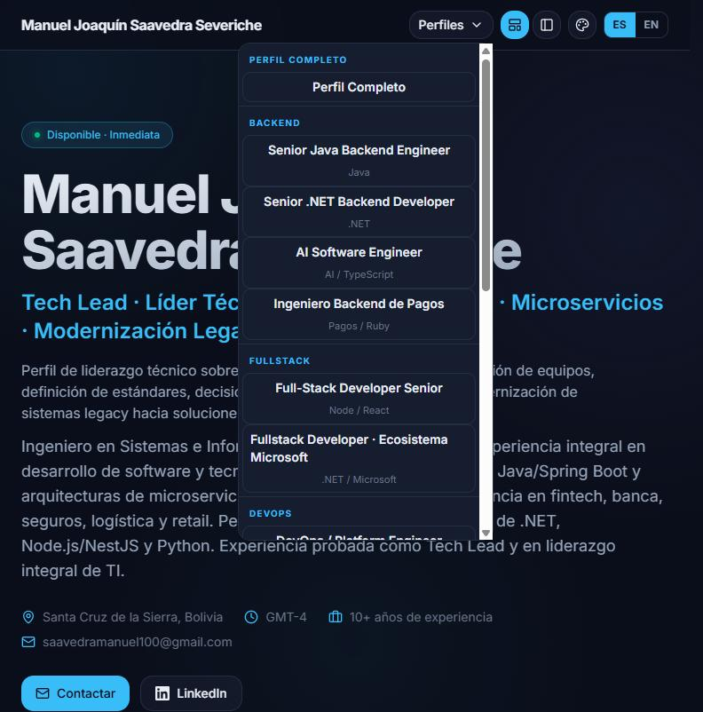
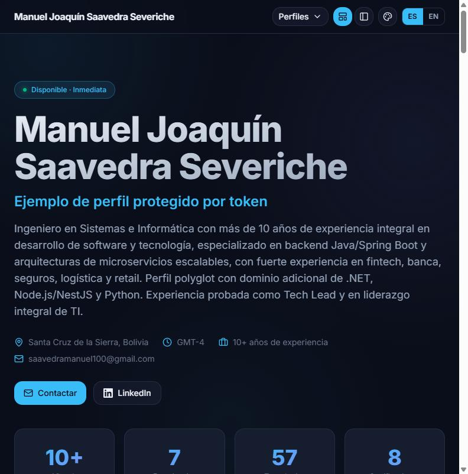
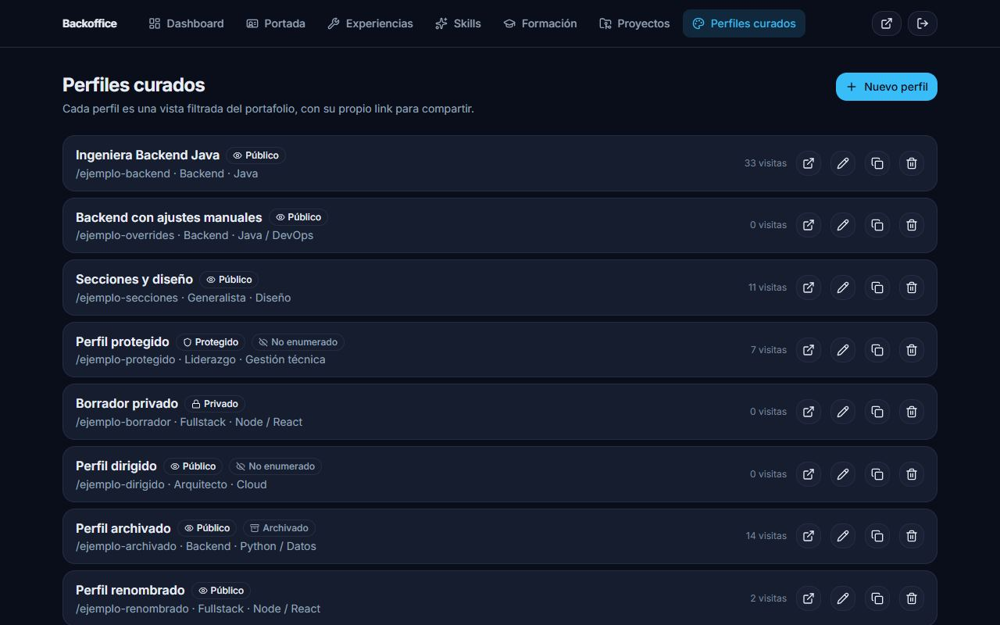
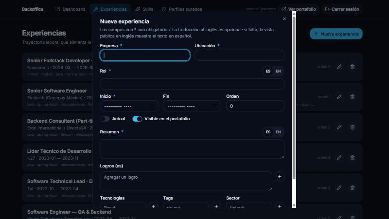
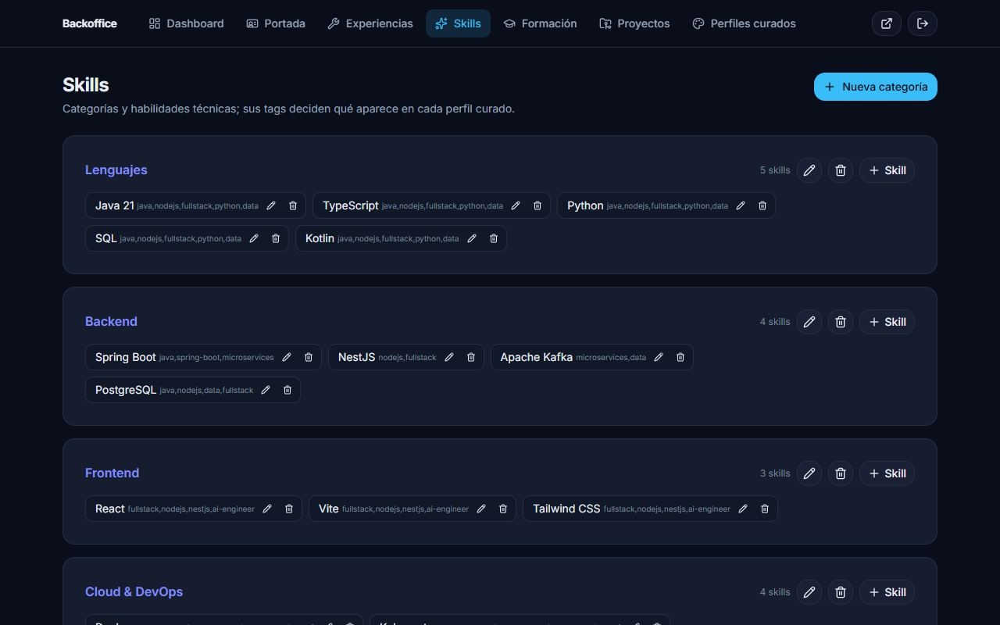

# MANUAL — Uso de la plataforma, paso a paso y con casos de prueba

> **Versión interactiva: [`manual/index.html`](manual/index.html)** — el mismo contenido con índice lateral, filtros por estado, buscador, capturas ampliables y marcas de corrida. Abrila con doble clic o publicada como artifact; este Markdown queda como la fuente en texto plano, diffeable en el repo.
>
> Guía interactiva: cada funcionalidad está escrita como un **caso de prueba funcional** con precondición, pasos, resultado esperado y evidencia. Se puede leer como manual de uso o ejecutar como suite de regresión manual antes de cada release.
>
> Para desplegar: [`DEPLOY-RAILWAY.md`](DEPLOY-RAILWAY.md) (guía corta) y [`DEPLOY.md`](DEPLOY.md) (referencia). Este documento empieza donde terminan esos.

**Leyenda de estado**

| | Significado |
|---|---|
| ✅ | Ejecutado y verificado el 4 de octubre de 2026 sobre la base del seed, con captura |
| 🔍 | Ejecutado y verificado contra la API, con la salida transcrita |
| 📝 | Documentado paso a paso; la captura de pantalla queda pendiente (ver § 6) |
| ❌ | Ejecutado y **falla**: el comportamiento real no es el esperado. Ver § 6.1 |

> El estado 📝 desapareció el 5 de octubre: todos los casos del backoffice tienen su captura.

---

## 0. Preparar el entorno

### Local

```bash
# 1. Base de datos
docker compose up -d                      # Postgres en 5434 y Adminer en 8080

# 2. Backend
cd backend
npm ci
npm run prisma:migrate                    # solo la primera vez
npm run seed && npm run seed:verify       # carga docs/cv-data.json
npm run admin:bootstrap                   # crea el administrador
npm run start:dev                         # API en http://localhost:3300

# 3. Frontend
cd ../frontend
npm ci && npm run dev                     # sitio en http://localhost:5173
```

### Puertos

| Servicio | Puerto | Cómo se cambia |
|---|---|---|
| Postgres | **5434** | `POSTGRES_PORT=5555 docker compose up -d` |
| Adminer | 8080 | `ADMINER_PORT=8081 docker compose up -d` |
| API (NestJS) | 3300 | `PORT` en `backend/.env` |
| Sitio (Vite) | 5173 | `npm run dev -- --port 5174` |

> El Postgres del portafolio **no usa el 5432** a propósito: ese puerto suele estar tomado por otro Postgres local. Si el 5434 también lo está, cambialo con `POSTGRES_PORT` y ajustá `DATABASE_URL` en `backend/.env`.

Comprobá que todo arrancó:

```bash
curl -s http://localhost:3300/health | jq
# {"status":"ok","uptime":16,"checks":{"database":{"status":"up","responseTime":12}}}
```

### Sesión para los `curl`

El panel usa una cookie httpOnly, pero la API también acepta `Authorization: Bearer`, que es más cómodo en consola:

```bash
API=http://localhost:3300          # en producción, el dominio del sitio

TOKEN=$(curl -s -X POST $API/api/auth/login \
  -H 'Content-Type: application/json' \
  -d '{"email":"tu@email.com","password":"tu-password"}' | jq -r '.accessToken')

AUTH="Authorization: Bearer $TOKEN"
curl -s $API/api/auth/me -H "$AUTH" | jq
```

> El login está limitado a **5 intentos por minuto y por IP**. Si ves un `429`, mirá el `Retry-After`.

---

## 1. Mapa de la plataforma

**Rutas públicas**

| Ruta | Qué es |
|---|---|
| `/` | La home. Es el perfil curado con slug `all` |
| `/:slug` | Un perfil curado. Ej. `/tech-lead-dotnet` |
| cualquier otra | 404 propio |
| `/robots.txt`, `/sitemap.xml` | Los genera el backend con los perfiles `PUBLIC` |

**Parámetros de URL** — viven en la URL, nunca en `localStorage`, así que se comparten:

| Parámetro | Valores | Por defecto |
|---|---|---|
| `?lang=` | `es`, `en` | `Accept-Language` y después `es`. La API también acepta `?locale=`, con prioridad |
| `?theme=` | `modern-dark`, `modern-light`, `minimal`, `elegant`, `corporate` | `modern-dark` |
| `?layout=` | `classic`, `sidebar` | `classic` |
| `?token=` | el token del perfil | — |

**Panel** — en `/admin`, detrás de la cookie de sesión:

| Ruta | Pantalla |
|---|---|
| `/admin/login` | Entrada |
| `/admin` | Dashboard de analítica |
| `/admin/experiencias` | CRUD de experiencias |
| `/admin/skills` | CRUD de categorías y skills |
| `/admin/perfiles` | Lista de perfiles curados |
| `/admin/perfiles/:id` | **El constructor**: Identidad, Selección, Diseño y Publicación, con preview en vivo |

---

## 2. Casos de la vista pública

### TC-01 — La home resuelve el perfil completo ✅

**Precondición:** base seedeada, sitio levantado.
**Pasos:** abrir `http://localhost:5173/?lang=es`.
**Resultado esperado:** se renderiza el perfil `all` con el hero, el badge de disponibilidad, los datos de contacto y la fila de métricas. El título del documento es `Perfil Completo · <nombre>`.
**Verificado:** 15 experiencias, 80 tecnologías, 8 certificaciones.


### TC-02 — El idioma se negocia y se puede forzar ✅

**Pasos:**
1. Abrir `/` sin parámetros, con el navegador en inglés.
2. Abrir `/?lang=es`.

**Resultado esperado:** sin parámetro, el contenido sale en el idioma del `Accept-Language` (acá, inglés) y el selector marca **EN**. Con `?lang=es`, todo pasa a español, incluido el título del documento (`Full Profile` → `Perfil Completo`). Los datos no se duplican: es el mismo registro resuelto en otro idioma.


### TC-03 — Un perfil curado filtra el contenido ✅

**Pasos:** abrir `/tech-lead-dotnet?lang=es`.
**Resultado esperado:** el titular pasa a ser el del perfil (`Tech Lead · Líder Técnico de Desarrollo · .NET · Microservicios · Modernización Legacy`), se antepone la descripción del perfil al resumen general, y las métricas bajan respecto de la home porque el contenido está filtrado por `filterTags`.


> **Cómo se comprueba el filtro sin mirar:** compará las métricas con las de TC-01. En un perfil con `filterTags: ["dotnet"]` se pasa de 15 experiencias y 80 tecnologías a 7 y 57.

### TC-04 — Tema y layout se cambian desde la URL ✅

**Pasos:** abrir `/tech-lead-dotnet?lang=es&theme=corporate&layout=sidebar`.
**Resultado esperado:** el preset `corporate` cambia la paleta completa en caliente, sin recargar ni reconstruir, y `sidebar` reorganiza la página en dos columnas con los datos fijos a la izquierda. Lo guardado en el perfil **no** se modifica: es una vista alternativa que se puede compartir.


### TC-05 — El menú ofrece los demás perfiles públicos ✅

**Pasos:** en cualquier vista, abrir el desplegable **Perfiles**.
**Resultado esperado:** lista todos los perfiles `PUBLIC` agrupados por `roleType` (Perfil Completo, Backend, Fullstack, DevOps…), cada uno con su `techFocus` debajo.



> **Comportamiento a tener en cuenta:** el menú se monta también en `/:slug`, así que quien recibe un link ve los otros perfiles hechos para otras vacantes. Está identificado y resuelto en el change `add-curated-profile-lifecycle` (ver `ROADMAP-1.1.md`).

### TC-06 — Un perfil protegido pide token ✅

**Precondición:** un perfil con `visibility: PROTECTED` y `accessToken`.
**Pasos:** abrir su slug sin `?token=`.
**Resultado esperado:** la API responde **401** y la vista muestra el formulario de token, sin filtrar ningún dato del perfil.


### TC-07 — Con el token correcto, el perfil resuelve ✅

**Pasos:** escribir el token y pulsar **Acceder**.
**Resultado esperado:** el token pasa a la URL como `?token=`, la API responde 200 y el perfil se renderiza. El link con el token es compartible tal cual.



### TC-08 — Un slug inexistente o privado da 404 ✅

**Pasos:** abrir `/no-existe`.
**Resultado esperado:** la API responde **404** y la vista muestra el 404 propio con el enlace al perfil completo. Un perfil `PRIVATE` responde exactamente igual: **a propósito**, para no confirmar que el slug existe.


### TC-09 — La vista funciona en móvil ✅

**Pasos:** abrir cualquier perfil con el viewport en 375×812.
**Resultado esperado:** una sola columna, el menú colapsa en hamburguesa, los selectores de tema e idioma siguen accesibles y no hay scroll horizontal.


### TC-10 — Los códigos de estado por visibilidad 🔍

**Pasos y resultado verificado:**

```bash
curl -s -o /dev/null -w '%{http_code}\n' $API/api/curated-profiles/demo-protegido
# 401   ← PROTECTED sin token

curl -s -o /dev/null -w '%{http_code}\n' "$API/api/curated-profiles/demo-protegido?token=EL-TOKEN"
# 200   ← PROTECTED con token

curl -s -o /dev/null -w '%{http_code}\n' $API/api/curated-profiles/no-existe
# 404   ← inexistente, y lo mismo devuelve un PRIVATE
```

El token también viaja en la cabecera `X-Access-Token`. En los logs el `?token=` sale **censurado**, y `Referrer-Policy: no-referrer` evita que se filtre al navegar a un enlace externo.

---

## 3. Casos del backoffice

### TC-11 — Entrar al panel ✅

**Pasos:** abrir `/admin`.
**Resultado esperado:** redirige a `/admin/login`. Tras entrar con credenciales válidas, se llega al Dashboard y se vuelve al destino original si se había pedido otra ruta.


La sesión es una cookie **httpOnly**: el cliente nunca guarda el JWT y el estado se deriva de `GET /api/auth/me`. Al expirar (`JWT_EXPIRES_IN`, por defecto `1d`), el panel vuelve al login en la siguiente petición.

### TC-12 — Crear un perfil curado para una vacante ✅

**Precondición:** sesión iniciada.
**Pasos:**
1. `/admin/perfiles` → **Nuevo perfil**.
2. Pestaña **Identidad**: `slug` en kebab-case (es la URL, y se valida), `title`, `headline` y `description` en ES y EN, `roleType` (agrupa el menú) y `techFocus`.
3. Guardar.

**Resultado esperado:** el perfil se crea y el constructor queda abierto sobre él. Un slug repetido devuelve **409**.

**Equivalente por API** 🔍:

```bash
curl -s -X POST $API/api/admin/curated-profiles -H "$AUTH" \
  -H 'Content-Type: application/json' -d '{
  "slug": "acme-tech-lead",
  "title":    { "es": "Tech Lead .NET", "en": "Tech Lead .NET" },
  "headline": { "es": "14 años construyendo y liderando equipos .NET",
                "en": "14 years building and leading .NET teams" },
  "roleType": { "es": "Tech Lead", "en": "Tech Lead" },
  "techFocus": ".NET",
  "visibility": "PRIVATE"
}' | jq '{id, slug, visibility}'
```

**Ejecutado el 5 de octubre de 2026:**

```
POST /api/admin/curated-profiles       -> 201  slug=suite-demo visibility=PRIVATE
  defaults: accentColor=#1A365D layout=classic views=0 filterTags=[]
POST con el mismo slug                 -> 409
POST con un campo fuera del DTO        -> 400
POST omitiendo "title" (obligatorio)   -> 500  ❌ antes del arreglo de D-02 — ver § 6.1
POST omitiendo "title" (obligatorio)   -> 400  ✅ después: "title should not be null or undefined"
```

> **Recomendado:** crealo `PRIVATE` y pasalo a `PUBLIC` recién cuando esté listo (TC-16). Un `PRIVATE` devuelve 404, así que nadie lo encuentra mientras lo armás.



*La lista muestra el slug, la visibilidad, la taxonomía y las visitas de cada perfil.*


*Pestaña Identidad, con la vista previa en vivo a la derecha: `12 experiencias · 10 categorías · 1 proyectos` ya filtradas.*

Los campos que no mandás toman su valor por defecto: `filterTags`, `includeIds`, `excludeIds`, `sectionsOrder` y `sectionsHidden` vacíos, `accentColor` en `#1A365D`, `layout` en `classic`, `visibility` en `PUBLIC`.

### TC-13 — Elegir qué entra con tags y overrides ✅

Tres mecanismos, en este orden:

| Mecanismo | Efecto |
|---|---|
| `filterTags` | Entra el item que comparta **al menos un** tag. **Vacío = entra todo** |
| `includeIds` | Fuerza la inclusión. Solo funciona con items **visibles** |
| `excludeIds` | Fuerza la exclusión. **Siempre gana**, incluso sobre `includeIds` |

**Pasos:** pestaña **Selección** → los tags disponibles aparecen como chips (clic para activar o desactivar) y cada experiencia tiene los botones *Incluir* y *Excluir*. El preview de la derecha se recalcula con cada clic.

**Resultado esperado:** el preview refleja el filtro. Varios clics seguidos se acumulan: cada uno parte del estado anterior, no del render inicial.

**Equivalente por API:**

```bash
ID=<id del perfil>
curl -s -X PATCH $API/api/admin/curated-profiles/$ID -H "$AUTH" \
  -H 'Content-Type: application/json' -d '{
  "filterTags": ["dotnet", "leadership"],
  "includeIds": ["<id de una experiencia que quiero sí o sí>"],
  "excludeIds": ["<id de algo que no aplica>"]
}' | jq '{filterTags, includeIds, excludeIds}'

# Ver los tags que existen:
curl -s $API/api/admin/experiences -H "$AUTH" | jq -r '[.[].tags[]] | unique | join(", ")'
```

**Ejecutado**, con dos experiencias de prueba que comparten el tag `suite-tag`, una visible y otra oculta:

```
filterTags vacío                          -> 16 experiencias (entra todo lo visible)
filterTags=[suite-tag]                    -> 1; la visible entró, la oculta no
includeIds sobre una experiencia oculta   -> no entró  (includeIds no fuerza invisibles)
mismo id en includeIds y excludeIds       -> no entró  (excludeIds siempre gana)
```

El orden de salida siempre es cronológico: `startDate` descendente, `order` ascendente como desempate. No se reordena item por item, a propósito: todos los perfiles cuentan la historia en el mismo sentido.


*Los tags activos arriba y el universo de tags disponible debajo, sacado de los datos reales. La vista previa se recalcula con cada clic.*

### TC-14 — Ordenar y ocultar secciones ✅

Las nueve secciones conocidas: `hero`, `stats`, `experience`, `skills`, `projects`, `education`, `certifications`, `presence`, `contact`.

**Pasos:** pestaña **Diseño**, bloque *Secciones*: cada fila tiene un interruptor de visibilidad y las flechas **Subir** y **Bajar**.

**Resultado esperado:** el preview respeta el orden y el ocultado. Dos reglas que conviene conocer:

- Una sección **con datos** que no figure en `sectionsOrder` **se agrega al final**. Para ocultarla hay que ponerla en `sectionsHidden`.
- Una sección **sin datos** no se renderiza aunque esté en el orden.


*Las nueve secciones con su interruptor y sus flechas. `projects` y `presence` quedan en las posiciones 8 y 9 porque el orden guardado trae solo siete.*

```bash
curl -s -X PATCH $API/api/admin/curated-profiles/$ID -H "$AUTH" \
  -H 'Content-Type: application/json' -d '{
  "sectionsOrder": ["hero", "experience", "skills", "projects", "stats", "contact"],
  "sectionsHidden": ["education", "certifications"]
}' | jq '{sectionsOrder, sectionsHidden}'
```

**Ejecutado** sobre un borrador sin proyectos ni formación que pasen el filtro:

```
sectionsOrder=[hero,experience]                        -> sections=[hero,experience]
sectionsOrder=[hero,skills,experience,contact]
            + sectionsHidden=[skills]                  -> sections=[hero,experience,contact]
                                                          hiddenSections=[skills]
```

> **Desde el change `unify-section-catalog`** el catálogo es uno solo, con **9** secciones, y el **backend** aplica el relleno: `sections` trae además, al final y en orden canónico, las secciones con datos que no figuran en `sectionsOrder` ni están ocultas. Es el orden final que se renderiza. La transcripción de arriba es anterior al change y muestra `sections` sin ese relleno. Un id fuera del catálogo en `sectionsOrder` o `sectionsHidden` ahora responde 400.

### TC-15 — Personalizar el tema ✅

**Pasos:** pestaña **Diseño**, bloque *Tema*:

1. **Tema base** — uno de los cinco presets.
2. **Colores** — ocho controles: Fondo, Fondo suave, Tarjeta, Borde, Texto, Texto tenue, Acento y Acento 2.
3. **Densidad** — Compacta, Cómoda o Amplia.
4. **Restablecer** — vuelve al preset y descarta los ajustes.

**Resultado esperado:** el preview cambia al instante, porque los tokens se aplican como variables CSS `--t-*` en el contenedor del preview, no en el documento. Y **solo se guardan las diferencias** contra el tema base, en `themeOverrides`: si mañana cambia el preset, el perfil hereda la mejora y conserva su ajuste.

```bash
curl -s $API/api/admin/themes -H "$AUTH" | jq -r '.[] | "\(.id)  \(.slug)"'

curl -s -X PATCH $API/api/admin/curated-profiles/$ID -H "$AUTH" \
  -H 'Content-Type: application/json' -d '{
  "themeId": "<id del tema base>",
  "themeOverrides": { "colors": { "accent": "#5B2C87" }, "density": "compact" }
}' | jq '{themeId, themeOverrides}'
```

**Ejecutado:**

```
GET /api/admin/themes  -> 5 temas: corporate, elegant, minimal, modern-dark, modern-light
PATCH themeOverrides   -> se guarda {"colors":{"accent":"#5B2C87"}}, solo la diferencia
```


*Tema base, los ocho colores con su valor hexadecimal, y **Restablecer** para volver al preset.*

### TC-16 — Publicar, proteger o esconder ✅

| Visibilidad | Sin token | Con token | En el sitemap |
|---|---|---|---|
| `PUBLIC` | 200 | — | **Sí** |
| `PROTECTED` | **401** | 200 | No |
| `PRIVATE` | **404** | 404 | No |

**Pasos:** pestaña **Publicación** → selector *Visibilidad*. Al elegir `PROTECTED` aparece el campo del token, que pasa a ser obligatorio. El bloque del link ofrece copiarlo y abrirlo.

```bash
# Publicar
curl -s -X PATCH $API/api/admin/curated-profiles/$ID -H "$AUTH" \
  -H 'Content-Type: application/json' -d '{"visibility":"PUBLIC"}' | jq .visibility

# Proteger con token
curl -s -X PATCH $API/api/admin/curated-profiles/$ID -H "$AUTH" \
  -H 'Content-Type: application/json' \
  -d "{\"visibility\":\"PROTECTED\",\"accessToken\":\"$(openssl rand -hex 16)\"}" | jq '{visibility, accessToken}'
```

**Ejecutado**, recorriendo las tres visibilidades sobre el mismo perfil:

```
PUBLIC    sin token -> 200
PROTECTED sin token -> 401
PROTECTED con token -> 200
PRIVATE   sin token -> 404
PRIVATE   con token -> 404   (no revela que existe)
slug inexistente    -> 404   (indistinguible del PRIVATE)
el PRIVATE figura en el sitemap -> no
```


*Visibilidad, el link público con copiar y abrir, y el contador de visitas del perfil.*

Después de proteger algo, ejecutá TC-10: es la comprobación que importa.

### TC-17 — Previsualizar sin guardar 🔍

El preview **no lo calcula el navegador**: lo resuelve el backend con el mismo servicio que la ruta pública (`CuratedProfileComposer`), para que no puedan divergir. Lo que ves es lo que verá quien reciba el link.

```bash
curl -s -X POST $API/api/admin/curated-profiles/preview -H "$AUTH" \
  -H 'Content-Type: application/json' -d '{
  "title":    { "es": "Prueba", "en": "Test" },
  "headline": { "es": "Probando filtros", "en": "Testing filters" },
  "filterTags": ["dotnet"],
  "layout": "sidebar"
}' | jq '{experiencias: (.experiences|length), skills: (.skillCategories|length), secciones: .sections}'
```

No persiste nada. Sirve para tantear un filtro antes de tocar un perfil ya publicado.

> **Cuidado con los nombres:** lo que **mandás** usa `sectionsOrder` y `sectionsHidden`; lo que **vuelve resuelto** trae `sections` (ya ordenadas y filtradas) y `hiddenSections`. Es la diferencia entre la configuración y el resultado.

### TC-18 — Medir qué pasó con los links ✅

**Pasos:** `/admin` es el dashboard.

- **Rango:** 7, 30 (por defecto), 90 días o el último año.
- **Totales:** Visitas en el rango · Perfiles vistos · Idiomas.
- **Tablas:** por día, por perfil (con enlace al constructor y a la vista pública) y por idioma.

```bash
curl -s "$API/api/admin/analytics/views?from=2026-09-01&to=2026-10-04" -H "$AUTH" | jq '{
  total,
  porPerfil: [.byProfile[] | {slug, views}],
  porIdioma: .byLocale
}'
```

**Ejecutado.** Acá apareció el defecto D-01, ya corregido:

```
views del perfil antes                 -> 2
tras 2 visitas a la ruta pública       -> 4   ✅ el contador sube
tras un preview del panel              -> 4   ✅ el preview no cuenta como visita
GET analytics/views?from=hoy&to=hoy    -> total=0   ❌ antes del arreglo; debía ser 4
GET analytics/views?from=hoy&to=hoy    -> total=4   ✅ después del arreglo
```

El contador del perfil y el registro de `ProfileView` siempre funcionaron. Lo que fallaba era el **rango** del agregado: `to` era exclusivo y el dashboard pide `[hoy-29, hoy]`, así que las visitas de hoy no aparecían nunca. Ver § 6.1.


*516 visitas en el rango, repartidas en 6 perfiles y 2 idiomas. Las tres tablas: por día, por perfil y por idioma.*

De cada visita se guarda el perfil, el idioma, la fecha y la IP **solo como HMAC** con `ANALYTICS_SALT`. No hay cookies de seguimiento. Las visitas se registran únicamente en la ruta pública, nunca en el preview, y si el registro falla la respuesta al visitante no se altera.

### TC-19 — Mantener las experiencias ✅

**Pasos:** `/admin/experiencias` → **Nueva experiencia**.

| Campo | Notas |
|---|---|
| Empresa * | plano, no se traduce |
| Ubicación * | plano |
| Rol, resumen, logros | **bilingües**, con pestañas ES y EN |
| Inicio * / Fin | si marcás *Actual*, Fin queda vacío |
| Orden | desempate cuando dos comparten `startDate` |
| Tecnologías, tags, sector | listas de chips. **Los tags son los que usa `filterTags`** |
| Visible en el portafolio | si lo apagás, no aparece en ningún perfil, ni forzándolo con `includeIds` |

```bash
curl -s -X POST $API/api/admin/experiences -H "$AUTH" \
  -H 'Content-Type: application/json' -d '{
  "company": "Acme",
  "location": "Santa Cruz, Bolivia",
  "role": { "es": "Tech Lead", "en": "Tech Lead" },
  "startDate": "2024-01",
  "current": true,
  "technologies": [".NET", "Azure"],
  "tags": ["dotnet", "leadership"],
  "visible": true
}' | jq '{id, company}'
```

**Ejecutado:**

```
POST experiencia visible                       -> 201, tags=[suite-tag]
POST experiencia oculta (visible:false)        -> 201
GET /api/experiences (público) la oculta       -> no aparece
GET /api/admin/experiences la oculta           -> sí aparece, con visible=false
POST omitiendo "summary" (obligatorio)         -> 500  ❌ antes del arreglo de D-02 — ver § 6.1
POST omitiendo "summary" (obligatorio)         -> 400  ✅ después: "summary should not be null or undefined"
```

> Un tag nuevo aparece solo como chip en el constructor de **todos** los perfiles: es la forma más rápida de abrir una dimensión de filtrado nueva.
>


*Cada fila con su empresa, periodo, tags y orden.*



*Los campos bilingües llevan su conmutador ES/EN. **Logros (es)** no lo tiene: es la limitación de abajo, a la vista.*

> **Limitación actual:** el formulario expone los logros solo en español. El inglés se conserva al guardar, pero no se puede editar desde el panel. Lo resuelve el change `add-bilingual-builder-parity`.

### TC-20 — Mantener skills y categorías ✅

**Pasos:** `/admin/skills`. Las skills viven dentro de categorías.

1. **Nueva categoría** — nombre bilingüe y orden.
2. Dentro de cada una, **Nueva skill** — nombre, tags, orden.
3. Una skill se mueve de categoría editando su campo de categoría.
4. Borrar una categoría **borra sus skills**; el panel lo confirma antes.

```bash
CAT=$(curl -s -X POST $API/api/admin/skill-categories -H "$AUTH" \
  -H 'Content-Type: application/json' \
  -d '{"name":{"es":"Plataforma","en":"Platform"},"order":5}' | jq -r .id)

curl -s -X POST $API/api/admin/skill-categories/$CAT/skills -H "$AUTH" \
  -H 'Content-Type: application/json' \
  -d '{"name":"Railway","tags":["devops","cloud"],"order":1}' | jq '{id, name}'
```

**Ejecutado:**

```
POST categoría "Suite Cat"                          -> 201
POST skill "SuiteSkill" con tags=[suite-tag]        -> 201
preview con filterTags=[suite-tag]                  -> la categoría entra por el tag de su skill
DELETE de la categoría                              -> se lleva sus skills
```



*Las skills viven dentro de categorías, y cada una lleva los tags que deciden en qué perfiles aparece.*

Una categoría entra en un perfil curado si **alguna de sus skills** comparte un tag con `filterTags`; dentro, se muestran solo las skills que pasan el filtro.

---

## 4. Lo que hoy NO se administra desde el panel

Conviene saberlo antes de necesitarlo. Estas entidades se muestran en el sitio y **solo se cargan por seed**:

| Entidad | Dónde se edita hoy |
|---|---|
| Perfil base (nombre, titular, resumen, contacto, disponibilidad) | `docs/cv-data.json` → `npm run seed` |
| Educación, certificaciones | ídem |
| Proyectos destacados, enlaces sociales | ídem |
| Temas (los cinco presets) | ídem |

```bash
# 1. Editar docs/cv-data.json
# 2. Recargar (CUIDADO: sobrescribe el contenido del portafolio)
cd backend && npm run seed && npm run seed:verify
```

> `seed` **sobrescribe**. No borra los perfiles curados creados desde el panel, pero sí reemplaza el contenido que administra. Antes de correrlo en producción, hacé el `pg_dump` del § 7 de [`DEPLOY.md`](DEPLOY.md).

Es la deuda más visible del producto y la resuelve el change `add-profile-content-admin`.

---

## 5. Operación

```bash
# ¿Vive y ve la base?
curl -s $API/health | jq            # 200, o 503 si Postgres no responde
curl -s $API/health/live            # 200 mientras viva el proceso, sin tocar la base

# Seguir un error concreto: cada respuesta de error trae requestId,
# y el mismo id está en la cabecera X-Request-Id y en el log.
curl -sD - $API/api/curated-profiles/no-existe -o /dev/null | grep -i x-request-id
```

| Situación | Qué hacer |
|---|---|
| Olvidaste la contraseña del admin | `npm run admin:bootstrap` con `ADMIN_PASSWORD` nuevo |
| Rotar el `JWT_SECRET` | cambiá la variable y redesplegá: invalida todas las sesiones |
| Un perfil quedó mal publicado | pasalo a `PRIVATE` (404 al instante) y arreglalo con calma |
| Perdiste datos | restaurá del backup — § 7 de [`DEPLOY.md`](DEPLOY.md) |
| Deploy roto | Rollback en Deployments, dentro de las 72 h del plan Hobby |

---

## 6. Suite de regresión manual

Antes de cada release, recorrer en este orden. Última ejecución completa: **5 de octubre de 2026**, contra la base del seed (14 perfiles, 15 experiencias), con la API en `localhost:3300`.

Los casos del backoffice están automatizados en [`manual/suite-backoffice.ps1`](manual/suite-backoffice.ps1): ejecuta TC-12 a TC-20 contra la API, imprime el resultado real junto al esperado y borra todos los datos de prueba que crea, pase o falle.

```bash
cd docs/manual && pwsh ./suite-backoffice.ps1
```

| # | Caso | Estado | Evidencia |
|---|---|---|---|
| TC-01 | La home resuelve el perfil completo | ✅ | captura |
| TC-02 | Idioma negociado y forzado | ✅ | captura |
| TC-03 | Un perfil curado filtra el contenido | ✅ | captura + métricas 15→7 |
| TC-04 | Tema y layout desde la URL | ✅ | captura |
| TC-05 | Menú de perfiles públicos | ✅ | captura |
| TC-06 | Perfil protegido pide token | ✅ | captura |
| TC-07 | Token correcto resuelve el perfil | ✅ | captura |
| TC-08 | Slug inexistente o privado da 404 | ✅ | captura |
| TC-09 | Vista móvil | ✅ | captura |
| TC-10 | Códigos de estado por visibilidad | 🔍 | 401 / 200 / 404 |
| TC-11 | Entrar al panel | ✅ | captura del login |
| TC-12 | Crear un perfil curado | ✅ | 2 capturas · 201 / 409 / 400 (D-02 corregido) |
| TC-13 | Tags y overrides | ✅ | captura · los cuatro casos del filtro |
| TC-14 | Ordenar y ocultar secciones | ✅ | captura · orden y ocultado resueltos |
| TC-15 | Personalizar el tema | ✅ | captura · solo se guarda la diferencia |
| TC-16 | Publicar, proteger, esconder | ✅ | captura · la tabla completa de visibilidad |
| TC-17 | Previsualizar sin guardar | 🔍 | no persiste nada |
| TC-18 | Dashboard de analítica | ✅ | captura previa al arreglo · el contador sube y el rango incluye hoy (D-01 corregido, verificado en e2e) |
| TC-19 | Mantener experiencias | ✅ | 2 capturas · visible / oculta (D-02 corregido) |
| TC-20 | Mantener skills | ✅ | captura · la categoría entra por el tag de su skill |

**Los 20 casos pasan, y los 20 tienen evidencia.** 20 capturas en `docs/manual/` más las transcripciones de la API. La captura de TC-18 es anterior al arreglo de D-01 y todavía muestra el dashboard en cero: se renueva en la próxima ejecución con sesión iniciada.

### 6.1 Defectos encontrados al ejecutar la suite

Los dos aparecieron al ejecutar estos casos por primera vez de punta a punta. Ninguno estaba reportado. **Los dos están corregidos**; quedan documentados acá porque la suite los sigue cubriendo.

#### D-01 — El dashboard nunca muestra las visitas de hoy — ✅ corregido

**Severidad:** alta, visible para el usuario.
**Síntoma:** se compartía un link, alguien lo abría, y el dashboard seguía en cero hasta el día siguiente.
**Causa:** el parámetro `to` de `GET /api/admin/analytics/views` se interpretaba como un instante, así que `to=2026-10-05` era la medianoche de ese día. `frontend/src/features/backoffice/dashboard/ranges.ts` documenta y construye un **rango cerrado** `[hoy - (días - 1), hoy]`, de modo que el `to = hoy` del panel dejaba fuera el día en curso.

```
GET /api/admin/analytics/views?from=2026-10-05&to=2026-10-05  -> total=0    (antes)
GET /api/admin/analytics/views?from=2026-10-05&to=2026-10-06  -> total=13, byDay={2026-10-05:13}
```

**Arreglo aplicado:** el rango pasó a ser cerrado en la API, que es lo que describe la spec `admin-analytics-dashboard` y lo que el panel ya asumía. Una fecha sin hora se resuelve al borde del día en UTC — inicio para `from`, último milisegundo para `to` —; un instante completo (`2026-10-05T14:30:00Z`) se respeta tal cual, para poder pedir ventanas más finas que un día. La decisión vive en un servicio puro, `backend/src/modules/analytics/domain/services/range-boundaries.ts`, y el controller la usa en lugar de llamar a `new Date()` directamente. Se descartó la alternativa de que el frontend mandara `to = mañana`, porque deja la API mintiendo sobre su propio contrato.

**Regresión:** `range-boundaries.spec.ts` cubre los bordes del parseo, y `admin.e2e-spec.ts` agrega el caso de punta a punta — una visita nueva aparece en `?from=hoy&to=hoy`. Sin el arreglo ese caso da `total=0`. La descripción del endpoint en Swagger ahora dice que el rango es cerrado, así que `openapi.json` y los tipos del frontend se regeneraron.

#### D-02 — Omitir un objeto obligatorio devuelve 500 en lugar de 400 — ✅ corregido

**Severidad:** media; solo afecta endpoints autenticados del panel.
**Síntoma:** un cuerpo al que le falta un campo obligatorio anidado respondía `500 Error interno del servidor` en vez de un 400 que dijera qué falta.
**Causa:** los campos obligatorios de tipo objeto se declaran con `@ValidateNested()` + `@Type()` pero **sin `@IsDefined()`**. `class-validator` no valida un valor `undefined`, así que la validación pasa y el mapper revienta con `TypeError: Cannot read properties of undefined (reading 'en')`.

**Arreglo aplicado:** `@IsDefined()` en los cinco campos obligatorios de tipo objeto que había en los DTO de entrada — `role` y `summary` de `CreateExperienceDto`, `title` y `headline` de `CreateCuratedProfileDto`, y `name` de `CreateSkillCategoryDto`. Los `Update*Dto` heredan por `PartialType`, que inyecta `@IsOptional()` y corta la cadena antes de `@IsDefined()`: los PATCH parciales siguen funcionando igual. `openapi.json` no cambia, porque la obligatoriedad en Swagger ya venía de `@ApiProperty`.

Las mismas cinco variantes, tras el arreglo:

```
POST /api/admin/experiences       sin "summary"  -> 400  ["summary should not be null or undefined"]
POST /api/admin/experiences       sin "role"     -> 400  ["role should not be null or undefined"]
POST /api/admin/curated-profiles  sin "title"    -> 400  ["title should not be null or undefined"]
POST /api/admin/curated-profiles  sin "headline" -> 400  ["headline should not be null or undefined"]
POST /api/admin/skill-categories  sin "name"     -> 400  ["name should not be null or undefined"]
POST /api/admin/experiences       completo       -> 201  (control)
```

**Regresión:** `backend/test/dto-validation.spec.ts` corre `class-validator` sobre cada DTO de entrada con las mismas opciones que `adminValidationPipe` y exige un error por cada campo obligatorio — con el cuerpo vacío, con el campo ausente y con el campo en `null` — más un control con el cuerpo completo. Es un test de comportamiento en vez del test estático que se había propuesto: no depende de qué decorador arregle el problema y cubre todos los campos obligatorios, no solo los anidados. Sin los `@IsDefined()` fallan 8 de sus 34 casos.

---

## 7. Receta completa: de la vacante al link, en 6 llamadas

```bash
# 1. Crear en privado
ID=$(curl -s -X POST $API/api/admin/curated-profiles -H "$AUTH" -H 'Content-Type: application/json' -d '{
  "slug":"acme-tech-lead",
  "title":{"es":"Tech Lead .NET","en":"Tech Lead .NET"},
  "headline":{"es":"14 años en .NET y liderazgo","en":"14 years in .NET and leadership"},
  "roleType":{"es":"Tech Lead","en":"Tech Lead"},"techFocus":".NET","visibility":"PRIVATE"}' | jq -r .id)

# 2. Ver qué tags hay
curl -s $API/api/admin/experiences -H "$AUTH" | jq -r '[.[].tags[]]|unique|join(", ")'

# 3. Probar el filtro sin tocar nada
curl -s -X POST $API/api/admin/curated-profiles/preview -H "$AUTH" -H 'Content-Type: application/json' \
  -d '{"title":{"es":"x","en":"x"},"headline":{"es":"x","en":"x"},"filterTags":["dotnet"]}' \
  | jq '.experiences | length'

# 4. Aplicar filtro, secciones y tema
curl -s -X PATCH $API/api/admin/curated-profiles/$ID -H "$AUTH" -H 'Content-Type: application/json' -d '{
  "filterTags":["dotnet","leadership"],
  "sectionsOrder":["hero","experience","skills","projects","contact"],
  "sectionsHidden":["education"],
  "themeOverrides":{"colors":{"accent":"#5B2C87"}},
  "layout":"sidebar"}' > /dev/null

# 5. Publicar
curl -s -X PATCH $API/api/admin/curated-profiles/$ID -H "$AUTH" -H 'Content-Type: application/json' \
  -d '{"visibility":"PUBLIC"}' | jq .visibility

# 6. Comprobar y compartir
curl -s -o /dev/null -w '%{http_code}\n' $API/api/curated-profiles/acme-tech-lead
echo "$SITIO/acme-tech-lead"
```

---

## 8. Qué falla y por qué

| Síntoma | Causa |
|---|---|
| `401` en todo el panel | la cookie expiró, o `JWT_SECRET` cambió. Volvé a entrar |
| `429` al entrar | 5 intentos por minuto y por IP. Esperá el `Retry-After` |
| El perfil ignora un `includeIds` | la experiencia tiene `visible: false`. `includeIds` solo fuerza items visibles |
| Una sección aparece aunque no la puse en el orden | tiene datos: se agrega al final. Para ocultarla, `sectionsHidden` |
| Una sección no aparece aunque la puse | no tiene datos que pasen el filtro |
| `400` al crear un perfil | campo de más o faltante: el pipe rechaza lo que no está en el DTO. El mensaje dice cuál |
| `409` al crear un perfil | el `slug` ya existe |
| El `?token=` no funciona | el perfil es `PRIVATE`, no `PROTECTED`. `PRIVATE` siempre da 404 |
| La vista previa en LinkedIn es genérica | el borde no insertó el head del perfil: la API no respondió en 500 ms y el sitio degradó al genérico, o el perfil no es `PUBLIC` (a propósito: `PROTECTED` y `PRIVATE` nunca exponen sus textos). Comprobar con `curl -s <sitio>/<slug> \| grep og:title`. La imagen es la misma para todos los perfiles; una por vacante quedó fuera del change `add-server-rendered-head` |
| El nuevo perfil no está en el sitemap | solo entran los `PUBLIC` |
