# MANUAL — Uso de la plataforma, paso a paso y con casos de prueba

> **Versión interactiva: [`manual/index.html`](manual/index.html)** — el mismo contenido con índice lateral, filtros por estado, buscador, capturas ampliables y marcas de corrida. Abrila con doble clic o publicada como artifact; este Markdown queda como la fuente en texto plano, diffeable en el repo.
>
> Guía interactiva: cada funcionalidad está escrita como un **caso de prueba funcional** con precondición, pasos, resultado esperado y evidencia. Se puede leer como manual de uso o ejecutar como suite de regresión manual antes de cada release.
>
> Para desplegar: [`DEPLOY-RAILWAY.md`](DEPLOY-RAILWAY.md) (guía corta) y [`DEPLOY.md`](DEPLOY.md) (referencia). Este documento empieza donde terminan esos.

**Leyenda de estado**

| | Significado |
|---|---|
| ✅ | Ejecutado y verificado el 4 de octubre de 2026 sobre la base del seed, con captura |
| 🔍 | Ejecutado y verificado contra la API, con la salida transcrita |
| 📝 | Documentado paso a paso; la captura de pantalla queda pendiente (ver § 6) |
| ❌ | Ejecutado y **falla**: el comportamiento real no es el esperado. Ver § 6.1 |

> El estado 📝 desapareció el 5 de octubre: todos los casos del backoffice tienen su captura.

---

## 0. Preparar el entorno

### Local

```bash
# 1. Base de datos
docker compose up -d                      # Postgres en 5434 y Adminer en 8080

# 2. Backend
cd backend
npm ci
npm run prisma:migrate                    # solo la primera vez
npm run seed && npm run seed:verify       # carga docs/cv-data.json
npm run admin:bootstrap                   # crea el administrador
npm run start:dev                         # API en http://localhost:3300

# 3. Frontend
cd ../frontend
npm ci && npm run dev                     # sitio en http://localhost:5173
```

### Puertos

| Servicio | Puerto | Cómo se cambia |
|---|---|---|
| Postgres | **5434** | `POSTGRES_PORT=5555 docker compose up -d` |
| Adminer | 8080 | `ADMINER_PORT=8081 docker compose up -d` |
| API (NestJS) | 3300 | `PORT` en `backend/.env` |
| Sitio (Vite) | 5173 | `npm run dev -- --port 5174` |

> El Postgres del portafolio **no usa el 5432** a propósito: ese puerto suele estar tomado por otro Postgres local. Si el 5434 también lo está, cambialo con `POSTGRES_PORT` y ajustá `DATABASE_URL` en `backend/.env`.

Comprobá que todo arrancó:

```bash
curl -s http://localhost:3300/health | jq
# {"status":"ok","uptime":16,"checks":{"database":{"status":"up","responseTime":12}}}
```

### Sesión para los `curl`

El panel usa una cookie httpOnly, pero la API también acepta `Authorization: Bearer`, que es más cómodo en consola:

```bash
API=http://localhost:3300          # en producción, el dominio del sitio

TOKEN=$(curl -s -X POST $API/api/auth/login \
  -H 'Content-Type: application/json' \
  -d '{"email":"tu@email.com","password":"tu-password"}' | jq -r '.accessToken')

AUTH="Authorization: Bearer $TOKEN"
curl -s $API/api/auth/me -H "$AUTH" | jq
```

> El login está limitado a **5 intentos por minuto y por IP**. Si ves un `429`, mirá el `Retry-After`.

---

## 1. Mapa de la plataforma

**Rutas públicas**

| Ruta | Qué es |
|---|---|
| `/` | La home. Es el perfil curado con slug `all` |
| `/:slug` | Un perfil curado. Ej. `/tech-lead-dotnet` |
| cualquier otra | 404 propio |
| `/robots.txt`, `/sitemap.xml` | Los genera el backend con los perfiles `PUBLIC` |

**Parámetros de URL** — viven en la URL, nunca en `localStorage`, así que se comparten:

| Parámetro | Valores | Por defecto |
|---|---|---|
| `?lang=` | `es`, `en` | `Accept-Language` y después `es`. La API también acepta `?locale=`, con prioridad |
| `?theme=` | `modern-dark`, `modern-light`, `minimal`, `elegant`, `corporate` | `modern-dark` |
| `?layout=` | `classic`, `sidebar` | `classic` |
| `?token=` | el token del perfil | — |

**Panel** — en `/admin`, detrás de la cookie de sesión:

| Ruta | Pantalla |
|---|---|
| `/admin/login` | Entrada |
| `/admin` | Dashboard de analítica, con la tabla **Por origen** |
| `/admin/portada` | Perfil base (titular, resumen, contacto, disponibilidad) e idiomas, con vista previa del hero |
| `/admin/experiencias` | CRUD de experiencias |
| `/admin/skills` | CRUD de categorías y skills |
| `/admin/formacion` | Educación y certificaciones |
| `/admin/proyectos` | Proyectos destacados y enlaces sociales |
| `/admin/perfiles` | Lista de perfiles curados |
| `/admin/perfiles/:id` | **El constructor**: Identidad, Selección, Diseño y Publicación, con preview en vivo |

---

## 2. Casos de la vista pública

### TC-01 — La home resuelve el perfil completo ✅

**Precondición:** base seedeada, sitio levantado.
**Pasos:** abrir `http://localhost:5173/?lang=es`.
**Resultado esperado:** se renderiza el perfil `all` con el hero, el badge de disponibilidad, los datos de contacto y la fila de métricas. El título del documento es `Perfil Completo · <nombre>`.
**Verificado:** 15 experiencias, 80 tecnologías, 8 certificaciones.


### TC-02 — El idioma se negocia y se puede forzar ✅

**Pasos:**
1. Abrir `/` sin parámetros, con el navegador en inglés.
2. Abrir `/?lang=es`.

**Resultado esperado:** sin parámetro, el contenido sale en el idioma del `Accept-Language` (acá, inglés) y el selector marca **EN**. Con `?lang=es`, todo pasa a español, incluido el título del documento (`Full Profile` → `Perfil Completo`). Los datos no se duplican: es el mismo registro resuelto en otro idioma.

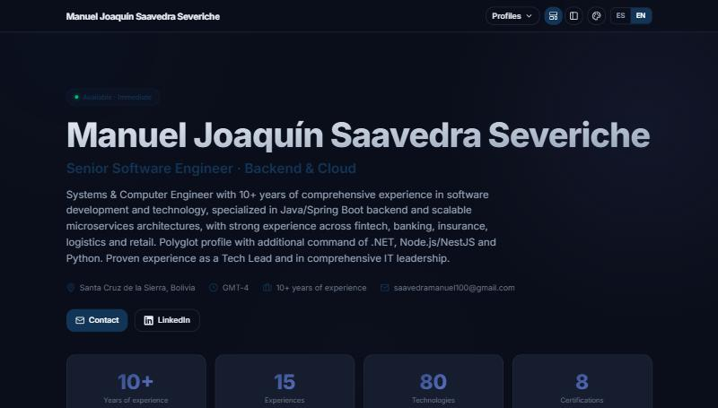

### TC-03 — Un perfil curado filtra el contenido ✅

**Pasos:** abrir `/tech-lead-dotnet?lang=es`.
**Resultado esperado:** el titular pasa a ser el del perfil (`Tech Lead · Líder Técnico de Desarrollo · .NET · Microservicios · Modernización Legacy`), se antepone la descripción del perfil al resumen general, y las métricas bajan respecto de la home porque el contenido está filtrado por `filterTags`.

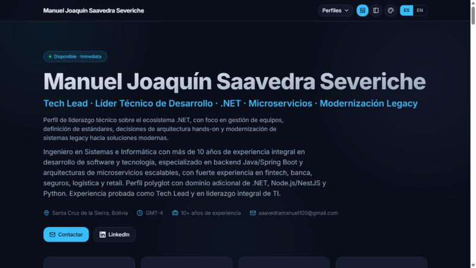

> **Cómo se comprueba el filtro sin mirar:** compará las métricas con las de TC-01. En un perfil con `filterTags: ["dotnet"]` se pasa de 15 experiencias y 80 tecnologías a 7 y 57.

### TC-04 — Tema y layout se cambian desde la URL ✅

**Pasos:** abrir `/tech-lead-dotnet?lang=es&theme=corporate&layout=sidebar`.
**Resultado esperado:** el preset `corporate` cambia la paleta completa en caliente, sin recargar ni reconstruir, y `sidebar` reorganiza la página en dos columnas con los datos fijos a la izquierda. Lo guardado en el perfil **no** se modifica: es una vista alternativa que se puede compartir.

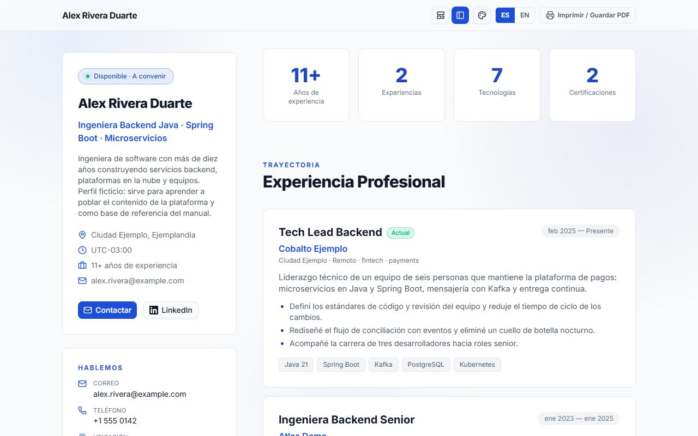

### TC-05 — El menú ofrece los demás perfiles, solo en la home ✅

**Pasos:** en la home (`/`), abrir el desplegable **Perfiles**. Después abrir un perfil por su link, por ejemplo `/tech-lead-dotnet`.
**Resultado esperado:** en la home, el menú lista los perfiles públicos, enumerados y no archivados, agrupados por `roleType` (Perfil Completo, Backend, Fullstack, DevOps…), cada uno con su `techFocus` debajo. En `/:slug` **no hay menú**: quien recibe un link no ve los otros perfiles hechos para otras vacantes.


*El desplegable abierto en la home, agrupado por tipo de rol. Capturada el 8 de octubre de 2026; en la misma ejecución, `/tech-lead-dotnet` no tenía el botón **Perfiles**.*

> Desde el change `add-curated-profile-lifecycle` el menú solo se monta en la home. La captura del perfil sin menú está en `openspec/changes/archive/*-add-curated-profile-lifecycle/verification/05-perfil-sin-menu.png`.

### TC-06 — Un perfil protegido pide token ✅

**Precondición:** un perfil con `visibility: PROTECTED` y `accessToken`.
**Pasos:** abrir su slug sin `?token=`.
**Resultado esperado:** la API responde **401** y la vista muestra el formulario de token, sin filtrar ningún dato del perfil.


### TC-07 — Con el token correcto, el perfil resuelve ✅

**Pasos:** escribir el token y pulsar **Acceder**.
**Resultado esperado:** el token pasa a la URL como `?token=`, la API responde 200 y el perfil se renderiza. El link con el token es compartible tal cual.


### TC-08 — Un slug inexistente o privado da 404 ✅

**Pasos:** abrir `/no-existe`.
**Resultado esperado:** la API responde **404** y la vista muestra el 404 propio con el enlace al perfil completo. Un perfil `PRIVATE` responde exactamente igual: **a propósito**, para no confirmar que el slug existe.

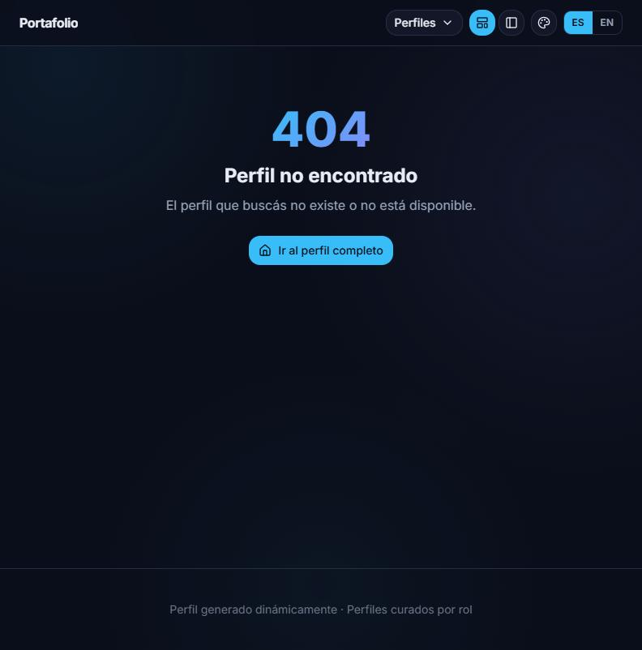

### TC-09 — La vista funciona en móvil ✅

**Pasos:** abrir cualquier perfil con el viewport en 375×812.
**Resultado esperado:** una sola columna, el menú colapsa en hamburguesa, los selectores de tema e idioma siguen accesibles y no hay scroll horizontal.

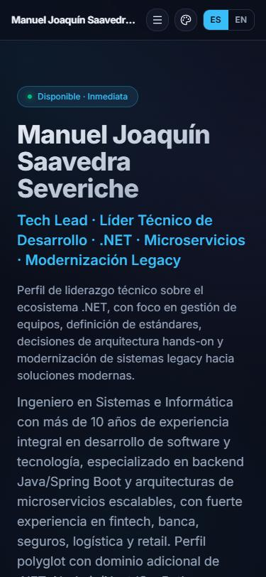

### TC-10 — Los códigos de estado por visibilidad 🔍

**Pasos y resultado verificado:**

```bash
curl -s -o /dev/null -w '%{http_code}\n' $API/api/curated-profiles/demo-protegido
# 401   ← PROTECTED sin token

curl -s -o /dev/null -w '%{http_code}\n' "$API/api/curated-profiles/demo-protegido?token=EL-TOKEN"
# 200   ← PROTECTED con token

curl -s -o /dev/null -w '%{http_code}\n' $API/api/curated-profiles/no-existe
# 404   ← inexistente, y lo mismo devuelve un PRIVATE
```

El token también viaja en la cabecera `X-Access-Token`. En los logs el `?token=` sale **censurado**, y `Referrer-Policy: no-referrer` evita que se filtre al navegar a un enlace externo.

### TC-31 — Imprimir un perfil en una hoja 🔍

**Precondición:** base seedeada, sitio levantado, Chrome (y Firefox para el paso 6).
**Pasos:**
1. Abrir `/tech-lead-dotnet` y, **sin hacer scroll**, apretar **Ctrl+P**.
2. En el diálogo: papel **A4**, márgenes por defecto, **Encabezados y pies de página desactivados** y **Gráficos de fondo desactivados**.
3. Cerrar el diálogo y repetir con el botón **Imprimir / Guardar PDF** de la barra superior.
4. Repetir con `?lang=en`, con `?theme=modern-dark&layout=sidebar` y con papel **Letter**.
5. Guardar como PDF y abrirlo: los enlaces (email, LinkedIn, la URL del pie) son clicables.
6. Repetir el paso 2 en Firefox.

**Resultado esperado:** una sola hoja, con texto oscuro sobre blanco aunque el tema sea oscuro (también con *Gráficos de fondo* activado: la página sigue blanca), el nombre visible y el orden de secciones del perfil. Sin barra superior, selectores ni pie del sitio. Lo que no entró dice *"y N experiencias más"* (*"and N more roles"* en inglés) y el pie trae **Versión completa** con la URL del perfil, que no lleva `token`, `theme` ni `layout`. En la pantalla del token de un perfil `PROTECTED` el botón no aparece. Imprimir no hace ninguna petición ni suma una visita al perfil.

`print:check` automatiza esto en Chrome, sin el diálogo: genera el PDF de cada perfil público y de `all`, en `es` y `en`, en A4 y Letter, con el tema del perfil y con `?theme=modern-dark&layout=sidebar`, cuenta las páginas y mide el contraste. Sale con código 1 si algún caso pasa de una hoja o contrasta menos de 4,5:1.

Requiere `PRINT_CHECK_DISPOSABLE_DB=1`, que confirma que la API apunta a una base descartable: cada caso registra una visita y, contra una base real, ensucia la analítica; sin la variable el script sale con código 2. La API tiene que apuntar a una base descartable (p. ej. `portfolio_print_check`, con migraciones y seed).

```bash
cd frontend
npm run dev                       # y la API en el 3300
PRINT_CHECK_DISPOSABLE_DB=1 PRINT_CHECK_TOKENS=slug=token npm run print:check   # el token es opcional (perfiles PROTECTED)
```

**Verificado:** 56 casos (14 perfiles × `es`/`en` × 2 temas) con una página en A4 y en Letter y un contraste mínimo de 9,7:1. El detalle y los PDF están en el archivo del change `add-printable-one-page`. Los pasos con el diálogo de impresión y Firefox son manuales.

### TC-32 — El nivel del idioma en los dos idiomas ✅

**Precondición:** base seedeada, sitio y API levantados, sesión iniciada en `/admin`.
**Pasos:**
1. `/admin/portada` → **Idiomas** → editar *Inglés*. El **Nivel** tiene pestañas ES/EN, como el detalle: el español es obligatorio y el inglés opcional. Un nivel legado (texto plano, p. ej. `C1`) se abre en ES con EN vacío.
2. En la pestaña EN escribir *B1-B2 (working proficiency)* y **Guardar**. Recargar y reabrir: ES y EN se conservan.
3. Abrir `/?lang=en`: el contacto dice *English · B1-B2 (working proficiency)*; con `?lang=es` dice el español. La vista de impresión (Ctrl+P o **Imprimir / Guardar PDF**) muestra lo mismo, porque lee el texto ya resuelto.
4. Vaciar el inglés del nivel y guardar. En el constructor (`/admin/perfiles/<id>` → **Publicación**), con la vista previa en EN, el aviso de faltantes dice *Idiomas — Inglés: Nivel*. Es solo un aviso: se puede guardar y publicar igual, y en inglés el nivel sale en español.

**Resultado esperado:** con el seed, `/?lang=en` muestra *Spanish · Native* y *English · B1-B2*, y `/?lang=es` muestra *Español · Nativo*. Una base migrada desde la anterior queda igual (la migración `localize_language_level` convierte `Nativo` en `{ es: "Nativo", en: "Native" }`).

```bash
curl -s "$API/api/profile?lang=en" | jq '.languages[] | {name, level}'
curl -s "$API/api/curated-profiles/all?lang=es" | jq '.profile.languages[0].level'
curl -s $API/api/admin/languages -H "$AUTH" | jq '.[0].level'            # crudo: { es, en }
curl -s -X POST $API/api/admin/languages -H "$AUTH" -H 'Content-Type: application/json' \
  -d '{"name":"X","level":"B2"}'                                            # 400: level debe ser { es, en? }
```

**Ejecutado** (10 de octubre de 2026, contra una copia de la base de desarrollo, `portfolio_levelfix`, con la API en el 3300 y el panel en el 5173; transcripción en `openspec/changes/localize-language-level/verification/6.2-api.txt` y `6.3-app-real.txt`):

```
GET /api/curated-profiles/all?lang=en            -> languages[0] = Spanish · Native
GET /api/curated-profiles/all?lang=es            -> languages[0] = Español · Nativo
GET /api/curated-profiles/tech-lead-dotnet?lang=en -> Spanish · Native
POST /api/admin/languages  level: "B2"           -> 400 (level must be an object)
Portada: EN del nivel -> guardar -> recargar     -> ES="B1-B2" EN="B1-B2 (working proficiency)"
Constructor, vista previa en EN, nivel sin inglés -> "Falta 1 traducción en EN · Idiomas · Inglés: Nivel"
```

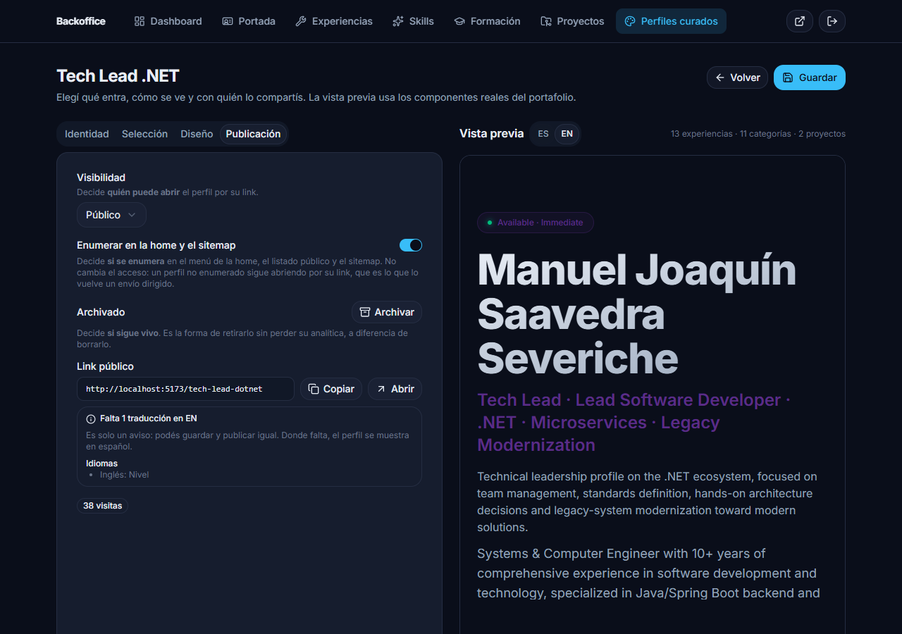

### TC-33 — Navegación por teclado y foco visible ✅

**Precondición:** base seedeada, sitio levantado, Chrome; para los pasos 4 y 5, sesión iniciada en `/admin`.
**Pasos:**
1. Abrir `/tech-lead-dotnet` y, sin tocar el mouse, apretar **Tab**: lo primero que aparece es **Saltar al contenido** (*Skip to content* con `?lang=en`). Con **Enter** el foco pasa al contenido; el siguiente Tab cae en el primer control del hero, no en la barra superior.
2. Volver a empezar y recorrer con Tab la barra (marca, menú de perfiles, diseño, tema, idioma, imprimir) y el hero. Cada control muestra un contorno **sólido de 2 px**, separado del borde, del color de acento legible del tema. Repetir con `?theme=modern-light` y `?theme=modern-dark`.
3. En la home, abrir con **Enter** el menú de perfiles y el selector de tema (en móvil, el menú lateral): el foco entra, **Escape** cierra y el foco vuelve al botón.
4. En `/admin`: el primer Tab es **Saltar al contenido**; con Enter, el siguiente Tab entra al contenido de la pantalla y no al menú lateral.
5. En `/admin/experiencias` abrir **Nueva experiencia** con Enter y cerrar con **Escape**: el foco vuelve al botón. En `/admin/portada` cambiar un campo de ES a EN con las pestañas: el campo y su etiqueta siguen al idioma.
6. En Chrome → DevTools → *Rendering* → *Emulate CSS media feature prefers-reduced-motion: reduce*, activar el salto: el desplazamiento no es animado.

**Resultado esperado:** el foco nunca queda invisible ni se pierde (tampoco al cerrar un diálogo), y el salto lleva siempre al `<main>`. Con `prefers-reduced-motion: reduce` el documento tiene `scroll-behavior: auto`.

`a11y:check` automatiza los pasos 1 y 2 en la home y en dos perfiles (primer Tab en el salto, Enter enfoca `<main id="contenido">`, el contorno de cada control alcanzado con Tab mide ≥ 3:1 contra el fondo) y los pasos 4 y 5 en el panel; los menús y los diálogos se recorrieron con Chrome controlado por `puppeteer-core`.

**Ejecutado** (15 de octubre de 2026, contra la imagen de producción de `frontend/Dockerfile` y una base descartable):

```
Tab 1 en /tech-lead-dotnet            -> "Skip to content" / "Saltar al contenido"
Enter                                 -> document.activeElement = main#contenido
Menú de perfiles, tema, Sheet móvil   -> foco adentro; Escape devuelve el foco al botón
Nueva experiencia / categoría / proyecto + Escape -> el foco vuelve al botón (antes: <body>)
prefers-reduced-motion: reduce        -> scroll-behavior: auto
```

### TC-34 — Contraste con un acento oscuro ✅

**Precondición:** base seedeada, sitio levantado, sesión iniciada en `/admin` para el paso 4.
**Pasos:**
1. Abrir `/tech-lead-dotnet` (`themeOverrides.colors.accent = #5B2C87`, 1,72:1 contra la tarjeta de `modern-dark`). El titular del hero, el *eyebrow* de cada sección y las etiquetas del menú se leen: tienen el **tono** del acento, más claro.
2. El botón *Contactar* conserva el relleno `#5B2C87` con texto blanco. Repetir con `/software-architect` (`#1E293B`, 1,15:1).
3. Abrir `/tech-lead-dotnet?theme=modern-light`: el botón primario lleva texto oscuro (4,70:1) y no blanco (4,10:1).
4. En `/admin/perfiles/<id>` → **Diseño**, elegir como acento `#1E293B`: en la vista previa se lee como texto. Guardar y reabrir: lo guardado es `#1E293B`, el color elegido, no el derivado.

**Resultado esperado:** ningún texto del sitio baja de 4,5:1 contra su fondo, con ningún preset ni con los acentos de los 14 perfiles; el dato guardado no cambia. Medido sobre los tokens (`css-vars` y su spec) y sobre el sitio (axe, `a11y:check`):

| Acento | Como texto antes | `--t-accent-ink` | Como texto después |
|---|---|---|---|
| `#5B2C87` (tech-lead-dotnet) | 1,72:1 | `#a575d2` | 4,86:1 |
| `#1E293B` (software-architect) | 1,15:1 | `#6c87b4` | 4,61:1 |
| `#0078D4` (devops-azure y dos más) | 3,71:1 | `#008ffd` | 5,08:1 |
| `#38bdf8` (all, modern-dark) | 7,85:1 | `#38bdf8` | 7,85:1 (sin cambio) |
| `#0284c7` (modern-light) | 3,74:1 | `#0270a9` | 4,92:1 |

El texto atenuado (`text-dim`) pasó de 3,5–4,0:1 a ≥ 4,5:1 en los cinco presets.

**Ejecutado** (15 de octubre de 2026): `a11y:check` sobre la home, cada preset × layout, `?lang=en`, los 13 perfiles con acento bajo y el panel: 0 violaciones en 72 cargas. Antes: 1376 nodos de `color-contrast` en las vistas de perfil y 420 en el panel.

---

## 3. Casos del backoffice

### TC-11 — Entrar al panel ✅

**Pasos:** abrir `/admin`.
**Resultado esperado:** redirige a `/admin/login`. Tras entrar con credenciales válidas, se llega al Dashboard y se vuelve al destino original si se había pedido otra ruta.

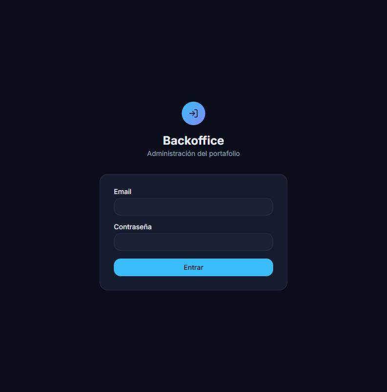

La sesión es una cookie **httpOnly**: el cliente nunca guarda el JWT y el estado se deriva de `GET /api/auth/me`. Al expirar (`JWT_EXPIRES_IN`, por defecto `1d`), el panel vuelve al login en la siguiente petición.

### TC-12 — Crear un perfil curado para una vacante ✅

**Precondición:** sesión iniciada.
**Pasos:**
1. `/admin/perfiles` → **Nuevo perfil**.
2. Pestaña **Identidad**: `slug` en kebab-case (es la URL, y se valida), `title`, `headline` (opcional: vacío usa el titular del perfil base) y `description` en ES y EN, `roleType` (agrupa el menú) y `techFocus`.
3. Guardar.

**Resultado esperado:** el perfil se crea y el constructor queda abierto sobre él. Un slug repetido devuelve **409**.

**Equivalente por API** 🔍:

```bash
curl -s -X POST $API/api/admin/curated-profiles -H "$AUTH" \
  -H 'Content-Type: application/json' -d '{
  "slug": "acme-tech-lead",
  "title":    { "es": "Tech Lead .NET", "en": "Tech Lead .NET" },
  "headline": { "es": "14 años construyendo y liderando equipos .NET",
                "en": "14 years building and leading .NET teams" },
  "roleType": { "es": "Tech Lead", "en": "Tech Lead" },
  "techFocus": ".NET",
  "visibility": "PRIVATE"
}' | jq '{id, slug, visibility}'
```

**Ejecutado el 5 de octubre de 2026:**

```
POST /api/admin/curated-profiles       -> 201  slug=suite-demo visibility=PRIVATE
  defaults: layout=classic views=0 filterTags=[]
POST con el mismo slug                 -> 409
POST con un campo fuera del DTO        -> 400
POST omitiendo "title" (obligatorio)   -> 500  ❌ antes del arreglo de D-02 — ver § 6.1
POST omitiendo "title" (obligatorio)   -> 400  ✅ después: "title should not be null or undefined"
POST con accentColor                   -> 400  campo retirado (retire-accent-color)
```

> **Recomendado:** crealo `PRIVATE` y pasalo a `PUBLIC` recién cuando esté listo (TC-16). Un `PRIVATE` devuelve 404, así que nadie lo encuentra mientras lo armás.


*La lista muestra el slug, la visibilidad, la taxonomía y las visitas de cada perfil.*


*Pestaña Identidad, con la vista previa en vivo a la derecha: `12 experiencias · 10 categorías · 1 proyectos` ya filtradas.*

Los campos que no mandás toman su valor por defecto: `filterTags`, `includeIds`, `excludeIds`, `sectionsOrder` y `sectionsHidden` vacíos, `layout` en `classic`, `visibility` en `PUBLIC`.

> **Nota.** `accentColor` se retiró en el change `retire-accent-color`: ya no existe en la API y un cuerpo que lo traiga responde 400. El acento de un perfil es `themeOverrides.colors.accent` (TC-15).

### TC-13 — Elegir qué entra con tags y overrides ✅

Tres mecanismos, en este orden:

| Mecanismo | Efecto |
|---|---|
| `filterTags` | Entra el item que comparta **al menos un** tag. **Vacío = entra todo** |
| `includeIds` | Fuerza la inclusión. Solo funciona con items **visibles** |
| `excludeIds` | Fuerza la exclusión. **Siempre gana**, incluso sobre `includeIds` |

**Pasos:** pestaña **Selección** → los tags disponibles aparecen como chips (clic para activar o desactivar) y cada experiencia tiene los botones *Incluir* y *Excluir*. El preview de la derecha se recalcula con cada clic.

**Resultado esperado:** el preview refleja el filtro. Varios clics seguidos se acumulan: cada uno parte del estado anterior, no del render inicial.

**Equivalente por API:**

```bash
ID=<id del perfil>
curl -s -X PATCH $API/api/admin/curated-profiles/$ID -H "$AUTH" \
  -H 'Content-Type: application/json' -d '{
  "filterTags": ["dotnet", "leadership"],
  "includeIds": ["<id de una experiencia que quiero sí o sí>"],
  "excludeIds": ["<id de algo que no aplica>"]
}' | jq '{filterTags, includeIds, excludeIds}'

# Ver los tags que existen:
curl -s $API/api/admin/experiences -H "$AUTH" | jq -r '[.[].tags[]] | unique | join(", ")'
```

**Ejecutado**, con dos experiencias de prueba que comparten el tag `suite-tag`, una visible y otra oculta:

```
filterTags vacío                          -> 16 experiencias (entra todo lo visible)
filterTags=[suite-tag]                    -> 1; la visible entró, la oculta no
includeIds sobre una experiencia oculta   -> no entró  (includeIds no fuerza invisibles)
mismo id en includeIds y excludeIds       -> no entró  (excludeIds siempre gana)
```

El orden de salida siempre es cronológico: `startDate` descendente, `order` ascendente como desempate. No se reordena item por item, a propósito: todos los perfiles cuentan la historia en el mismo sentido.


*Los tags activos arriba y el universo de tags disponible debajo, sacado de los datos reales. La vista previa se recalcula con cada clic.*

### TC-14 — Ordenar y ocultar secciones ✅

Las nueve secciones conocidas: `hero`, `stats`, `experience`, `skills`, `projects`, `education`, `certifications`, `presence`, `contact`.

**Pasos:** pestaña **Diseño**, bloque *Secciones*: cada fila tiene un interruptor de visibilidad y las flechas **Subir** y **Bajar**.

**Resultado esperado:** el preview respeta el orden y el ocultado. Dos reglas que conviene conocer:

- Una sección **con datos** que no figure en `sectionsOrder` **se agrega al final**. Para ocultarla hay que ponerla en `sectionsHidden`.
- Una sección **sin datos** no se renderiza aunque esté en el orden.

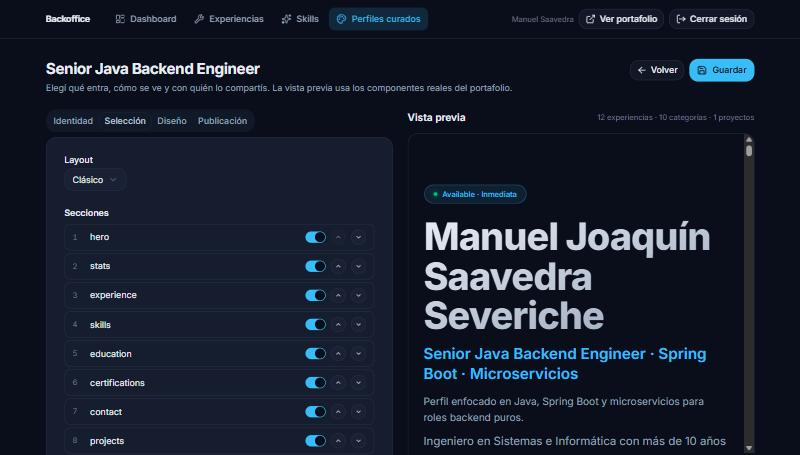

*Las nueve secciones con su interruptor y sus flechas. `projects` y `presence` quedan en las posiciones 8 y 9 porque el orden guardado trae solo siete.*

```bash
curl -s -X PATCH $API/api/admin/curated-profiles/$ID -H "$AUTH" \
  -H 'Content-Type: application/json' -d '{
  "sectionsOrder": ["hero", "experience", "skills", "projects", "stats", "contact"],
  "sectionsHidden": ["education", "certifications"]
}' | jq '{sectionsOrder, sectionsHidden}'
```

**Ejecutado** sobre un borrador sin proyectos ni formación que pasen el filtro:

```
sectionsOrder=[hero,experience]                        -> sections=[hero,experience]
sectionsOrder=[hero,skills,experience,contact]
            + sectionsHidden=[skills]                  -> sections=[hero,experience,contact]
                                                          hiddenSections=[skills]
```

> **Desde el change `unify-section-catalog`** el catálogo es uno solo, con **9** secciones, y el **backend** aplica el relleno: `sections` trae además, al final y en orden canónico, las secciones con datos que no figuran en `sectionsOrder` ni están ocultas. Es el orden final que se renderiza. La transcripción de arriba es anterior al change y muestra `sections` sin ese relleno. Un id fuera del catálogo en `sectionsOrder` o `sectionsHidden` ahora responde 400.

### TC-15 — Personalizar el tema ✅

**Pasos:** pestaña **Diseño**, bloque *Tema*:

1. **Tema base** — uno de los cinco presets.
2. **Colores** — ocho controles: Fondo, Fondo suave, Tarjeta, Borde, Texto, Texto tenue, Acento y Acento 2.
3. **Densidad** — Compacta, Cómoda o Amplia.
4. **Restablecer** — vuelve al preset y descarta los ajustes.

> **Perfiles existentes.** Al retirarse `accentColor` (`retire-accent-color`), el color de cada perfil pasó a `themeOverrides.colors.accent`. Por eso el customizador muestra el **Acento** de esos perfiles como una diferencia respecto del preset, y **Restablecer** lo devuelve al del preset (`#38bdf8` en `modern-dark`). Varios de esos colores contrastan poco con el fondo oscuro: se corrigen desde este mismo control, perfil por perfil.

**Resultado esperado:** el preview cambia al instante, porque los tokens se aplican como variables CSS `--t-*` en el contenedor del preview, no en el documento. Y **solo se guardan las diferencias** contra el tema base, en `themeOverrides`: si mañana cambia el preset, el perfil hereda la mejora y conserva su ajuste.

```bash
curl -s $API/api/admin/themes -H "$AUTH" | jq -r '.[] | "\(.id)  \(.slug)"'

curl -s -X PATCH $API/api/admin/curated-profiles/$ID -H "$AUTH" \
  -H 'Content-Type: application/json' -d '{
  "themeId": "<id del tema base>",
  "themeOverrides": { "colors": { "accent": "#5B2C87" }, "density": "compact" }
}' | jq '{themeId, themeOverrides}'
```

**Ejecutado:**

```
GET /api/admin/themes  -> 5 temas: corporate, elegant, minimal, modern-dark, modern-light
PATCH themeOverrides   -> se guarda {"colors":{"accent":"#5B2C87"}}, solo la diferencia
```


*Tema base, los ocho colores con su valor hexadecimal, y **Restablecer** para volver al preset.*

### TC-16 — Publicar, proteger o esconder ✅

Un perfil tiene **tres ejes independientes**, y la pestaña **Publicación** los presenta por separado:

| Eje | Decide | Dónde se cambia |
|---|---|---|
| **Visibilidad** (`PUBLIC` / `PROTECTED` / `PRIVATE`) | **quién puede abrir** el perfil por su link | selector *Visibilidad* |
| **Enumeración** (`listed`) | **si se enumera** en el menú de la home, el listado público y el sitemap. No cambia el acceso | interruptor *Enumerar en la home y el sitemap* (TC-23) |
| **Archivado** (`archivedAt`) | **si sigue vivo**: archivado responde 404 siempre y gana sobre los otros dos | botón *Archivar* (TC-22) |

| Visibilidad | Sin token | Con token | En el sitemap |
|---|---|---|---|
| `PUBLIC` | 200 | — | **Sí**, si está enumerado |
| `PROTECTED` | **401** | 200 | No |
| `PRIVATE` | **404** | 404 | No |
| cualquiera, **archivado** | **404** | **404** | No |

**Pasos:** pestaña **Publicación** → selector *Visibilidad*. Al elegir `PROTECTED` aparece el campo del token, que pasa a ser obligatorio. El bloque del link ofrece copiarlo y abrirlo.

```bash
# Publicar
curl -s -X PATCH $API/api/admin/curated-profiles/$ID -H "$AUTH" \
  -H 'Content-Type: application/json' -d '{"visibility":"PUBLIC"}' | jq .visibility

# Proteger con token
curl -s -X PATCH $API/api/admin/curated-profiles/$ID -H "$AUTH" \
  -H 'Content-Type: application/json' \
  -d "{\"visibility\":\"PROTECTED\",\"accessToken\":\"$(openssl rand -hex 16)\"}" | jq '{visibility, accessToken}'
```

**Ejecutado**, recorriendo las tres visibilidades sobre el mismo perfil:

```
PUBLIC    sin token -> 200
PROTECTED sin token -> 401
PROTECTED con token -> 200
PRIVATE   sin token -> 404
PRIVATE   con token -> 404   (no revela que existe)
slug inexistente    -> 404   (indistinguible del PRIVATE)
el PRIVATE figura en el sitemap -> no
```


*Visibilidad, el link público con copiar y abrir, y el contador de visitas del perfil.*

Después de proteger algo, ejecutá TC-10: es la comprobación que importa.

### TC-17 — Previsualizar sin guardar 🔍

El preview **no lo calcula el navegador**: lo resuelve el backend con el mismo servicio que la ruta pública (`CuratedProfileComposer`), para que no puedan divergir. Lo que ves es lo que verá quien reciba el link.

```bash
curl -s -X POST $API/api/admin/curated-profiles/preview -H "$AUTH" \
  -H 'Content-Type: application/json' -d '{
  "title":    { "es": "Prueba", "en": "Test" },
  "headline": { "es": "Probando filtros", "en": "Testing filters" },
  "filterTags": ["dotnet"],
  "layout": "sidebar"
}' | jq '{experiencias: (.experiences|length), skills: (.skillCategories|length), secciones: .sections}'
```

No persiste nada. Sirve para tantear un filtro antes de tocar un perfil ya publicado.

**Idioma de la vista previa.** En el constructor, el conmutador **ES / EN** del panel de vista previa pide el preview en el otro idioma (`?locale=en`). Es estado de vista, no del perfil: no se guarda ni viaja en el guardado, y al recargar vuelve a español. Los dos idiomas conviven en caché, así que volver al anterior es instantáneo.

**Aviso de faltantes.** El preview devuelve además `missingTranslations`: los campos bilingües que están vacíos en el idioma pedido y caerían al español. La pestaña **Publicación**, junto al link público, lo muestra con el conteo y la lista agrupada por entidad (por ejemplo, «Acme Corp — Backend: Logros»); si no falta nada, lo dice en una línea («Sin faltantes de traducción en EN»). Es solo informativo: no impide guardar ni publicar, porque hay perfiles que se mandan solo en español. Un texto igual en los dos idiomas (`Tech Lead`, `.NET`) no cuenta como faltante. La ruta pública no trae este informe.

```bash
curl -s -X POST "$API/api/admin/curated-profiles/preview?locale=en" -H "$AUTH"   -H 'Content-Type: application/json' -d '{ "filterTags": ["dotnet"] }'   | jq '.missingTranslations'
```

> **Cuidado con los nombres:** lo que **mandás** usa `sectionsOrder` y `sectionsHidden`; lo que **vuelve resuelto** trae `sections` (ya ordenadas y filtradas) y `hiddenSections`. Es la diferencia entre la configuración y el resultado.

### TC-18 — Medir qué pasó con los links ✅

**Pasos:** `/admin` es el dashboard.

- **Rango:** 7, 30 (por defecto), 90 días o el último año.
- **Totales:** Visitas en el rango · Perfiles vistos · Idiomas.
- **Tablas:** por día, por perfil (con enlace al constructor y a la vista pública) y por idioma.

```bash
curl -s "$API/api/admin/analytics/views?from=2026-09-01&to=2026-10-04" -H "$AUTH" | jq '{
  total,
  porPerfil: [.byProfile[] | {slug, views}],
  porIdioma: .byLocale
}'
```

**Ejecutado.** Acá apareció el defecto D-01, ya corregido:

```
views del perfil antes                 -> 2
tras 2 visitas a la ruta pública       -> 4   ✅ el contador sube
tras un preview del panel              -> 4   ✅ el preview no cuenta como visita
GET analytics/views?from=hoy&to=hoy    -> total=0   ❌ antes del arreglo; debía ser 4
GET analytics/views?from=hoy&to=hoy    -> total=4   ✅ después del arreglo
```

El contador del perfil y el registro de `ProfileView` siempre funcionaron. Lo que fallaba era el **rango** del agregado: `to` era exclusivo y el dashboard pide `[hoy-29, hoy]`, así que las visitas de hoy no aparecían nunca. Ver § 6.1.

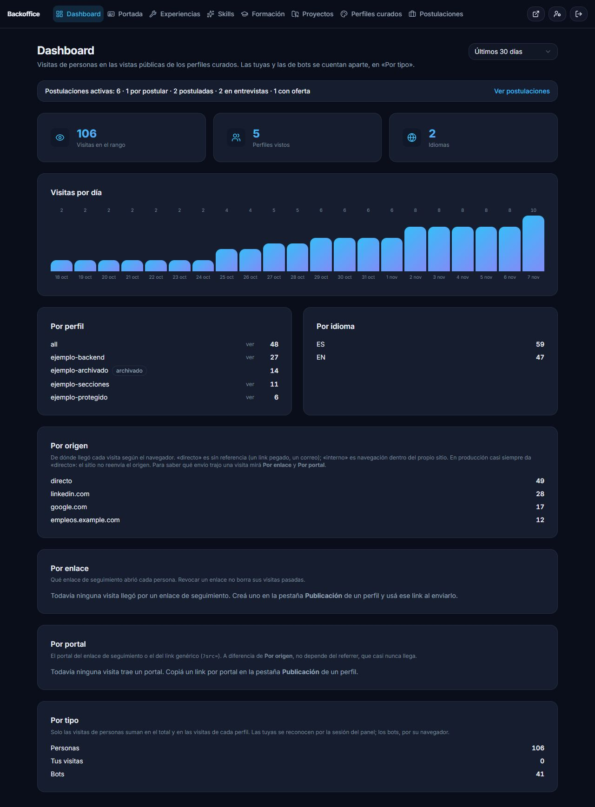

*Capturada el 8 de octubre de 2026 con sesión iniciada: 381 visitas en el rango, en 7 perfiles y 2 idiomas, con las de hoy incluidas (D-01 corregido). Las cuatro tablas: por día, por perfil, por idioma y por origen.*

De cada visita se guarda el perfil, el idioma, la fecha y la IP **solo como HMAC** con `ANALYTICS_SALT`. No hay cookies de seguimiento. Las visitas se registran únicamente en la ruta pública, nunca en el preview, y si el registro falla la respuesta al visitante no se altera.

### TC-19 — Mantener las experiencias ✅

**Pasos:** `/admin/experiencias` → **Nueva experiencia**.

| Campo | Notas |
|---|---|
| Empresa * | plano, no se traduce |
| Ubicación * | plano |
| Rol, resumen, logros | **bilingües**, con pestañas ES y EN |
| Inicio * / Fin | si marcás *Actual*, Fin queda vacío |
| Orden | desempate cuando dos comparten `startDate` |
| Tecnologías, tags, sector | listas de chips. **Los tags son los que usa `filterTags`** |
| Visible en el portafolio | si lo apagás, no aparece en ningún perfil, ni forzándolo con `includeIds` |

```bash
curl -s -X POST $API/api/admin/experiences -H "$AUTH" \
  -H 'Content-Type: application/json' -d '{
  "company": "Acme",
  "location": "Santa Cruz, Bolivia",
  "role": { "es": "Tech Lead", "en": "Tech Lead" },
  "startDate": "2024-01",
  "current": true,
  "technologies": [".NET", "Azure"],
  "tags": ["dotnet", "leadership"],
  "visible": true
}' | jq '{id, company}'
```

**Ejecutado:**

```
POST experiencia visible                       -> 201, tags=[suite-tag]
POST experiencia oculta (visible:false)        -> 201
GET /api/experiences (público) la oculta       -> no aparece
GET /api/admin/experiences la oculta           -> sí aparece, con visible=false
POST omitiendo "summary" (obligatorio)         -> 500  ❌ antes del arreglo de D-02 — ver § 6.1
POST omitiendo "summary" (obligatorio)         -> 400  ✅ después: "summary should not be null or undefined"
```

> Un tag nuevo aparece solo como chip en el constructor de **todos** los perfiles: es la forma más rápida de abrir una dimensión de filtrado nueva.
>
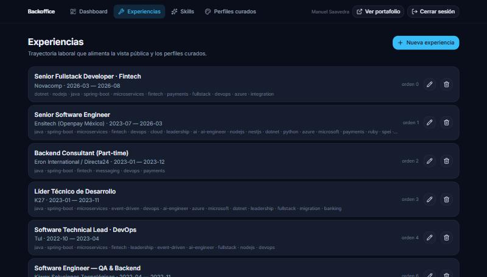

*Cada fila con su empresa, periodo, tags y orden.*


*Los campos bilingües llevan su conmutador ES/EN. **Logros (es)** no lo tiene: es la limitación de abajo, a la vista.*

> **Limitación actual:** el formulario expone los logros solo en español. El inglés se conserva al guardar, pero no se puede editar desde el panel. Lo resuelve el change `add-bilingual-builder-parity`.

### TC-20 — Mantener skills y categorías ✅

**Pasos:** `/admin/skills`. Las skills viven dentro de categorías.

1. **Nueva categoría** — nombre bilingüe y orden.
2. Dentro de cada una, **Nueva skill** — nombre, tags, orden.
3. Una skill se mueve de categoría editando su campo de categoría.
4. Borrar una categoría **borra sus skills**; el panel lo confirma antes.

```bash
CAT=$(curl -s -X POST $API/api/admin/skill-categories -H "$AUTH" \
  -H 'Content-Type: application/json' \
  -d '{"name":{"es":"Plataforma","en":"Platform"},"order":5}' | jq -r .id)

curl -s -X POST $API/api/admin/skill-categories/$CAT/skills -H "$AUTH" \
  -H 'Content-Type: application/json' \
  -d '{"name":"Railway","tags":["devops","cloud"],"order":1}' | jq '{id, name}'
```

**Ejecutado:**

```
POST categoría "Suite Cat"                          -> 201
POST skill "SuiteSkill" con tags=[suite-tag]        -> 201
preview con filterTags=[suite-tag]                  -> la categoría entra por el tag de su skill
DELETE de la categoría                              -> se lleva sus skills
```


*Las skills viven dentro de categorías, y cada una lleva los tags que deciden en qué perfiles aparece.*

Una categoría entra en un perfil curado si **alguna de sus skills** comparte un tag con `filterTags`; dentro, se muestran solo las skills que pasan el filtro.

---

### TC-21 — Duplicar un perfil para otra vacante 🔍

**Pasos:** `/admin/perfiles` → botón **Duplicar** de un perfil → confirmar.

**Resultado esperado:** se crea una copia con toda la configuración (tags, inclusiones, exclusiones, secciones, tema y layout) y el constructor se abre sobre ella. La copia nace **privada y no enumerada**, sin token, sin visitas y sin archivar, con el slug del original más el primer sufijo libre (`-2`, `-3`, …). Así una copia a medio configurar nunca queda accesible. Para publicarla alcanza con cambiar slug, título, titular y visibilidad.

```bash
curl -s -X POST $API/api/admin/curated-profiles/$ID/duplicate -H "$AUTH" \
  | jq '{slug, visibility, listed, accessToken, views}'
```

**Ejecutado** en la app real (2026-10-05): duplicar `tech-lead-dotnet` dio `/tech-lead-dotnet-2`, privado; publicado como `acme-tech-lead` cambiando solo slug, título y titular, respondió 200 con sus 13 experiencias. El original quedó intacto. Transcripción y capturas: `openspec/changes/archive/*-add-curated-profile-lifecycle/verification/7.4-app-real.txt`.

### TC-22 — Retirar un perfil sin perder sus visitas 🔍

**Pasos:** pestaña **Publicación** → **Archivar** → confirmar. Para volver atrás, **Desarchivar**.

**Resultado esperado:** el link responde **404**, igual que un slug que nunca existió, incluso si es `PROTECTED` y se presenta el token. El perfil sale del listado, del menú y del sitemap, pero **conserva sus visitas**, que siguen en el dashboard marcadas como *archivado*. Archivar dos veces conserva la primera fecha. Mientras está archivado no se registran visitas nuevas.

```bash
curl -s -X POST $API/api/admin/curated-profiles/$ID/archive -H "$AUTH" | jq .archivedAt
curl -s -o /dev/null -w '%{http_code}\n' $API/api/curated-profiles/acme-tech-lead   # 404
curl -s -X POST $API/api/admin/curated-profiles/$ID/unarchive -H "$AUTH" | jq .archivedAt   # null
```

> **Archivar en lugar de borrar.** Borrar se lleva las visitas con el perfil. Archivar lo retira conservándolas, y se puede deshacer. `archivedAt` no se escribe por `PATCH`: un `PATCH` con ese campo da 400.

**Ejecutado** en la app real: archivado `acme-tech-lead` con 3 visitas, el link dio 404, el panel pasó a *Desarchivar* sin recargar y el dashboard siguió mostrando sus 3 visitas.

### TC-23 — Un link dirigido que no aparece en ningún listado 🔍

**Pasos:** pestaña **Publicación** → apagar **Enumerar en la home y el sitemap** → Guardar.

**Resultado esperado:** el perfil sigue abriendo por su link (200 si es `PUBLIC`; 401 sin token y 200 con token si es `PROTECTED`), pero no figura en `GET /api/curated-profiles`, en el menú de la home ni en el `sitemap.xml`. Es la forma de mandar un perfil a una sola empresa sin que quede expuesto.

```bash
curl -s -X PATCH $API/api/admin/curated-profiles/$ID -H "$AUTH" \
  -H 'Content-Type: application/json' -d '{"listed":false}' | jq .listed
```

> Los 13 perfiles del seed nacen enumerados, igual que antes: dejarlos de enumerar los retiraría de los buscadores. Es una decisión perfil por perfil, desde el panel.

### TC-24 — Renombrar un slug sin romper los links ya enviados 🔍

**Pasos:** pestaña **Identidad** → cambiar el **Slug** → Guardar.

**Resultado esperado:** el slug anterior **sigue funcionando**. Responde el mismo perfil con su slug canónico en el cuerpo y en la cabecera `Content-Location`, y el navegador corrige la URL solo. El sitemap y el `canonical` usan únicamente el slug nuevo. Un slug que es el anterior de otro perfil no se puede tomar (409). Volver al slug anterior borra ese alias. El alias de un perfil archivado también da 404.

```bash
curl -s -D - -o /dev/null $API/api/curated-profiles/el-slug-viejo | grep -i content-location
```

## 4. Administrar el resto del contenido

Desde el change `add-profile-content-admin`, todo lo que el sitio muestra se edita en el panel. El seed queda para **poblar una base vacía**, no para editar.

### TC-25 — Cambiar el titular y la disponibilidad ✅

**Pasos:** `/admin/portada`.

1. Editar **Titular** o **Fecha de inicio** (pestañas ES/EN). La vista previa del hero, a la derecha, cambia sin guardar: la resuelve el backend con el mismo mapper que la ruta pública.
2. **Guardar portada.** El cambio se ve en `/` y en cada perfil curado, sin correr el seed.
3. Un obligatorio vacío (nombre, titular o resumen en español, email, ubicación) no se envía; si llega a la API, es 400 y el perfil queda como estaba.
4. **Idiomas**, en la misma página: agregar, editar y borrar con confirmación. El nombre mostrado, el **nivel** y el detalle tienen pestañas ES/EN (el español del nivel es obligatorio); ver TC-32.

> El titular base se ve en la home y en todo perfil curado **sin titular propio** (decisión D7). Las 13 plantillas del seed traen el suyo, pensado para su rol, y lo conservan; la home `all` no tiene ninguno. Para que un perfil curado vuelva a usar el titular base, vaciá su titular en la pestaña Identidad del constructor.

```bash
# El perfil es un singleton: no hay id en la ruta. El PUT reemplaza todo.
curl -s $API/api/admin/profile -H "$AUTH" | jq '{headline, availability}'
curl -s -X PUT $API/api/admin/profile -H "$AUTH" -H 'Content-Type: application/json'   -d "$(curl -s $API/api/admin/profile -H "$AUTH" | jq 'del(.id) | .availability.startDate={"es":"En dos semanas","en":"In two weeks"}')"
```

**Ejecutado** (e2e `content-admin.e2e-spec.ts`):

```
PUT con headline nuevo                     -> 200 y el hero de / lo muestra (all no tiene titular propio)
PUT con startDate nuevo                    -> el perfil curado lo sirve en el idioma pedido
PUT con un campo desconocido               -> 400 y el perfil queda idéntico
PUT con email vacío                        -> 400 y conserva el email anterior
POST /api/admin/profile/preview            -> 200 resuelto, sin escribir nada
```


### TC-26 — Formación: ocultar sin borrar ✅

**Pasos:** `/admin/formacion`. Dos listas: **Educación** y **Certificaciones**, con el mismo patrón de lista y diálogo que Skills.

1. **Nueva** → completar → **Guardar**. Las fechas aceptan `YYYY-MM` o `YYYY`; *en curso* excluye la fecha de fin.
2. Para retirar un ítem sin perderlo, desmarcar **Visible en el sitio**: sale de la vista pública y sigue en el panel con la marca *Oculto*.
3. Borrar pide confirmación.

```
POST certificación + PATCH {visible:false} -> fuera de GET /api/certifications, sigue en /api/admin/certifications
GET /api/admin/education                   -> incluye la oculta, con visible y order
```


### TC-27 — Proyectos y enlaces sociales ✅

**Pasos:** `/admin/proyectos`.

1. Un proyecto con **tags** que coincidan con los `filterTags` de un perfil curado aparece en ese perfil, con su **url** como enlace. Es la forma de completar la `url` de los dos proyectos del seed.
2. Enlaces sociales: plataforma (`github`, `linkedin`, …), handle, url, etiqueta bilingüe, *destacado*, y `stats` como JSON (un objeto; un array o un texto es 400).

```
POST proyecto con tags del perfil          -> aparece en /api/curated-profiles/tech-lead-dotnet con su url
DELETE enlace social                       -> 204 y desaparece de /api/social-links
POST enlace con stats=[1,2]                -> 400
POST de cualquiera de las cinco entidades con un campo extra -> 400
```


### TC-28 — El constructor avisa antes de descartar cambios ✅

**Pasos:** `/admin/perfiles/:id` (por ejemplo `tech-lead-dotnet`).

1. Editar un campo, por ejemplo el **Título** de la pestaña Identidad. El botón *Guardar* sigue igual; lo que cambia es que salir ya no es gratis.
2. Pulsar **Volver** (o un enlace del menú lateral, o *Atrás* del navegador): aparece **Tenés cambios sin guardar** y la página no se mueve.
3. **Seguir editando** cierra el aviso y conserva lo escrito. **Salir sin guardar** navega y descarta: el título guardado sigue como estaba.
4. Recargar o cerrar la pestaña con cambios dispara el aviso nativo del navegador (el texto lo pone el navegador).
5. Escribir y borrar el mismo carácter, o un espacio final, vuelve a "limpio". Cambiar solo el idioma del preview o archivar el perfil nunca cuentan como cambio. Un perfil nuevo sin tocar sale sin diálogo, y un guardado exitoso deja la ficha limpia.

```
Título de tech-lead-dotnet editado -> Volver abre el aviso, sigue en /admin/perfiles/:id
Salir sin guardar                  -> /admin/perfiles, el título guardado sigue "Tech Lead .NET"
```

> El aviso nativo de `beforeunload` lo dibuja el navegador y no se capturó en la app real: lo cubren los tests del guardián (`use-unsaved-changes-guard.test.tsx`, `ProfileBuilderPage.test.tsx`).

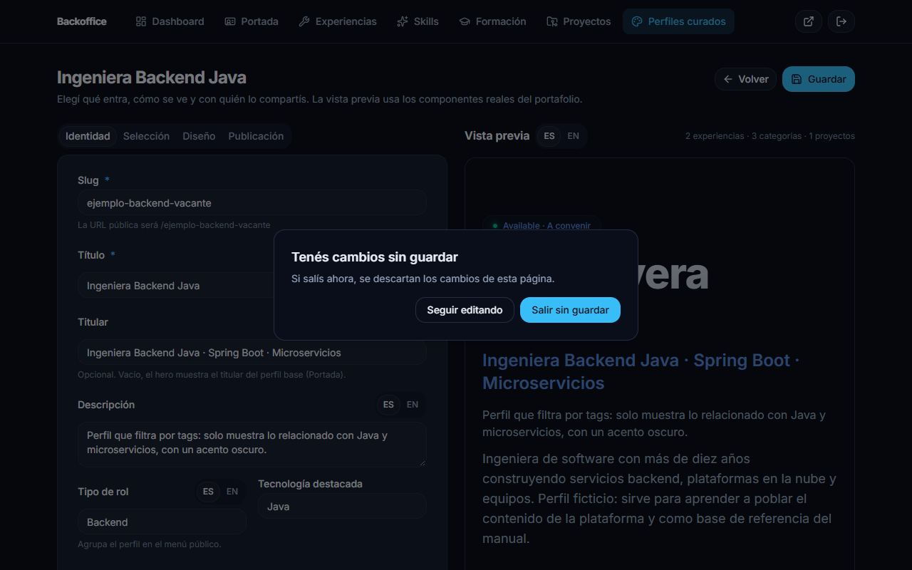

### TC-29 — La Portada avisa; cambiar el idioma no ✅

**Pasos:** `/admin/portada`.

1. Con el formulario en *Cambios sin guardar* (por ejemplo, un titular editado), elegir *Experiencias* en el menú lateral: aparece el mismo aviso que en el constructor, con *Seguir editando* / *Salir sin guardar*.
2. Cambiar el idioma de la vista previa (`?lang=`) con cambios pendientes **no** pide confirmación: es solo la query.
3. **Guardar portada** deja la página limpia y salir ya no pregunta.

**Ejecutado** el 8 de octubre de 2026 contra el contenedor `web`: se editó la Ubicación; cambiar el idioma de la vista previa (EN y de vuelta a ES, la URL pasó a `?lang=es`) no abrió el aviso y la edición se conservó; ir a Skills desde el menú lateral abrió «Tenés cambios sin guardar»; *Salir sin guardar* llevó a `/admin/skills` y la ubicación guardada siguió «Santa Cruz de la Sierra, Bolivia». Reusa el guardián y el diálogo de TC-28, con los tests de `PortadaPage.test.tsx`.


### TC-30 — Los formularios en diálogo avisan antes de descartar ✅

**Pasos:** cualquier formulario en diálogo del panel: experiencia, categoría y skill, formación y certificación, proyecto, enlace social e idioma. Ejemplo: `/admin/skills` → **Nueva categoría**.

1. Escribir un nombre y cerrar con **Escape**, con un clic fuera, con la X o con **Cancelar**: aparece **Tenés cambios sin guardar** ("Si lo cerrás ahora, se descartan los cambios de este formulario.") con el formulario abierto detrás.
2. **Seguir editando** conserva los valores. **Descartar** cierra sin crear nada.
3. Sin cambios, los cuatro caminos cierran directo. Guardar con éxito cierra sin aviso.
4. Con el diálogo abierto y con cambios, recargar dispara el aviso nativo.

```
Skills > Nueva categoría > nombre escrito > Escape -> aviso con el formulario abierto detrás
Descartar                                          -> cierra, la categoría no se crea
```

> *Atrás* del navegador con un diálogo abierto no tiene aviso propio (decisión D11 del change): el modal tapa la navegación del panel y *Atrás* con un modal abierto es raro. En la app real se probó *Escape*; clic fuera, X y *Cancelar* los cubren los tests del guardián y de cada página.


### El seed ya no es la forma de editar

```bash
# Solo para una base vacía (o para volver al estado del CV a propósito)
cd backend && npm run seed && npm run seed:verify
```

> `seed` **sobrescribe**: correrlo sobre una base con contenido administrado desde el panel **pisa ese trabajo** (portada, formación, proyectos, enlaces, experiencias y skills). Antes de correrlo en producción, hacé el `pg_dump` del § 7 de [`DEPLOY.md`](DEPLOY.md).

---

## 5. Operación

```bash
# ¿Vive y ve la base?
curl -s $API/health | jq            # 200, o 503 si Postgres no responde
curl -s $API/health/live            # 200 mientras viva el proceso, sin tocar la base

# Seguir un error concreto: cada respuesta de error trae requestId,
# y el mismo id está en la cabecera X-Request-Id y en el log.
curl -sD - $API/api/curated-profiles/no-existe -o /dev/null | grep -i x-request-id
```

| Situación | Qué hacer |
|---|---|
| Olvidaste la contraseña del admin | `npm run admin:bootstrap` con `ADMIN_PASSWORD` nuevo |
| Rotar el `JWT_SECRET` | cambiá la variable y redesplegá: invalida todas las sesiones |
| Un perfil quedó mal publicado | pasalo a `PRIVATE` (404 al instante) y arreglalo con calma |
| Perdiste datos | restaurá del backup — § 7 de [`DEPLOY.md`](DEPLOY.md) |
| Deploy roto | Rollback en Deployments, dentro de las 72 h del plan Hobby |
| El sitio dejó de cargar algo (fuente, script) tras un deploy | La CSP del servicio `web` lo bloquea. Probá con `CSP_HEADER=Content-Security-Policy-Report-Only` en `web` (solo reporta, sin bloquear; no requiere reconstruir) y mirá la consola. Detalle en `DEPLOY.md` § 9.5 |
| Una visita no suma justo después de un deploy | La visita se registra en segundo plano y el apagado espera hasta 5 s; confirmá que `RAILWAY_DEPLOYMENT_DRAINING_SECONDS` del servicio `api` esté por encima (p. ej. 10) |

### 5.1 Calidad web: accesibilidad, Lighthouse y presupuesto de JS

Tres comandos del frontend (`frontend/scripts/`), los mismos que corre el CI:

```bash
cd frontend
npm run build && npm run perf:budget                      # tope de JS del arranque público; sin navegador ni base

# Los dos siguientes abren páginas reales: cada carga registra una visita (ProfileView).
# Exigen A11Y_CHECK_DISPOSABLE_DB=1 y salen con 2 sin ella. Usalos SOLO contra una base descartable
# (p. ej. `portfolio_a11y`, con migraciones, seed y un administrador de prueba), nunca contra la del owner.
export A11Y_CHECK_DISPOSABLE_DB=1
A11Y_CHECK_ADMIN_EMAIL=… A11Y_CHECK_ADMIN_PASSWORD=… npm run a11y:check -- http://localhost:8080 --out reports
npm run perf:check -- http://localhost:8080 --out reports
```

Se miden contra el sitio como se sirve en producción (la imagen de `frontend/Dockerfile` con la API detrás), porque la CSP, el head por perfil y la compresión de Caddy cambian los puntajes; `vite dev` no sirve para esto. `CHROME_PATH` apunta al Chrome del sistema. Los reportes (axe en JSON, Lighthouse en HTML y JSON, resúmenes `.md`) solo se escriben con `--out`.

| Medida | Local, antes de un release | CI | ¿Bloquea? |
|---|---|---|---|
| `perf:budget` | ≤ 180 KB gzip | ≤ 180 KB gzip | Sí |
| axe (`a11y:check`) | 0 `serious` y 0 `critical`; el recorrido de teclado sin fallas | Igual | Sí |
| Lighthouse Accessibility, Best Practices y SEO (páginas públicas, mobile) | mediana de 3 ≥ 90 | mediana de 5 ≥ 90 | Sí |
| Lighthouse Performance (páginas públicas, mobile) | mediana de 3 ≥ 90 (`PERF_CHECK_RUNS`, `PERF_CHECK_MIN_PERFORMANCE`) | mediana de 5 ≥ **85** | Sí |
| `/admin/login` | Accessibility y Best Practices ≥ 90 (SEO exento: lleva `noindex`; Performance, informativa) | Igual | Sí |

El umbral de Performance baja a 85 en CI porque los runners compartidos suman ruido de CPU (en una máquina local la misma build varió 8 puntos entre corridas); la red principal contra una regresión es el presupuesto de bytes, que no tiene ruido. `moderate` y `minor` de axe se informan sin bloquear. Una advertencia `inspector-issues` de Best Practices la dispara el propio axe al leer la hoja de Google Fonts y no se arregla abriendo la CSP.

**En CI:** el job `web-quality` (*Frontend · accesibilidad y Lighthouse*, dos ejecuciones en paralelo: `a11y` y `lighthouse`) levanta un Postgres de servicio, la API en `NODE_ENV=production` y la imagen del frontend, y corre el check. Si falla, el workflow queda en rojo y los reportes se bajan desde la corrida en *Summary → Artifacts → `web-quality-a11y` o `web-quality-lighthouse`* (14 días). Que además impida fusionar depende de marcar esos dos checks como requeridos en la protección de `main` (configuración del repositorio).

---

## 6. Suite de regresión manual

Antes de cada release, recorrer en este orden. Última ejecución completa: **5 de octubre de 2026**, contra la base del seed (14 perfiles, 15 experiencias), con la API en `localhost:3300`.

Los casos del backoffice están automatizados en [`manual/suite-backoffice.ps1`](manual/suite-backoffice.ps1): ejecuta TC-12 a TC-20 contra la API, imprime el resultado real junto al esperado y borra todos los datos de prueba que crea, pase o falle.

```bash
cd docs/manual && pwsh ./suite-backoffice.ps1
```

| # | Caso | Estado | Evidencia |
|---|---|---|---|
| TC-01 | La home resuelve el perfil completo | ✅ | captura |
| TC-02 | Idioma negociado y forzado | ✅ | captura |
| TC-03 | Un perfil curado filtra el contenido | ✅ | captura + métricas 15→7 |
| TC-04 | Tema y layout desde la URL | ✅ | captura |
| TC-05 | Menú de perfiles, solo en la home | ✅ | captura renovada · en `/:slug` no hay menú |
| TC-06 | Perfil protegido pide token | ✅ | captura |
| TC-07 | Token correcto resuelve el perfil | ✅ | captura |
| TC-08 | Slug inexistente o privado da 404 | ✅ | captura |
| TC-09 | Vista móvil | ✅ | captura |
| TC-10 | Códigos de estado por visibilidad | 🔍 | 401 / 200 / 404 |
| TC-11 | Entrar al panel | ✅ | captura del login |
| TC-12 | Crear un perfil curado | ✅ | 2 capturas · 201 / 409 / 400 (D-02 corregido) |
| TC-13 | Tags y overrides | ✅ | captura · los cuatro casos del filtro |
| TC-14 | Ordenar y ocultar secciones | ✅ | captura · orden y ocultado resueltos |
| TC-15 | Personalizar el tema | ✅ | captura · solo se guarda la diferencia |
| TC-16 | Publicar, proteger, esconder | ✅ | captura · la tabla completa de visibilidad |
| TC-17 | Previsualizar sin guardar | 🔍 | no persiste nada |
| TC-18 | Dashboard de analítica | ✅ | captura renovada con las visitas de hoy y la tabla por origen (D-01 corregido) |
| TC-19 | Mantener experiencias | ✅ | 2 capturas · visible / oculta (D-02 corregido) |
| TC-20 | Mantener skills | ✅ | captura · la categoría entra por el tag de su skill |
| TC-21 | Duplicar un perfil | 🔍 | e2e · app real con capturas en el archivo del change |
| TC-22 | Archivar sin perder visitas | 🔍 | e2e · app real con capturas en el archivo del change |
| TC-23 | Link dirigido (`listed`) | 🔍 | e2e |
| TC-24 | Renombrar sin romper links | 🔍 | e2e |
| TC-25 | Portada: titular, disponibilidad, idiomas | ✅ | captura · e2e · 200 / 400 sin cambios · preview sin escribir |
| TC-26 | Formación: ocultar sin borrar | ✅ | captura · e2e · visible:false sale del sitio y queda en el panel |
| TC-27 | Proyectos y enlaces sociales | ✅ | captura · e2e · el proyecto entra por tags con su url · stats inválido 400 |
| TC-28 | El constructor avisa antes de descartar | ✅ | captura · app real contra el contenedor · tests del guardián |
| TC-29 | La Portada avisa; el idioma no | ✅ | captura · app real contra el contenedor · tests de `PortadaPage` |
| TC-30 | Los formularios en diálogo avisan | ✅ | captura · app real contra el contenedor · tests por formulario |
| TC-31 | Imprimir un perfil en una hoja | 🔍 | `print:check` (56 casos, 1 página en A4 y Letter) · PDF en el archivo del change · tests de la hoja y del botón |
| TC-32 | El nivel del idioma en los dos idiomas | ✅ | captura · app real contra una copia de la base · e2e · tests del formulario y del aviso |
| TC-33 | Navegación por teclado y foco visible | ✅ | `a11y:check` (recorrido de teclado) · menús y diálogos con Chrome controlado · capturas del foco en el archivo del change |
| TC-34 | Contraste con un acento oscuro | ✅ | `a11y:check` (0 violaciones en 72 cargas) · tabla de contraste por acento · tests de `css-vars` |

**Los 34 casos pasan.** Los 20 originales tienen evidencia: 20 capturas en `docs/manual/` más las transcripciones de la API. Las capturas de TC-05 y TC-18 se renovaron el 8 de octubre de 2026 con sesión iniciada. TC-21 a TC-24 (change `add-curated-profile-lifecycle`) están cubiertos por e2e; TC-21 y TC-22 además se ejecutaron en la app real, con capturas en el archivo del change. TC-25 a TC-27 (change `add-profile-content-admin`) suman la transcripción del e2e y su captura de la app real. TC-28 a TC-30 (change `polish-builder-and-edge`) se ejecutaron el 8 de octubre de 2026 contra el contenedor `web` con la API de la rama detrás (TC-28, TC-29 y TC-30, con captura): 26 capturas en total. TC-31 (change `add-printable-one-page`) se verificó el 9 de octubre de 2026 con `npm run print:check` contra la base del seed y con los tests de la hoja; el diálogo de impresión y Firefox quedan como pasos manuales del caso. TC-32 (change `localize-language-level`) se ejecutó el 10 de octubre de 2026 en la app real contra una copia de la base de desarrollo, con captura y transcripción en el archivo del change. TC-33 y TC-34 (change `improve-a11y-and-performance`) se ejecutaron el 15 de octubre de 2026 contra la imagen de producción del frontend y una base descartable, con `npm run a11y:check`, Chrome controlado por `puppeteer-core` y tests; la evidencia está en el archivo del change.

### 6.1 Defectos encontrados al ejecutar la suite

Los dos aparecieron al ejecutar estos casos por primera vez de punta a punta. Ninguno estaba reportado. **Los dos están corregidos**; quedan documentados acá porque la suite los sigue cubriendo.

#### D-01 — El dashboard nunca muestra las visitas de hoy — ✅ corregido

**Severidad:** alta, visible para el usuario.
**Síntoma:** se compartía un link, alguien lo abría, y el dashboard seguía en cero hasta el día siguiente.
**Causa:** el parámetro `to` de `GET /api/admin/analytics/views` se interpretaba como un instante, así que `to=2026-10-05` era la medianoche de ese día. `frontend/src/features/backoffice/dashboard/ranges.ts` documenta y construye un **rango cerrado** `[hoy - (días - 1), hoy]`, de modo que el `to = hoy` del panel dejaba fuera el día en curso.

```
GET /api/admin/analytics/views?from=2026-10-05&to=2026-10-05  -> total=0    (antes)
GET /api/admin/analytics/views?from=2026-10-05&to=2026-10-06  -> total=13, byDay={2026-10-05:13}
```

**Arreglo aplicado:** el rango pasó a ser cerrado en la API, que es lo que describe la spec `admin-analytics-dashboard` y lo que el panel ya asumía. Una fecha sin hora se resuelve al borde del día en UTC — inicio para `from`, último milisegundo para `to` —; un instante completo (`2026-10-05T14:30:00Z`) se respeta tal cual, para poder pedir ventanas más finas que un día. La decisión vive en un servicio puro, `backend/src/modules/analytics/domain/services/range-boundaries.ts`, y el controller la usa en lugar de llamar a `new Date()` directamente. Se descartó la alternativa de que el frontend mandara `to = mañana`, porque deja la API mintiendo sobre su propio contrato.

**Regresión:** `range-boundaries.spec.ts` cubre los bordes del parseo, y `admin.e2e-spec.ts` agrega el caso de punta a punta — una visita nueva aparece en `?from=hoy&to=hoy`. Sin el arreglo ese caso da `total=0`. La descripción del endpoint en Swagger ahora dice que el rango es cerrado, así que `openapi.json` y los tipos del frontend se regeneraron.

#### D-02 — Omitir un objeto obligatorio devuelve 500 en lugar de 400 — ✅ corregido

**Severidad:** media; solo afecta endpoints autenticados del panel.
**Síntoma:** un cuerpo al que le falta un campo obligatorio anidado respondía `500 Error interno del servidor` en vez de un 400 que dijera qué falta.
**Causa:** los campos obligatorios de tipo objeto se declaran con `@ValidateNested()` + `@Type()` pero **sin `@IsDefined()`**. `class-validator` no valida un valor `undefined`, así que la validación pasa y el mapper revienta con `TypeError: Cannot read properties of undefined (reading 'en')`.

**Arreglo aplicado:** `@IsDefined()` en los cinco campos obligatorios de tipo objeto que había en los DTO de entrada — `role` y `summary` de `CreateExperienceDto`, `title` y `headline` de `CreateCuratedProfileDto`, y `name` de `CreateSkillCategoryDto`. Los `Update*Dto` heredan por `PartialType`, que inyecta `@IsOptional()` y corta la cadena antes de `@IsDefined()`: los PATCH parciales siguen funcionando igual. `openapi.json` no cambia, porque la obligatoriedad en Swagger ya venía de `@ApiProperty`.

Las mismas cinco variantes, tras el arreglo:

```
POST /api/admin/experiences       sin "summary"  -> 400  ["summary should not be null or undefined"]
POST /api/admin/experiences       sin "role"     -> 400  ["role should not be null or undefined"]
POST /api/admin/curated-profiles  sin "title"    -> 400  ["title should not be null or undefined"]
POST /api/admin/curated-profiles  sin "headline" -> 400  ["headline should not be null or undefined"]
POST /api/admin/skill-categories  sin "name"     -> 400  ["name should not be null or undefined"]
POST /api/admin/experiences       completo       -> 201  (control)
```

> Desde `add-profile-content-admin` (decisión D7), `headline` es **opcional**: un perfil curado sin titular propio responde 201 y su hero muestra el titular del perfil base. La línea de `headline` de arriba queda como registro del defecto; hoy esa omisión da 201.

**Regresión:** `backend/test/dto-validation.spec.ts` corre `class-validator` sobre cada DTO de entrada con las mismas opciones que `adminValidationPipe` y exige un error por cada campo obligatorio — con el cuerpo vacío, con el campo ausente y con el campo en `null` — más un control con el cuerpo completo. Es un test de comportamiento: no depende de qué decorador arregle el problema y cubre todos los campos obligatorios, no solo los anidados. Sin los `@IsDefined()` fallan 8 de sus 34 casos. Desde el PR #3 lo complementan una guarda estática en `backend/test/security.spec.ts`, que exige `@IsDefined()` en todo `@ValidateNested()` no opcional de cualquier clase validada en `src/`, y un e2e en `admin.e2e-spec.ts` que prueba las seis omisiones por HTTP.

---

## 7. Receta completa: de la vacante al link, en 6 llamadas

```bash
# 1. Crear en privado
ID=$(curl -s -X POST $API/api/admin/curated-profiles -H "$AUTH" -H 'Content-Type: application/json' -d '{
  "slug":"acme-tech-lead",
  "title":{"es":"Tech Lead .NET","en":"Tech Lead .NET"},
  "headline":{"es":"14 años en .NET y liderazgo","en":"14 years in .NET and leadership"},
  "roleType":{"es":"Tech Lead","en":"Tech Lead"},"techFocus":".NET","visibility":"PRIVATE"}' | jq -r .id)

# 2. Ver qué tags hay
curl -s $API/api/admin/experiences -H "$AUTH" | jq -r '[.[].tags[]]|unique|join(", ")'

# 3. Probar el filtro sin tocar nada
curl -s -X POST $API/api/admin/curated-profiles/preview -H "$AUTH" -H 'Content-Type: application/json' \
  -d '{"title":{"es":"x","en":"x"},"headline":{"es":"x","en":"x"},"filterTags":["dotnet"]}' \
  | jq '.experiences | length'

# 4. Aplicar filtro, secciones y tema
curl -s -X PATCH $API/api/admin/curated-profiles/$ID -H "$AUTH" -H 'Content-Type: application/json' -d '{
  "filterTags":["dotnet","leadership"],
  "sectionsOrder":["hero","experience","skills","projects","contact"],
  "sectionsHidden":["education"],
  "themeOverrides":{"colors":{"accent":"#5B2C87"}},
  "layout":"sidebar"}' > /dev/null

# 5. Publicar
curl -s -X PATCH $API/api/admin/curated-profiles/$ID -H "$AUTH" -H 'Content-Type: application/json' \
  -d '{"visibility":"PUBLIC"}' | jq .visibility

# 6. Comprobar y compartir
curl -s -o /dev/null -w '%{http_code}\n' $API/api/curated-profiles/acme-tech-lead
echo "$SITIO/acme-tech-lead"
```

**Los tres ejes, al final de la receta** (TC-16):

- La **visibilidad** decide quién puede abrirlo. `PUBLIC` para cualquiera con el link y `PROTECTED` para quien tenga el token.
- La **enumeración** decide si aparece en la home y el sitemap. Para un envío a una sola empresa, `{"listed": false}`: el link funciona igual y el perfil no queda expuesto (TC-23).
- El **archivado** decide si sigue vivo. Cuando la vacante se cierra, archivarlo: el link da 404 y las visitas se conservan (TC-22).

**Atajo:** para la próxima vacante parecida, no hace falta empezar de cero. Duplicá este perfil (TC-21) y ajustá slug, título y titular.

---

## 8. Qué falla y por qué

| Síntoma | Causa |
|---|---|
| `401` en todo el panel | la cookie expiró, o `JWT_SECRET` cambió. Volvé a entrar |
| `429` al entrar | 5 intentos por minuto y por IP. Esperá el `Retry-After` |
| El perfil ignora un `includeIds` | la experiencia tiene `visible: false`. `includeIds` solo fuerza items visibles |
| Una sección aparece aunque no la puse en el orden | tiene datos: se agrega al final. Para ocultarla, `sectionsHidden` |
| Una sección no aparece aunque la puse | no tiene datos que pasen el filtro |
| `400` al crear un perfil | campo de más o faltante: el pipe rechaza lo que no está en el DTO. El mensaje dice cuál |
| `409` al crear un perfil | el `slug` ya existe |
| El `?token=` no funciona | el perfil es `PRIVATE`, no `PROTECTED`. `PRIVATE` siempre da 404 |
| La vista previa en LinkedIn es genérica | el borde no insertó el head del perfil: la API no respondió en 500 ms y el sitio degradó al genérico, o el perfil no es `PUBLIC` (a propósito: `PROTECTED` y `PRIVATE` nunca exponen sus textos). Comprobar con `curl -s <sitio>/<slug> \| grep og:title`. La imagen es la misma para todos los perfiles; una por vacante quedó fuera del change `add-server-rendered-head` |
| El nuevo perfil no está en el sitemap | solo entran los `PUBLIC`, enumerados y no archivados. Un duplicado nace `PRIVATE` y no enumerado |
| El link que mandé da 404 | el perfil está archivado (TC-22) o es `PRIVATE`. El bloque del link en la pestaña Publicación lo advierte |
| Un perfil público no aparece en el menú | no está enumerado (`listed: false`), o se está mirando un `/:slug`: el menú solo se muestra en la home |
| Renombré un slug y el link viejo sigue respondiendo | es a propósito: el slug anterior queda como alias y redirige al nuevo (TC-24) |
| `409` al usar un slug que nadie tiene | es el slug anterior de otro perfil |
| `400` al mandar `archivedAt` | no se escribe por `PATCH`: usar `/archive` y `/unarchive` |
